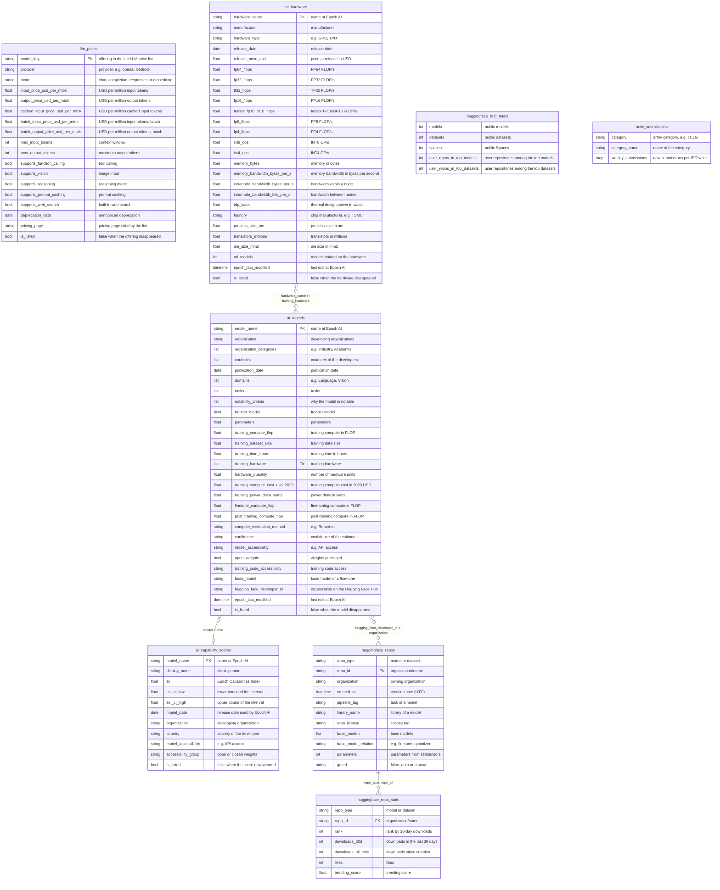
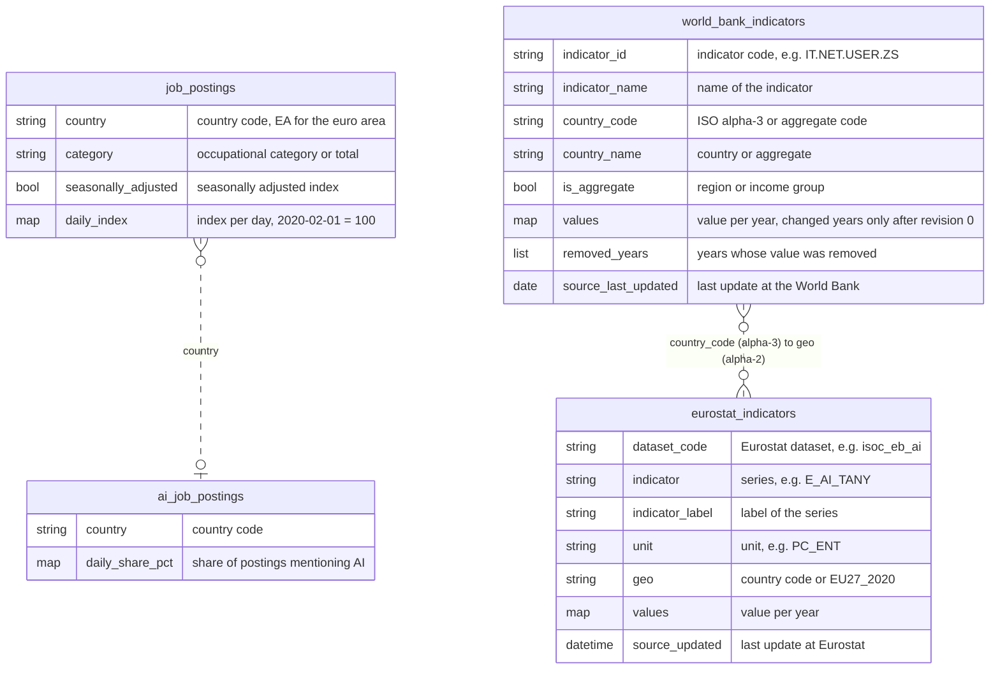
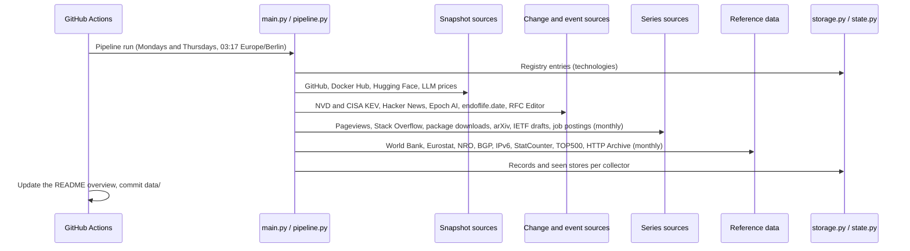

# Tech Dataset
[](https://github.com/kleinnconrad/dataset.technology/actions/workflows/ci.yml)

A long-term dataset of the technology world for trend analysis and prediction over 15 to 20 years. It covers AI and machine learning, software development, data, IT infrastructure, networking, security, hardware and emerging technologies. A pipeline in GitHub Actions runs twice a week (Mondays and Thursdays) for at most 45 minutes. It collects attention, developer activity, adoption, prices, capabilities, vulnerabilities, standards, internet infrastructure and labor market data from public APIs and open data files, and stores everything as partitioned JSON files in this repository.

## Table of Contents
- [Dataset Overview](#dataset-overview)
- [Datasets](#datasets)
- [Technology Registry](#technology-registry)
- [Data Model](#data-model)
- [Example Records](#example-records)
- [Sources and Fetch Rules](#sources-and-fetch-rules)
- [Pipeline](#pipeline)
- [Data Files](#data-files)
- [Workflows](#workflows)
- [Configuration](#configuration)
- [Running Locally](#running-locally)
- [Continuous Integration](#continuous-integration)
- [Setup](#setup)
- [License](#license)

## Dataset Overview
<!-- DATASET_OVERVIEW_START -->
- No run yet.
<!-- DATASET_OVERVIEW_END -->

## Datasets

| Dataset | Content | Source | Kind |
|---|---|---|---|
| `technologies` | Registry of the tracked technologies with their identifiers at the sources | [config/technologies.toml](config/technologies.toml) | change |
| `wikipedia_pageviews` | Daily views of the English Wikipedia article of each technology, since July 2015 | Wikimedia | series |
| `hackernews_stories` | Hacker News stories with at least 100 points, with the technologies named in the title | HN Search API (Algolia) | event |
| `hackernews_mentions` | Weekly counts of stories and comments that mention a term of a technology | HN Search API (Algolia) | series |
| `stackoverflow_questions` | Weekly new questions and total questions per tag | Stack Exchange API | series |
| `github_repositories` | Stars, forks, issues, contributors, commits and releases of the main repositories | GitHub REST API | snapshot |
| `package_downloads` | Daily downloads of npm, PyPI and crates.io packages | npm, pypistats.org, crates.io | series |
| `docker_image_pulls` | Cumulative pulls and stars of container images | Docker Hub | snapshot |
| `release_cycles` | Release, support and end-of-life dates of the release cycles of products | endoflife.date | change |
| `llm_prices` | Token prices, limits and capabilities of LLM offerings per provider | LiteLLM price list | change |
| `ai_models` | AI models with parameters, training compute, cost and accessibility | Epoch AI | change |
| `ml_hardware` | Machine learning accelerators with performance, memory, power and price | Epoch AI | change |
| `ai_capability_scores` | Epoch Capabilities Index scores of AI models | Epoch AI | change |
| `huggingface_repos` | Attributes of the top model and dataset repositories of organizations | Hugging Face Hub | change |
| `huggingface_repo_stats` | Downloads, likes and rank of these repositories | Hugging Face Hub | snapshot |
| `huggingface_hub_totals` | Numbers of models, datasets and Spaces on the Hub | Hugging Face Hub | snapshot |
| `arxiv_submissions` | Weekly new submissions in 20 arXiv categories | arXiv API | series |
| `cve_daily_counts` | CVE records published per day by status, severity, weakness and vendor | NVD | event |
| `known_exploited_vulnerabilities` | Vulnerabilities known to be exploited, with NVD publication date and score | CISA KEV, NVD | change |
| `rfcs` | RFCs with status, stream, area, working group and relations | RFC Editor | change |
| `ietf_draft_activity` | Weekly new Internet-Drafts and draft revisions by group type and area | IETF Datatracker | series |
| `ip_address_delegations` | IPv4 addresses, IPv6 space and AS numbers per registry, country and status | NRO | snapshot |
| `bgp_routing_table` | Daily prefixes and origin ASes of the global IPv4 and IPv6 routing tables | bgp.potaroo.net | series |
| `ipv6_adoption` | Daily shares of IPv6-capable and IPv6-preferring users for the world and 11 economies | APNIC Labs | series |
| `market_shares` | Monthly shares of operating systems, browsers, search engines, platforms and AI chatbots | StatCounter | series |
| `supercomputer_lists` | Aggregates of every edition of the TOP500 list | TOP500 | event |
| `web_metrics` | HTTPS and HTTP/2 shares, page weight and JavaScript bytes of web pages | HTTP Archive | series |
| `job_postings` | Daily job postings index for tech occupations and totals in 11 countries | Indeed Hiring Lab | series |
| `ai_job_postings` | Daily share of job postings that mention AI in 9 countries | Indeed Hiring Lab | series |
| `world_bank_indicators` | 19 ICT and innovation indicators for 266 countries and aggregates | World Bank | change |
| `eurostat_indicators` | AI, cloud and digital indicators for the EU and its member states | Eurostat | change |

**Kinds of datasets:**
- **series:** one record per entity and run with a map of the days, weeks or months since the previous run. Every period is stored once; past periods can be fetched again, so a failed run loses nothing.
- **snapshot:** one record per entity and run with the current value of a measure that the source does not keep as history (stars, pulls, downloads in the last 30 days).
- **change:** an item is written when it appears and again, with the next `revision`, when a tracked field changes. An item that disappears from its source gets one record with `is_listed: false`.
- **event:** an item is written once when it is observed.

**Fields of every record:** `record_id`, `revision`, `dataset`, `schema_version`, `observed_at`, `source_id`, `source_url`, `license`, `backfilled`. All other fields are defined with descriptions in [src/schema.py](src/schema.py); the variables, the prediction targets they serve and the design decisions are described in [project_architecture.md](project_architecture.md).

**Point-in-time correctness.** `observed_at` is the time at which the pipeline observed the item. Filtering `observed_at <= t` gives the state of knowledge at time t, so that models can be tested on past data without information from the future. Records of items that are older than the start of collection (e.g. the history of the pageviews) have `backfilled: true`.

**Revisions.** The valid version of an item of a change dataset at time t is the record with the highest revision observed at or before t. `world_bank_indicators` stores delta records: revision 0 holds all years, later revisions only the years that were added or changed.

**No full texts, no personal data.** Titles, identifiers, URLs, metadata, counts and derived variables are stored; descriptions, comments, user names and author names are not. Repositories of individual users on the Hugging Face Hub are counted but not stored.

## Technology Registry

[config/technologies.toml](config/technologies.toml) lists the tracked technologies in 8 domains (AI and machine learning, software development, data, IT infrastructure, networking, security, hardware, emerging technologies) and 34 categories. Every entry has a stable `id`, the join key `technology_id` of the technology-related datasets, and its verified identifiers at the sources:

```toml
[[technology]]
id = "kubernetes"
name = "Kubernetes"
category = "container_platform"
added = 2026-10-25
wikidata = "Q22661306"
stackoverflow_tags = ["kubernetes"]
github_repos = ["kubernetes/kubernetes"]
endoflife = "kubernetes"
hn_terms = ["kubernetes", "k8s"]
```

- `wikidata` selects the English Wikipedia article for `wikipedia_pageviews`; `stackoverflow_tags`, `github_repos`, `packages` (`npm:`, `pypi:`, `crates:`, `docker:`), `endoflife` and `hn_terms` select the values of the other technology-related datasets.
- Each identifier belongs to one entry; [src/registry.py](src/registry.py) rejects duplicates and invalid entries, and the test suite checks the committed file.
- A technology that is no longer tracked keeps its entry with `removed` and `removed_reason`; ids are never reused. The dataset `technologies` records every version of every entry.
- New or changed identifiers are verified against the live source before they are committed (see [CLAUDE.md](CLAUDE.md)).

## Data Model

The diagrams show all datasets with all their fields, grouped by theme, and the fields that link them. Each field has a short comment; the full descriptions are in [src/schema.py](src/schema.py).

- **`common_fields`** lists the fields that every record of every dataset has. They are not repeated in the dataset entities.
- **Lines:** solid lines are joins on stored fields; dashed lines are joins that need a conversion (e.g. a date from a timestamp) or a lookup.
- **Types:** `list` and `map` are JSON arrays and objects; the comment names their content.

**Registry and technology-related datasets**

```mermaid
erDiagram
    common_fields {
        string record_id "stable id of the item"
        int revision "0 for the first version, +1 per change"
        string dataset "name of the dataset"
        string schema_version "version of the record schema"
        datetime observed_at "UTC time the pipeline saw this version"
        string source_id "id of the API or file"
        string source_url "URL of the item or API resource"
        string license "license or terms of the source"
        bool backfilled "older than the start of collection"
    }
    technologies {
        string technology_id PK "stable id, e.g. kubernetes"
        string name "display name"
        string domain "domain of the category, e.g. ai_ml"
        string category "category, e.g. container_platform"
        date added "start of coverage"
        date removed "end of coverage"
        string removed_reason "why the entry was removed"
        string wikidata_qid "Wikidata id"
        list stackoverflow_tags "Stack Overflow tags"
        list github_repos "repositories as owner/name"
        list packages "packages and images, e.g. pypi:torch"
        string endoflife_product "product slug at endoflife.date"
        list hn_terms "terms counted on Hacker News"
        string github_language "language name in GitHub search"
    }
    wikipedia_pageviews {
        string technology_id FK "technology"
        string wikipedia_project "Wikipedia edition, en.wikipedia"
        string wikipedia_title "article title when observed"
        string wikidata_qid "Wikidata id"
        map daily_views "views by people per day"
    }
    hackernews_stories {
        string story_id PK "Hacker News id"
        datetime created_at "time of posting (UTC)"
        string title "title of the story"
        string url "linked URL"
        string domain "host of the linked URL"
        string story_type "story, ask_hn, show_hn or launch_hn"
        int points "points two to six days after posting"
        int comments "comments at that time"
        list technology_ids FK "technologies named in the title"
    }
    hackernews_mentions {
        string technology_id FK "technology"
        string term "counted term"
        map weekly_stories "stories with the term in the title per week"
        map weekly_comments "comments with the term per week"
        list approximate_weeks "weeks with non-exhaustive counts"
    }
    stackoverflow_questions {
        string technology_id FK "technology"
        string tag "Stack Overflow tag"
        map weekly_questions "new questions per ISO week"
        int total_questions "questions of the tag when observed"
    }
    github_repositories {
        string technology_id FK "technology"
        string repo "repository as listed in the registry"
        int repo_id "numeric GitHub id, stable across renames"
        string full_name "current owner/name"
        int stars "stars"
        int forks "forks"
        int open_issues "open issues and pull requests"
        int watchers "users watching the repository"
        int size_kb "size in KB"
        string primary_language "main language"
        string repo_license "SPDX id of the license"
        list topics "topics"
        datetime created_at "creation time (UTC)"
        datetime pushed_at "latest push (UTC)"
        bool archived "read-only"
        int contributors "contributors including anonymous ones"
        int commits_last_4_weeks "commits in the last 4 weeks"
        int commits_last_52_weeks "commits in the last 52 weeks"
        string latest_release_tag "tag of the latest release"
        datetime latest_release_at "time of the latest release (UTC)"
    }
    package_downloads {
        string technology_id FK "technology"
        string ecosystem "npm, pypi or crates"
        string package "package name"
        map daily_downloads "downloads per day"
    }
    docker_image_pulls {
        string technology_id FK "technology"
        string image "namespace/repository, e.g. library/postgres"
        int pull_count "pulls since creation"
        int star_count "stars"
        datetime last_updated "latest push (UTC)"
    }
    release_cycles {
        string technology_id FK "technology"
        string product "product slug at endoflife.date"
        string cycle "release cycle, e.g. 3.13"
        string codename "codename"
        date release_date "release date"
        bool is_lts "long-term support"
        date lts_from "start of long-term support"
        date active_support_until "end of active support"
        date eol_date "end of life"
        bool is_eol "end of life reached when observed"
        date extended_support_until "end of extended support"
        bool is_maintained "maintained when observed"
        string latest_version "latest release when observed"
        date latest_release_date "date of the latest release"
        bool is_listed "false when the cycle disappeared"
    }

    technologies ||--o{ wikipedia_pageviews : "technology_id"
    technologies }o--o{ hackernews_stories : "technology_ids"
    technologies ||--o{ hackernews_mentions : "technology_id"
    technologies ||--o{ stackoverflow_questions : "technology_id"
    technologies ||--o{ github_repositories : "technology_id"
    technologies ||--o{ package_downloads : "technology_id"
    technologies ||--o{ docker_image_pulls : "technology_id"
    technologies ||--o{ release_cycles : "technology_id"
```



**Artificial intelligence and machine learning**



**Security, standards, internet infrastructure and the web**

```mermaid
erDiagram
    cve_daily_counts {
        date published_date PK "publication day in the NVD"
        int cves "CVE records published"
        int rejected "rejected records"
        map by_status "records per NVD status"
        map by_cvss_v3_severity "records per CVSS v3 severity"
        map by_cvss_v4_severity "records per CVSS v4 severity"
        int unscored "records without CVSS v3 or v4 score"
        int nvd_scored "records scored by the NVD itself"
        map by_cwe "records per weakness (CWE)"
        map by_vendor "records per affected vendor"
        int with_exploit_reference "records with an exploit reference"
        int kev_listed "records already in the KEV catalog"
    }
    known_exploited_vulnerabilities {
        string cve_id PK "CVE id"
        string vendor_project "vendor or project"
        string product "product"
        string vulnerability_name "short name given by CISA"
        date date_added "added to the catalog"
        date due_date "remediation deadline"
        bool known_ransomware_use "used in ransomware campaigns"
        list cwe_ids "weaknesses (CWE)"
        datetime cve_published_at "publication in the NVD (UTC)"
        float cvss_base_score "CVSS base score when listed"
        string cvss_version "CVSS version"
        string cvss_source "nvd or other"
        bool is_listed "false when removed from the catalog"
    }
    rfcs {
        int rfc_number PK "RFC number"
        string title "title"
        int publication_year "year of publication"
        int publication_month "month of publication"
        int page_count "pages"
        int author_count "number of authors"
        string current_status "current status"
        string publication_status "status at publication"
        string stream "IETF, IRTF, IAB, INDEPENDENT, ..."
        string area "IETF area of the working group"
        string working_group "working group acronym"
        list keywords "keywords"
        list obsoletes "documents this RFC obsoletes"
        list obsoleted_by "documents that obsolete this RFC"
        list updates "documents this RFC updates"
        list updated_by "documents that update this RFC"
        list is_also "series, e.g. BCP14"
        string draft "Internet-Draft of the RFC"
        bool has_errata "errata reported"
        string doi "DOI"
    }
    ietf_draft_activity {
        string scope "all, group type or area"
        map weekly_new_drafts "first versions per ISO week"
        map weekly_revisions "draft versions per ISO week"
    }
    ip_address_delegations {
        string registry "afrinic, apnic, arin, lacnic, ripencc"
        string country "country of the holders, ZZ for pools"
        string status "assigned, available or reserved"
        int ipv4_addresses "IPv4 addresses"
        int ipv4_ranges "IPv4 ranges"
        float ipv6_slash32_equivalents "IPv6 space in /32 units"
        int ipv6_prefixes "IPv6 prefixes"
        int asns "AS numbers"
        int asn_ranges "AS number ranges"
        date file_date "date of the statistics file"
    }
    bgp_routing_table {
        int ip_version "4 or 6"
        map daily_prefixes "announced prefixes per day"
        map daily_ases "origin ASes per day"
    }
    ipv6_adoption {
        string economy "country code, XA for the world"
        map daily_capable_pct "IPv6-capable users in percent per day"
        map daily_preferred_pct "IPv6-preferring users in percent per day"
        map daily_samples "measured users per day"
    }
    market_shares {
        string statistic "os, desktop_os, browser, ai_chatbot, ..."
        string region "ww or country code"
        map monthly_shares "share per category per month"
    }
    supercomputer_lists {
        date list_edition PK "edition of the TOP500 list"
        int systems "systems in the list"
        float total_rmax_tflops "sum of Rmax in TFlop/s"
        float rank1_rmax_tflops "Rmax of rank 1"
        float rank500_rmax_tflops "Rmax of rank 500"
        string rank1_system "system at rank 1"
        string rank1_country "country of rank 1"
        int total_cores "sum of cores"
        float total_power_kw "sum of reported power in kW"
        int systems_with_power "systems that report power"
        map systems_by_country "systems per country"
        map rmax_by_country_tflops "Rmax per country"
        map systems_by_manufacturer "systems per manufacturer"
        int systems_with_accelerator "systems with accelerators"
    }
    web_metrics {
        string metric "e.g. pctHttps, h2, bytesTotal_p50"
        string client "desktop or mobile"
        string unit "percent or KB"
        map monthly_values "value per crawl date"
    }

    cve_daily_counts ||..o{ known_exploited_vulnerabilities : "published_date = date of cve_published_at"
```



**Economy and society**



**Reading the joins:**
- Change datasets have several records per item; for a point in time t, use the record with the highest revision observed at or before t.
- Series records of the same entity cover consecutive periods; concatenating their maps gives the full series.
- `hackernews_stories.technology_ids` holds the technologies whose terms occur in the title; one story can belong to several technologies.
- `ai_models` and `ai_capability_scores` share the model names of Epoch AI; names are not guaranteed to be stable over time.

## Example Records

One record per dataset, taken from a live run of all collectors on 2026-10-25 with a small registry (Python, C++, Kubernetes, PyTorch, React, PostgreSQL, large language model). The values are unchanged; long maps are shortened to their last or largest entries, as noted in each summary.

<details>
<summary><code>technologies</code>: the registry entry of Kubernetes</summary>

```json
{
  "record_id": "technology:kubernetes",
  "revision": 0,
  "dataset": "technologies",
  "schema_version": "1.0",
  "observed_at": "2026-10-25T10:23:52Z",
  "source_id": "registry",
  "source_url": "https://github.com/kleinnconrad/dataset.technology/blob/main/config/technologies.toml",
  "license": "ODbL-1.0",
  "backfilled": false,
  "technology_id": "kubernetes",
  "name": "Kubernetes",
  "domain": "it_infrastructure",
  "category": "container_platform",
  "added": "2026-10-25",
  "removed": null,
  "removed_reason": null,
  "wikidata_qid": "Q22661306",
  "stackoverflow_tags": [
    "kubernetes"
  ],
  "github_repos": [
    "kubernetes/kubernetes"
  ],
  "packages": [],
  "endoflife_product": "kubernetes",
  "hn_terms": [
    "kubernetes",
    "k8s"
  ],
  "github_language": null
}
```

</details>

<details>
<summary><code>wikipedia_pageviews</code>: daily views of the article on Python (`daily_views` shortened)</summary>

```json
{
  "record_id": "pageviews:python:2015-07-01:2026-10-24",
  "revision": 0,
  "dataset": "wikipedia_pageviews",
  "schema_version": "1.0",
  "observed_at": "2026-10-25T10:28:55Z",
  "source_id": "wikimedia_pageviews",
  "source_url": "https://wikimedia.org/api/rest_v1/metrics/pageviews/per-article/en.wikipedia.org/all-access/user/Python_%28programming_language%29/daily/20150701/20261024",
  "license": "CC0-1.0",
  "backfilled": true,
  "technology_id": "python",
  "wikipedia_project": "en.wikipedia",
  "wikipedia_title": "Python (programming language)",
  "wikidata_qid": "Q28865",
  "daily_views": {
    "2026-10-20": 4254,
    "2026-10-21": 5072,
    "2026-10-22": 5248,
    "2026-10-23": 27546,
    "2026-10-24": 10000
  }
}
```

</details>

<details>
<summary><code>release_cycles</code>: the Python 3.13 release cycle</summary>

```json
{
  "record_id": "eol:python:3.13",
  "revision": 0,
  "dataset": "release_cycles",
  "schema_version": "1.0",
  "observed_at": "2026-10-25T10:28:44Z",
  "source_id": "endoflife_date",
  "source_url": "https://endoflife.date/api/v1/products/python",
  "license": "MIT (endoflife.date)",
  "backfilled": true,
  "technology_id": "python",
  "product": "python",
  "cycle": "3.13",
  "codename": null,
  "release_date": "2024-10-07",
  "is_lts": false,
  "lts_from": null,
  "active_support_until": "2026-10-01",
  "eol_date": "2029-10-31",
  "is_eol": false,
  "extended_support_until": null,
  "is_maintained": true,
  "latest_version": "3.13.17",
  "latest_release_date": "2026-10-21",
  "is_listed": true
}
```

</details>

<details>
<summary><code>stackoverflow_questions</code>: weekly questions with the tag python</summary>

```json
{
  "record_id": "stackoverflow:python:2026-09-21:2026-10-12",
  "revision": 0,
  "dataset": "stackoverflow_questions",
  "schema_version": "1.0",
  "observed_at": "2026-10-25T10:29:04Z",
  "source_id": "stackexchange_api",
  "source_url": "https://api.stackexchange.com/2.3/questions?tagged=python&fromdate=1789948800&todate=1792367999&site=stackoverflow&filter=%219n30I5fDgPX4",
  "license": "Stack Exchange API (counts; content CC BY-SA 4.0)",
  "backfilled": true,
  "technology_id": "python",
  "tag": "python",
  "weekly_questions": {
    "2026-09-21": 30,
    "2026-09-28": 29,
    "2026-10-05": 14,
    "2026-10-12": 28
  },
  "total_questions": 2204254
}
```

</details>

<details>
<summary><code>github_repositories</code>: the repository of Kubernetes</summary>

```json
{
  "record_id": "github:kubernetes/kubernetes:2026-10-25",
  "revision": 0,
  "dataset": "github_repositories",
  "schema_version": "1.0",
  "observed_at": "2026-10-25T10:24:02Z",
  "source_id": "github_rest_api",
  "source_url": "https://api.github.com/repos/kubernetes/kubernetes",
  "license": "GitHub REST API (GitHub terms of service)",
  "backfilled": false,
  "technology_id": "kubernetes",
  "repo": "kubernetes/kubernetes",
  "repo_id": 20580498,
  "full_name": "kubernetes/kubernetes",
  "stars": 128620,
  "forks": 46766,
  "open_issues": 3223,
  "watchers": 3243,
  "size_kb": 1537306,
  "primary_language": "Go",
  "repo_license": "Apache-2.0",
  "topics": [
    "cncf",
    "containers",
    "go",
    "kubernetes"
  ],
  "created_at": "2014-06-06T22:56:04Z",
  "pushed_at": "2026-10-24T15:00:02Z",
  "archived": false,
  "contributors": 5968,
  "commits_last_4_weeks": 834,
  "commits_last_52_weeks": 8765,
  "latest_release_tag": "v1.37.1",
  "latest_release_at": "2026-09-23T19:13:17Z"
}
```

</details>

<details>
<summary><code>package_downloads</code>: daily npm downloads of react (`daily_downloads` shortened)</summary>

```json
{
  "record_id": "downloads:npm:react:2025-10-23:2026-10-22",
  "revision": 0,
  "dataset": "package_downloads",
  "schema_version": "1.0",
  "observed_at": "2026-10-25T10:29:08Z",
  "source_id": "npm_downloads",
  "source_url": "https://api.npmjs.org/downloads/range/2025-10-23:2026-10-22/react",
  "license": "npm public registry API (npm open source terms)",
  "backfilled": true,
  "technology_id": "react",
  "ecosystem": "npm",
  "package": "react",
  "daily_downloads": {
    "2026-10-18": 22430010,
    "2026-10-19": 0,
    "2026-10-20": 0,
    "2026-10-21": 0,
    "2026-10-22": 42444710
  }
}
```

</details>

<details>
<summary><code>docker_image_pulls</code>: the official PostgreSQL image</summary>

```json
{
  "record_id": "docker:library/postgres:2026-10-25",
  "revision": 0,
  "dataset": "docker_image_pulls",
  "schema_version": "1.0",
  "observed_at": "2026-10-25T10:24:04Z",
  "source_id": "docker_hub",
  "source_url": "https://hub.docker.com/v2/namespaces/library/repositories/postgres",
  "license": "Docker Hub API (Docker terms of service)",
  "backfilled": false,
  "technology_id": "postgresql",
  "image": "library/postgres",
  "pull_count": 12031073931,
  "star_count": 15039,
  "last_updated": "2026-10-23T07:08:42.186040Z"
}
```

</details>

<details>
<summary><code>cve_daily_counts</code>: the CVE records of one day (`by_cwe` shortened, `by_vendor` shortened)</summary>

```json
{
  "record_id": "cve-day:2026-10-24",
  "revision": 0,
  "dataset": "cve_daily_counts",
  "schema_version": "1.0",
  "observed_at": "2026-10-25T10:39:03Z",
  "source_id": "nvd_cve_api",
  "source_url": "https://services.nvd.nist.gov/rest/json/cves/2.0?pubStartDate=2026-10-24T00:00:00.000&pubEndDate=2026-10-24T23:59:59.999",
  "license": "Public domain (NVD). This product uses data from the NVD API but is not endorsed or certified by the NVD.",
  "backfilled": false,
  "published_date": "2026-10-24",
  "cves": 76,
  "rejected": 3,
  "by_status": {
    "Deferred": 7,
    "Received": 66,
    "Rejected": 3
  },
  "by_cvss_v3_severity": {
    "CRITICAL": 10,
    "HIGH": 22,
    "LOW": 5,
    "MEDIUM": 34
  },
  "by_cvss_v4_severity": {
    "CRITICAL": 3,
    "HIGH": 5,
    "LOW": 5,
    "MEDIUM": 13
  },
  "unscored": 1,
  "nvd_scored": 0,
  "by_cwe": {
    "CWE-79": 16,
    "CWE-862": 11,
    "CWE-639": 8,
    "CWE-502": 4,
    "CWE-94": 4
  },
  "by_vendor": {
    "unknown": 16,
    "cervantessec": 4,
    "n/a": 3,
    "travisun": 3,
    "faveosuite": 2
  },
  "with_exploit_reference": 0,
  "kev_listed": 0
}
```

</details>

<details>
<summary><code>known_exploited_vulnerabilities</code>: an entry of the KEV catalog</summary>

```json
{
  "record_id": "kev:CVE-2020-29583",
  "revision": 0,
  "dataset": "known_exploited_vulnerabilities",
  "schema_version": "1.0",
  "observed_at": "2026-10-25T10:38:41Z",
  "source_id": "cisa_kev",
  "source_url": "https://www.cisa.gov/sites/default/files/feeds/known_exploited_vulnerabilities.json",
  "license": "CC0-1.0 (CISA KEV)",
  "backfilled": true,
  "cve_id": "CVE-2020-29583",
  "vendor_project": "Zyxel",
  "product": "Multiple Products",
  "vulnerability_name": "Zyxel Multiple Products Use of Hard-Coded Credentials Vulnerability",
  "date_added": "2021-11-03",
  "due_date": "2022-05-03",
  "known_ransomware_use": false,
  "cwe_ids": [
    "CWE-522"
  ],
  "cve_published_at": "2020-12-22T22:15:14Z",
  "cvss_base_score": 9.8,
  "cvss_version": "3.1",
  "cvss_source": "nvd",
  "is_listed": true
}
```

</details>

<details>
<summary><code>rfcs</code>: RFC 9000 (QUIC)</summary>

```json
{
  "record_id": "rfc:9000",
  "revision": 0,
  "dataset": "rfcs",
  "schema_version": "1.0",
  "observed_at": "2026-10-25T10:28:50Z",
  "source_id": "rfc_editor_index",
  "source_url": "https://www.rfc-editor.org/info/rfc9000",
  "license": "IETF Trust (RFC Editor index metadata)",
  "backfilled": true,
  "rfc_number": 9000,
  "title": "QUIC: A UDP-Based Multiplexed and Secure Transport",
  "publication_year": 2021,
  "publication_month": 5,
  "page_count": 151,
  "author_count": 2,
  "current_status": "PROPOSED STANDARD",
  "publication_status": "PROPOSED STANDARD",
  "stream": "IETF",
  "area": "wit",
  "working_group": "quic",
  "keywords": [
    "multipath",
    "next generations",
    "protocol",
    "sctp++",
    "secure",
    "smart",
    "tcp/2",
    "tcpng",
    "transport",
    "transport-ng"
  ],
  "obsoletes": [],
  "obsoleted_by": [],
  "updates": [],
  "updated_by": [],
  "is_also": [],
  "draft": "draft-ietf-quic-transport-34",
  "has_errata": true,
  "doi": "10.17487/RFC9000"
}
```

</details>

<details>
<summary><code>ietf_draft_activity</code>: Internet-Draft submissions of all groups (`weekly_new_drafts` shortened, `weekly_revisions` shortened)</summary>

```json
{
  "record_id": "ietf-drafts:all:2026-08-24:2026-10-12",
  "revision": 0,
  "dataset": "ietf_draft_activity",
  "schema_version": "1.0",
  "observed_at": "2026-10-25T10:30:08Z",
  "source_id": "ietf_datatracker",
  "source_url": "https://datatracker.ietf.org/api/v1/doc/newrevisiondocevent/?doc__type=draft",
  "license": "IETF Trust (Datatracker API)",
  "backfilled": true,
  "scope": "all",
  "weekly_new_drafts": {
    "2026-09-21": 54,
    "2026-09-28": 43,
    "2026-10-05": 59,
    "2026-10-12": 80
  },
  "weekly_revisions": {
    "2026-09-21": 208,
    "2026-09-28": 218,
    "2026-10-05": 239,
    "2026-10-12": 323
  }
}
```

</details>

<details>
<summary><code>world_bank_indicators</code>: internet users in Germany (`values` shortened)</summary>

```json
{
  "record_id": "wb:IT.NET.USER.ZS:DEU",
  "revision": 0,
  "dataset": "world_bank_indicators",
  "schema_version": "1.0",
  "observed_at": "2026-10-25T10:32:30Z",
  "source_id": "worldbank_indicators",
  "source_url": "https://api.worldbank.org/v2/country/DEU/indicator/IT.NET.USER.ZS?format=json",
  "license": "CC-BY-4.0 (World Bank)",
  "backfilled": true,
  "indicator_id": "IT.NET.USER.ZS",
  "indicator_name": "Individuals using the Internet (% of population)",
  "country_code": "DEU",
  "country_name": "Germany",
  "is_aggregate": false,
  "values": {
    "2020": 89.81294133,
    "2021": 91.43060973,
    "2022": 91.62984383,
    "2023": 92.4763763,
    "2024": 93.49999579
  },
  "removed_years": [],
  "source_last_updated": "2026-10-08"
}
```

</details>

<details>
<summary><code>eurostat_indicators</code>: enterprises using AI in Germany</summary>

```json
{
  "record_id": "eurostat:isoc_eb_ai:E_AI_TANY:PC_ENT:DE",
  "revision": 0,
  "dataset": "eurostat_indicators",
  "schema_version": "1.0",
  "observed_at": "2026-10-25T10:32:32Z",
  "source_id": "eurostat",
  "source_url": "https://ec.europa.eu/eurostat/api/dissemination/statistics/1.0/data/isoc_eb_ai?format=JSON&lang=EN&freq=A&size_emp=GE10&nace_r2=C10-S951_X_K&indic_is=E_AI_TANY&unit=PC_ENT&geo=DE",
  "license": "Eurostat (reuse authorised with acknowledgement of the source)",
  "backfilled": true,
  "dataset_code": "isoc_eb_ai",
  "indicator": "E_AI_TANY",
  "indicator_label": "Enterprises using at least one of the AI technologies: AI_TTM, AI_TSR, AI_TNLG, AI_TIR, AI_TML, AI_TPA, AI_TAR, E_AI_TPVSG",
  "unit": "PC_ENT",
  "geo": "DE",
  "values": {
    "2021": 10.56,
    "2023": 11.55,
    "2024": 19.75,
    "2025": 25.97
  },
  "source_updated": "2026-06-15T09:00:00Z"
}
```

</details>

<details>
<summary><code>ip_address_delegations</code>: resources of holders in Germany at the RIPE NCC</summary>

```json
{
  "record_id": "nro:2026-10-24:ripencc:DE:assigned",
  "revision": 0,
  "dataset": "ip_address_delegations",
  "schema_version": "1.0",
  "observed_at": "2026-10-25T10:32:49Z",
  "source_id": "nro_delegated_stats",
  "source_url": "https://ftp.ripe.net/pub/stats/ripencc/nro-stats/20261024/nro-delegated-stats",
  "license": "Derived counts from the NRO extended delegated statistics (AFRINIC, APNIC, ARIN, LACNIC, RIPE NCC)",
  "backfilled": false,
  "registry": "ripencc",
  "country": "DE",
  "status": "assigned",
  "ipv4_addresses": 126279808,
  "ipv4_ranges": 10815,
  "ipv6_slash32_equivalents": 24386.0128326416,
  "ipv6_prefixes": 3106,
  "asns": 3252,
  "asn_ranges": 3252,
  "file_date": "2026-10-24"
}
```

</details>

<details>
<summary><code>bgp_routing_table</code>: the IPv6 routing table (`daily_prefixes` shortened, `daily_ases` shortened)</summary>

```json
{
  "record_id": "bgp:v6:2003-02-10:2026-10-24",
  "revision": 0,
  "dataset": "bgp_routing_table",
  "schema_version": "1.0",
  "observed_at": "2026-10-25T10:33:45Z",
  "source_id": "potaroo_bgp",
  "source_url": "https://bgp.potaroo.net/v6/as2.0/bgp-active.txt",
  "license": "bgp.potaroo.net (Geoff Huston, APNIC); no license published",
  "backfilled": true,
  "ip_version": 6,
  "daily_prefixes": {
    "2026-10-20": 258832,
    "2026-10-21": 258923,
    "2026-10-22": 258894,
    "2026-10-23": 259660,
    "2026-10-24": 259597
  },
  "daily_ases": {
    "2026-10-20": 37807,
    "2026-10-21": 37817,
    "2026-10-22": 37821,
    "2026-10-23": 37861,
    "2026-10-24": 37864
  }
}
```

</details>

<details>
<summary><code>ipv6_adoption</code>: IPv6 adoption in Germany (`daily_capable_pct` shortened, `daily_preferred_pct` shortened, `daily_samples` shortened)</summary>

```json
{
  "record_id": "ipv6:DE:2013-10-08:2026-10-22",
  "revision": 0,
  "dataset": "ipv6_adoption",
  "schema_version": "1.0",
  "observed_at": "2026-10-25T10:34:05Z",
  "source_id": "apnic_labs_ipv6",
  "source_url": "https://data1.labs.apnic.net/v6stats/v6economy/DE.json",
  "license": "APNIC Labs IPv6 measurement (re-use with attribution permitted)",
  "backfilled": true,
  "economy": "DE",
  "daily_capable_pct": {
    "2026-10-18": 72.2058,
    "2026-10-19": 72.8895,
    "2026-10-20": 73.2426,
    "2026-10-21": 73.6498,
    "2026-10-22": 73.5147
  },
  "daily_preferred_pct": {
    "2026-10-18": 70.2752,
    "2026-10-19": 70.4267,
    "2026-10-20": 70.5446,
    "2026-10-21": 70.8261,
    "2026-10-22": 70.7613
  },
  "daily_samples": {
    "2026-10-18": 381651,
    "2026-10-19": 527327,
    "2026-10-20": 508240,
    "2026-10-21": 470976,
    "2026-10-22": 462743
  }
}
```

</details>

<details>
<summary><code>market_shares</code>: AI chatbot shares worldwide (`monthly_shares` shortened)</summary>

```json
{
  "record_id": "statcounter:ai_chatbot:ww:2025-04:2026-08",
  "revision": 0,
  "dataset": "market_shares",
  "schema_version": "1.0",
  "observed_at": "2026-10-25T10:37:53Z",
  "source_id": "statcounter",
  "source_url": "https://gs.statcounter.com/chart.php?device=Desktop%20%26%20Mobile%20%26%20Tablet%20%26%20Console&device_hidden=desktop%2Bmobile%2Btablet%2Bconsole&multi-device=true&statType_hidden=ai_chatbot&region_hidden=ww&granularity=monthly&statType=AI%20Chatbot&region=Worldwide&fromInt=202503&toInt=202608&fromMonthYear=2025-03&toMonthYear=2026-08&csv=1",
  "license": "CC-BY-SA-3.0 (StatCounter Global Stats, https://gs.statcounter.com)",
  "backfilled": true,
  "statistic": "ai_chatbot",
  "region": "ww",
  "monthly_shares": {
    "2026-07-01": {
      "ChatGPT": 77.89,
      "Perplexity": 5.86,
      "Google Gemini": 9.93,
      "Microsoft Copilot": 3.07,
      "Claude": 3.2,
      "Deepseek": 0.03,
      "Other": 0.01
    },
    "2026-08-01": {
      "ChatGPT": 79.4,
      "Perplexity": 4.34,
      "Google Gemini": 10.93,
      "Microsoft Copilot": 2.77,
      "Claude": 2.53,
      "Deepseek": 0.02,
      "Other": 0.0
    }
  }
}
```

</details>

<details>
<summary><code>supercomputer_lists</code>: the latest TOP500 edition (`systems_by_country` shortened, `rmax_by_country_tflops` shortened, `systems_by_manufacturer` shortened)</summary>

```json
{
  "record_id": "top500:2026-06",
  "revision": 0,
  "dataset": "supercomputer_lists",
  "schema_version": "1.0",
  "observed_at": "2026-10-25T10:38:03Z",
  "source_id": "top500",
  "source_url": "https://www.top500.org/lists/top500/2026/06/download/TOP500_202606_all.xml/",
  "license": "Aggregates derived from the TOP500 lists (TOP500.org)",
  "backfilled": true,
  "list_edition": "2026-06-01",
  "systems": 500,
  "total_rmax_tflops": 18732742.1618,
  "rank1_rmax_tflops": 2198400.0,
  "rank500_rmax_tflops": 2661.46,
  "rank1_system": "LineShine",
  "rank1_country": "China",
  "total_cores": 152702044,
  "total_power_kw": 415879.8,
  "systems_with_power": 200,
  "systems_by_country": {
    "United States": 161,
    "Japan": 44,
    "Germany": 41,
    "China": 31,
    "France": 21
  },
  "rmax_by_country_tflops": {
    "United States": 7031438.87,
    "China": 2377225.6039,
    "Japan": 1517867.86,
    "Italy": 1450040.92,
    "Germany": 1402709.48
  },
  "systems_by_manufacturer": {
    "Lenovo": 130,
    "HPE": 119,
    "Bull": 58,
    "DELL": 49,
    "Nvidia": 36
  },
  "systems_with_accelerator": null
}
```

</details>

<details>
<summary><code>web_metrics</code>: the HTTPS share of mobile pages (`monthly_values` shortened)</summary>

```json
{
  "record_id": "httparchive:pctHttps:mobile:2016-01-01:2026-10-01",
  "revision": 0,
  "dataset": "web_metrics",
  "schema_version": "1.0",
  "observed_at": "2026-10-25T10:38:03Z",
  "source_id": "httparchive",
  "source_url": "https://cdn.httparchive.org/v1/static/reports/pctHttps.json",
  "license": "HTTP Archive (free use, attribution requested)",
  "backfilled": true,
  "metric": "pctHttps",
  "client": "mobile",
  "unit": "percent",
  "monthly_values": {
    "2026-06-01": 99.21,
    "2026-07-01": 99.3,
    "2026-08-01": 99.28,
    "2026-09-01": 99.33,
    "2026-10-01": 99.41
  }
}
```

</details>

<details>
<summary><code>job_postings</code>: software development job postings in the United States (`daily_index` shortened)</summary>

```json
{
  "record_id": "jobs:US:software-development:2020-02-01:2026-10-16",
  "revision": 0,
  "dataset": "job_postings",
  "schema_version": "1.0",
  "observed_at": "2026-10-25T10:32:29Z",
  "source_id": "indeed_job_postings",
  "source_url": "https://raw.githubusercontent.com/hiring-lab/job_postings_tracker/master/US/job_postings_by_sector_US.csv",
  "license": "CC-BY-4.0 (Indeed Hiring Lab)",
  "backfilled": true,
  "country": "US",
  "category": "Software Development",
  "seasonally_adjusted": true,
  "daily_index": {
    "2026-10-12": 78.04,
    "2026-10-13": 78.12,
    "2026-10-14": 78.38,
    "2026-10-15": 78.66,
    "2026-10-16": 78.86
  }
}
```

</details>

<details>
<summary><code>ai_job_postings</code>: share of job postings that mention AI in the United States (`daily_share_pct` shortened)</summary>

```json
{
  "record_id": "ai-jobs:US:2019-01-01:2026-09-30",
  "revision": 0,
  "dataset": "ai_job_postings",
  "schema_version": "1.0",
  "observed_at": "2026-10-25T10:32:19Z",
  "source_id": "indeed_ai_tracker",
  "source_url": "https://raw.githubusercontent.com/hiring-lab/ai-tracker/main/AI_posting.csv",
  "license": "CC-BY-4.0 (Indeed Hiring Lab)",
  "backfilled": true,
  "country": "US",
  "daily_share_pct": {
    "2026-09-26": 7.29309533207873,
    "2026-09-27": 7.30375656977849,
    "2026-09-28": 7.32025176043087,
    "2026-09-29": 7.32689967995836,
    "2026-09-30": 7.33818434887748
  }
}
```

</details>

<details>
<summary><code>llm_prices</code>: an offering of a language model</summary>

```json
{
  "record_id": "llm-price:claude-haiku-5-5",
  "revision": 0,
  "dataset": "llm_prices",
  "schema_version": "1.0",
  "observed_at": "2026-10-25T10:24:45Z",
  "source_id": "litellm_model_prices",
  "source_url": "https://raw.githubusercontent.com/BerriAI/litellm/main/model_prices_and_context_window.json",
  "license": "MIT (LiteLLM model price list)",
  "backfilled": false,
  "model_key": "claude-haiku-5-5",
  "provider": "anthropic",
  "mode": "chat",
  "input_price_usd_per_mtok": 0.1,
  "output_price_usd_per_mtok": 0.5,
  "cached_input_price_usd_per_mtok": 0.01,
  "batch_input_price_usd_per_mtok": 0.05,
  "batch_output_price_usd_per_mtok": 0.25,
  "max_input_tokens": 1000000,
  "max_output_tokens": 128000,
  "supports_function_calling": true,
  "supports_vision": true,
  "supports_reasoning": true,
  "supports_prompt_caching": true,
  "supports_web_search": true,
  "deprecation_date": null,
  "pricing_page": "https://platform.claude.com/docs/en/models/haiku-5-5/overview",
  "is_listed": true
}
```

</details>

<details>
<summary><code>ai_models</code>: a recent frontier model in the Epoch AI database</summary>

```json
{
  "record_id": "epoch-model:grok-3:bf105335",
  "revision": 0,
  "dataset": "ai_models",
  "schema_version": "1.0",
  "observed_at": "2026-10-25T10:28:41Z",
  "source_id": "epoch_ai",
  "source_url": "https://epoch.ai/data/all_ai_models.csv",
  "license": "CC-BY-4.0 (Epoch AI)",
  "backfilled": true,
  "model_name": "Grok 3",
  "organization": "xAI",
  "organization_categories": [
    "Industry"
  ],
  "countries": [
    "United States of America"
  ],
  "publication_date": "2025-02-17",
  "domains": [
    "Language",
    "Vision",
    "Multimodal"
  ],
  "tasks": [
    "Chat",
    "Language modeling/generation",
    "Question answering",
    "Code generation",
    "Visual question answering"
  ],
  "notability_criteria": [
    "Training cost"
  ],
  "frontier_model": true,
  "parameters": 3000000000000.0,
  "training_compute_flop": 3.5e+26,
  "training_dataset_size": null,
  "training_time_hours": 2160.0,
  "training_hardware": [
    "NVIDIA H100 SXM5 80GB"
  ],
  "hardware_quantity": 80000.0,
  "training_compute_cost_usd_2023": 217835545.5267339,
  "training_power_draw_watts": 109948656.20196915,
  "finetune_compute_flop": null,
  "post_training_compute_flop": null,
  "compute_estimation_method": "Hardware,Comparison with other models",
  "confidence": "Likely",
  "model_accessibility": "API access",
  "open_weights": false,
  "training_code_accessibility": "Unreleased",
  "base_model": null,
  "hugging_face_developer_id": null,
  "epoch_last_modified": "2026-06-03T15:53:16Z",
  "is_listed": true
}
```

</details>

<details>
<summary><code>ml_hardware</code>: an accelerator in the Epoch AI hardware database (`ml_models` shortened)</summary>

```json
{
  "record_id": "epoch-hardware:nvidia-h100-sxm5-80gb:01af8f4f",
  "revision": 0,
  "dataset": "ml_hardware",
  "schema_version": "1.0",
  "observed_at": "2026-10-25T10:28:43Z",
  "source_id": "epoch_ai",
  "source_url": "https://epoch.ai/data/ml_hardware.csv",
  "license": "CC-BY-4.0 (Epoch AI)",
  "backfilled": true,
  "hardware_name": "NVIDIA H100 SXM5 80GB",
  "manufacturer": "NVIDIA",
  "hardware_type": "GPU",
  "release_date": "2022-09-20",
  "release_price_usd": 33600.0,
  "fp64_flops": 33450000000000.0,
  "fp32_flops": 66910000000000.0,
  "tf32_flops": 494700000000000.0,
  "fp16_flops": 133800000000000.0,
  "tensor_fp16_bf16_flops": 989500000000000.0,
  "fp8_flops": 1979000000000000.0,
  "fp4_flops": null,
  "int8_ops": 1979000000000000.0,
  "int4_ops": null,
  "memory_bytes": 80000000000.0,
  "memory_bandwidth_bytes_per_s": 3350000000000.0,
  "intranode_bandwidth_bytes_per_s": 900000000000.0,
  "internode_bandwidth_bits_per_s": 400000000000.0,
  "tdp_watts": 700.0,
  "foundry": "TSMC",
  "process_size_nm": 5.0,
  "transistors_millions": 80000.0,
  "die_size_mm2": 814.0,
  "ml_models": [
    "Inflection-1",
    "Inflection-2",
    "MPT-30B",
    "StarCoder 2 7B",
    "Llama 3-70B"
  ],
  "epoch_last_modified": "2026-10-21T01:36:38Z",
  "is_listed": true
}
```

</details>

<details>
<summary><code>ai_capability_scores</code>: an Epoch Capabilities Index score</summary>

```json
{
  "record_id": "epoch-eci:stablelm-tuned-alpha-7b:db9ae694",
  "revision": 0,
  "dataset": "ai_capability_scores",
  "schema_version": "1.0",
  "observed_at": "2026-10-25T10:28:44Z",
  "source_id": "epoch_ai",
  "source_url": "https://epoch.ai/data/benchmark_data.zip",
  "license": "CC-BY-4.0 (Epoch AI)",
  "backfilled": true,
  "model_name": "stablelm-tuned-alpha-7b",
  "display_name": "stablelm-tuned-alpha-7b",
  "eci": 54.81,
  "eci_ci_low": 28.52,
  "eci_ci_high": 71.34,
  "model_date": "2023-04-19",
  "organization": null,
  "country": null,
  "model_accessibility": "Unknown",
  "accessibility_group": "Other",
  "is_listed": true
}
```

</details>

<details>
<summary><code>arxiv_submissions</code>: weekly submissions in cs.LG (`weekly_submissions` shortened)</summary>

```json
{
  "record_id": "arxiv:cs.LG:2026-08-17:2026-10-05",
  "revision": 0,
  "dataset": "arxiv_submissions",
  "schema_version": "1.0",
  "observed_at": "2026-10-25T10:29:32Z",
  "source_id": "arxiv_api",
  "source_url": "https://export.arxiv.org/api/query?search_query=cat%3Acs.LG+AND+submittedDate%3A%5B202608170000+TO+202610112359%5D&max_results=1",
  "license": "CC0-1.0 (arXiv metadata)",
  "backfilled": true,
  "category": "cs.LG",
  "category_name": "Machine Learning",
  "weekly_submissions": {
    "2026-09-14": 1036,
    "2026-09-21": 1499,
    "2026-09-28": 2345,
    "2026-10-05": 1785
  }
}
```

</details>

<details>
<summary><code>hackernews_stories</code>: a story that names a tracked technology in its title</summary>

```json
{
  "record_id": "hn-story:50119991",
  "revision": 0,
  "dataset": "hackernews_stories",
  "schema_version": "1.0",
  "observed_at": "2026-10-25T10:24:50Z",
  "source_id": "hn_algolia",
  "source_url": "https://news.ycombinator.com/item?id=50119991",
  "license": "Hacker News content (Y Combinator) via the HN Search API by Algolia; metadata only",
  "backfilled": true,
  "story_id": "50119991",
  "created_at": "2026-10-16T15:55:40Z",
  "title": "Postgres 19 delayed after AI reviewers find more bugs than humans can fix",
  "url": "https://www.theregister.com/databases/2026/10/16/postgres-19-delayed-after-ai-reviewers-find-more-bugs-than-humans-can-fix/5303471",
  "domain": "theregister.com",
  "story_type": "story",
  "points": 227,
  "comments": 93,
  "technology_ids": [
    "postgresql"
  ]
}
```

</details>

<details>
<summary><code>hackernews_mentions</code>: weekly mentions of a term</summary>

```json
{
  "record_id": "hn-mentions:kubernetes:kubernetes:2026-09-21:2026-10-12",
  "revision": 0,
  "dataset": "hackernews_mentions",
  "schema_version": "1.0",
  "observed_at": "2026-10-25T10:25:07Z",
  "source_id": "hn_algolia",
  "source_url": "https://hn.algolia.com/api/v1/search?query=kubernetes&tags=story&restrictSearchableAttributes=title&typoTolerance=false&queryType=prefixNone&numericFilters=created_at_i%3E%3D1789948800%2Ccreated_at_i%3C1792368000&hitsPerPage=0",
  "license": "Hacker News content (Y Combinator) via the HN Search API by Algolia; metadata only",
  "backfilled": true,
  "technology_id": "kubernetes",
  "term": "kubernetes",
  "weekly_stories": {
    "2026-09-21": 6,
    "2026-09-28": 5,
    "2026-10-05": 18,
    "2026-10-12": 6
  },
  "weekly_comments": {
    "2026-09-21": 42,
    "2026-09-28": 118,
    "2026-10-05": 67,
    "2026-10-12": 46
  },
  "approximate_weeks": []
}
```

</details>

<details>
<summary><code>huggingface_repos</code>: a model repository of an organization</summary>

```json
{
  "record_id": "hf-repo:model:Qwen/Qwen3.5-4B",
  "revision": 0,
  "dataset": "huggingface_repos",
  "schema_version": "1.0",
  "observed_at": "2026-10-25T10:24:39Z",
  "source_id": "huggingface_hub",
  "source_url": "https://huggingface.co/Qwen/Qwen3.5-4B",
  "license": "Hugging Face Hub metadata (Hugging Face terms of service)",
  "backfilled": true,
  "repo_type": "model",
  "repo_id": "Qwen/Qwen3.5-4B",
  "organization": "Qwen",
  "created_at": "2026-02-27T14:45:03Z",
  "pipeline_tag": "image-text-to-text",
  "library_name": "transformers",
  "repo_license": "apache-2.0",
  "base_models": [
    "Qwen/Qwen3.5-4B-Base"
  ],
  "base_model_relation": "finetune",
  "parameters": 4659865088,
  "gated": "false"
}
```

</details>

<details>
<summary><code>huggingface_repo_stats</code>: download statistics of a model repository</summary>

```json
{
  "record_id": "hf-stats:model:Qwen/Qwen3.5-4B:2026-10-25",
  "revision": 0,
  "dataset": "huggingface_repo_stats",
  "schema_version": "1.0",
  "observed_at": "2026-10-25T10:24:39Z",
  "source_id": "huggingface_hub",
  "source_url": "https://huggingface.co/Qwen/Qwen3.5-4B",
  "license": "Hugging Face Hub metadata (Hugging Face terms of service)",
  "backfilled": false,
  "repo_type": "model",
  "repo_id": "Qwen/Qwen3.5-4B",
  "rank": 40,
  "downloads_30d": 7430684,
  "downloads_all_time": 54705874,
  "likes": 1123,
  "trending_score": 23.0
}
```

</details>

<details>
<summary><code>huggingface_hub_totals</code>: totals of the Hub</summary>

```json
{
  "record_id": "hf-totals:2026-10-25",
  "revision": 0,
  "dataset": "huggingface_hub_totals",
  "schema_version": "1.0",
  "observed_at": "2026-10-25T10:24:44Z",
  "source_id": "huggingface_hub",
  "source_url": "https://huggingface.co",
  "license": "Hugging Face Hub metadata (Hugging Face terms of service)",
  "backfilled": false,
  "models": 3185476,
  "datasets": 1105071,
  "spaces": 1509015,
  "user_repos_in_top_models": 4,
  "user_repos_in_top_datasets": 8
}
```

</details>

## Sources and Fetch Rules

- **APIs and data files:** Wikimedia and Wikidata, Stack Exchange, GitHub, npm, pypistats.org, crates.io, Docker Hub, endoflife.date, LiteLLM (GitHub), Epoch AI, Hugging Face, arXiv, HN Search (Algolia), NVD, CISA, RFC Editor, IETF Datatracker, World Bank, Eurostat, Indeed Hiring Lab (GitHub), NRO (RIPE NCC FTP), bgp.potaroo.net, APNIC Labs, StatCounter, TOP500 and HTTP Archive. The table in [project_architecture.md](project_architecture.md#6-sources-and-fetch-rules) lists access, rate limits and terms per source.
- **User-Agent:** every request identifies the pipeline with `TechDataset/0.1 (+https://github.com/kleinnconrad/dataset.technology)`. No personal data is sent.
- **robots.txt:** documented APIs and data files offered for programmatic use are called under their terms and rate limits. Requests to websites are checked against the robots.txt of their host with the longest-match rule of RFC 9309; crawl delays are honored.
- **Bot protection:** a source that answers with HTTP 401/403, a challenge page or a CAPTCHA gets no further requests in the run, and the collector reports an error, which marks the run as failed. The pipeline does not use a headless browser.
- **Rate limits and quotas:** every host has a minimum interval between requests (`HOST_INTERVALS` in [src/pipeline.py](src/pipeline.py)). An exhausted quota stops the collector, which continues in the next run.
- **Attribution:** the counts in `stackoverflow_questions` come from the Stack Exchange Network (https://stackexchange.com) through the Stack Exchange API; the attribution of all sources is listed in [data/LICENSE.md](data/LICENSE.md).
- **Sources not used:** OpenRouter, Azure Retail Prices, SEC EDGAR, ecosyste.ms, Google IPv6 statistics, Cloudflare Radar, PeeringDB and RIPEstat were checked and are not collected because of their terms or licenses; see [project_architecture.md](project_architecture.md#12-implementation-status).

## Pipeline



Collectors whose values are lost when a run is missed run first; series collectors fetch all periods since their last stored period and can catch up later. Collectors with `min_days_between_runs` run only when their last complete run is old enough: 6 days for weekly collectors, 27 days for monthly ones.

**Run deadline.** The collectors start no new work 40 minutes after the start of the run (`RUN_DEADLINE_MINUTES`), so that the workflow commits the data before its timeout of 45 minutes. A collector that stops at the deadline or at an exhausted quota has the status `partial` and continues in the next run; a collector that has not started by then is skipped.

Each collector runs in isolation: a failure is logged in `data/state/collectors.json` and the run log, the other collectors continue, and the data already written is kept. The run then ends with exit code 1, so that the workflow fails visibly.

## Data Files

| Path | Content |
|---|---|
| `data/<dataset>/year=YYYY/month=MM/<dataset>_YYYY-MM-DD.json` | Records of a dataset observed on one UTC day |
| `data/state/seen/<dataset>.json` | Items already written, with content hash, revision and the last stored period; large stores are split into `seen/<dataset>/<shard>.json` |
| `data/state/collectors.json` | First run, last run, failures and cursor per collector |
| `data/state/run_log.jsonl` | One line per run with the outcome and counters of each collector |
| `data/LICENSE.md` | License and attribution of the data |

Each data file is a JSON list with one record per line. The folder names `year=` and `month=` let DuckDB, Polars and pyarrow read a dataset as one table:

```python
import duckdb
prices = duckdb.sql("select * from read_json('data/llm_prices/**/*.json', hive_partitioning=true)").df()
```

## Workflows

| Workflow | Schedule | Purpose |
|---|---|---|
| `pipeline.yml` | Mondays and Thursdays, 03:17 Europe/Berlin | Runs the due collectors (timeout 45 minutes), updates the overview and commits `data/` and `README.md` |
| `notify.yml` | After each `normal` or `backfill` run of `pipeline.yml` | Posts a summary of the run (status and records per collector, remaining API quotas) as a commit comment that mentions the repository owner |
| `ci.yml` | Pull requests, pushes to `main` | Lint, tests and commit message checks |

**Manual runs.** The workflows can be started by hand: open the **Actions** tab, select **Tech Dataset Pipeline** (or **CI**), click **Run workflow**, and choose the branch and the inputs. The button appears once the workflow file is on the default branch. The modes of `pipeline.yml`:
- `normal`: same as the scheduled run; commits the data.
- `backfill`: imports the available history of all collectors without the per-run caps and the intervals, and commits it (timeout 240 minutes, deadline 225 minutes). Run it once before the first `normal` run (see [Setup](#setup)).
- `shadow`: runs on a copy of the state in a temporary folder and uploads the output as an artifact; nothing is committed.
- `dry-run`: runs the collectors without writing any data; the log lists the counts per collector.

The input `collectors` restricts a manual run to a comma-separated list of collectors, e.g. `llm_prices,release_cycles`; selected collectors run even if they are not due.

## Configuration

| Variable | Default | Purpose |
|---|---|---|
| `GITHUB_TOKEN` | none | Token for the GitHub REST API; the workflow passes its own token (1,000 requests per hour). Without a token the limit is 60 requests per hour. |
| `STACKEXCHANGE_KEY` | none | Stack Exchange API key (optional): 10,000 instead of 300 requests per day, independent of other users of the runner's IP address |
| `NVD_API_KEY` | none | NVD API key (optional): 50 instead of 5 requests per 30 seconds |
| `RUN_DEADLINE_MINUTES` | 40 | Minutes after the start after which the collectors start no new work (225 in `backfill` runs) |
| `COLLECTORS` | all due | Comma-separated list of collectors to run; listed collectors run even if they are not due |

Fixed thresholds, such as the history imported for a new entity or the size of the Hugging Face top lists, are constants in the modules that use them.

## Running Locally

```bash
uv sync
uv run python src/main.py --dry-run --collectors llm_prices          # read one source, write nothing
uv run python src/main.py --collectors technologies,release_cycles   # selected collectors
uv run python src/main.py --backfill                                 # import the available history
uv run python src/generate_dataset_overview.py                       # README overview
```

Secrets are read from a `.env` file in the repository root (`GITHUB_TOKEN=...`, `STACKEXCHANGE_KEY=...`, `NVD_API_KEY=...`); the file is listed in `.gitignore`. Local runs write to `~/Downloads/tech_dataset/` unless `--output-dir` is given; in GitHub Actions they write to `data/`.

## Continuous Integration

The `CI` workflow runs on every pull request and on pushes to `main`:

| Job | Checks |
|---|---|
| `Lint` | `uv.lock` matches `pyproject.toml`; `ruff check`; `actionlint` (including `shellcheck`) on the workflow files |
| `Tests` | The tests in `tests/` on Python 3.11 and 3.14. They run offline with a fake web, check every collector against recorded responses, validate the registry, and check that the data model and the example records of this README match the schema. |
| `Conventional Commits` | Every commit of a pull request follows the Conventional Commits format (pull requests only) |
| `CI passed` | Succeeds only if all jobs above succeeded or were skipped; use it as the required status check of `main` |

Dependencies are managed with [uv](https://docs.astral.sh/uv/): `pyproject.toml` declares them, `uv.lock` pins them, and Dependabot proposes weekly updates. Run the checks locally before pushing:

```bash
uv lock --check
uv run ruff check .
uv run pytest
```

## Setup

1. Under **Settings > Actions > General > Workflow permissions**, choose read and write permissions, so that the workflows can push data and post the run summary.
2. Optional: add the repository secrets `STACKEXCHANGE_KEY` (register an application at https://stackapps.org/apps/oauth/register) and `NVD_API_KEY` (request at https://nvd.nist.gov/developers/request-an-api-key) under **Settings > Secrets and variables > Actions**. Without them the collectors use the lower quotas: the Stack Exchange quota without key is shared with other users of the runner's IP address, so the collector may stop early and continue in the next run.
3. Start `pipeline.yml` once by hand in the mode `backfill` before the first scheduled run. It imports the history that the sources provide (e.g. pageviews since July 2015, the BGP table since 1988, all RFCs, the Epoch AI databases, the World Bank indicators since 1960, the TOP500 lists since 1993). Collectors that do not finish within the deadline continue in the following runs.

## License

- **Code:** MIT License, see [LICENSE](LICENSE).
- **Data** (`data/`): Open Database License (ODbL) 1.0, individual contents under the Database Contents License (DbCL) 1.0 unless the field `license` of a record names other terms, see [data/LICENSE.md](data/LICENSE.md). The sources and their attribution are listed there.
