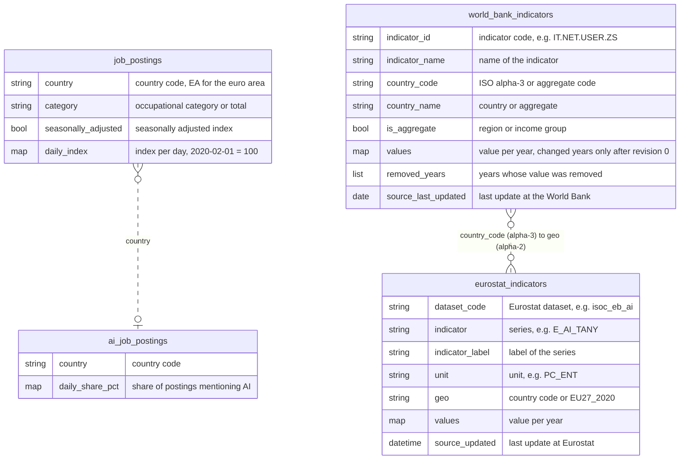
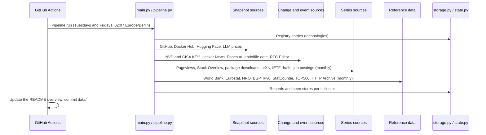

# Tech Dataset
[](https://github.com/kleinnconrad/dataset.technology/actions/workflows/ci.yml)

A long-term dataset of the technology world for trend analysis and prediction over 15 to 20 years. It covers AI and machine learning, software development, data, IT infrastructure, networking, security, hardware and emerging technologies. A pipeline in GitHub Actions runs twice a week (Tuesdays and Fridays) for at most 45 minutes. It collects attention, developer activity, adoption, prices, capabilities, vulnerabilities, standards, internet infrastructure and labor market data from public APIs and open data files, and stores everything as partitioned JSON files in this repository.

## Table of Contents
- [Variable Overview](#variable-overview)
- [Dataset Overview](#dataset-overview)
- [Datasets](#datasets)
- [Technology Registry](#technology-registry)
- [Data Model](#data-model)
- [Example Records](#example-records)
- [Sources and Fetch Rules](#sources-and-fetch-rules)
- [Pipeline](#pipeline)
- [Data Files](#data-files)
- [Workflows](#workflows)
- [Configuration](#configuration)
- [Running Locally](#running-locally)
- [Continuous Integration](#continuous-integration)
- [Setup](#setup)
- [License](#license)

## Variable Overview

The table lists the variables that carry content and the dataset (table) that stores them. The datasets `wikipedia_pageviews`, `hackernews_mentions`, `stackoverflow_questions`, `github_repositories`, `package_downloads`, `docker_image_pulls` and `release_cycles` hold values of a technology of the [registry](#technology-registry), linked by `technology_id`. Maps are shown with one or two entries of one record. Not listed are the fields that every record has, ids that link the datasets, the identifiers of the technologies and items at the sources (Wikidata ids, Stack Overflow tags, repositories, packages, images, Hacker News terms, product slugs, story ids, DOIs), codes of the providers, URLs, coverage dates, quality flags and the bookkeeping of revisions and listings; all fields are in the [Data Model](#data-model).

| Variable | Table | Description | Example |
|---|---|---|---|
| `name` | `technologies` | Name of the technology | `Kubernetes` |
| `domain` | `technologies` | Domain of the category, e.g. `ai_ml` or `security` | `it_infrastructure` |
| `category` | `technologies` | Category of the technology within its domain | `container_platform` |
| `daily_views` | `wikipedia_pageviews` | Views by people per day of the English Wikipedia article of a technology | `{"2026-10-23": 1148, "2026-10-24": 719}` |
| `created_at` | `hackernews_stories` | Time the story was posted (UTC) | `2026-10-20T13:18:07Z` |
| `title` | `hackernews_stories` | Title of the story | `Tsrs: A Port of TypeScript to Rust` |
| `domain` | `hackernews_stories` | Host of the linked URL | `blog.cloudflare.com` |
| `story_type` | `hackernews_stories` | Type of the post: story, ask_hn, show_hn or launch_hn | `story` |
| `points` | `hackernews_stories` | Points at observation, at least two days after posting | `432` |
| `comments` | `hackernews_stories` | Number of comments at observation | `213` |
| `technology_ids` | `hackernews_stories` | Technologies of the registry named in the title | `["rust", "typescript"]` |
| `weekly_stories` | `hackernews_mentions` | Stories per week with a term of a technology in the title | `{"2026-10-05": 83, "2026-10-12": 78}` |
| `weekly_comments` | `hackernews_mentions` | Comments per week that contain a term of a technology | `{"2026-10-05": 113, "2026-10-12": 165}` |
| `weekly_questions` | `stackoverflow_questions` | New questions per week with a tag of a technology | `{"2026-10-05": 1, "2026-10-12": 0}` |
| `total_questions` | `stackoverflow_questions` | Questions with the tag at observation | `23809` |
| `stars` | `github_repositories` | Stars of a repository of a technology | `128620` |
| `forks` | `github_repositories` | Number of forks | `46766` |
| `open_issues` | `github_repositories` | Open issues and pull requests | `3223` |
| `watchers` | `github_repositories` | Users watching the repository | `3243` |
| `size_kb` | `github_repositories` | Size of the repository in KB | `1537306` |
| `primary_language` | `github_repositories` | Main language of the repository | `Go` |
| `repo_license` | `github_repositories` | License of the repository (SPDX id) | `Apache-2.0` |
| `topics` | `github_repositories` | Topics of the repository | `["cncf", "containers", "go", "kubernetes"]` |
| `created_at` | `github_repositories` | Creation time of the repository (UTC) | `2014-06-06T22:56:04Z` |
| `pushed_at` | `github_repositories` | Time of the latest push (UTC) | `2026-10-24T15:00:02Z` |
| `archived` | `github_repositories` | Repository is archived (read-only) | `false` |
| `contributors` | `github_repositories` | Contributors including anonymous ones | `5968` |
| `commits_last_4_weeks` | `github_repositories` | Commits to the default branch in the last 4 weeks | `834` |
| `commits_last_52_weeks` | `github_repositories` | Commits to the default branch in the last 52 weeks | `8765` |
| `latest_release_tag` | `github_repositories` | Tag of the latest release | `v1.37.1` |
| `latest_release_at` | `github_repositories` | Publication time of the latest release (UTC) | `2026-09-23T19:13:17Z` |
| `ecosystem` | `package_downloads` | Package registry: npm, pypi or crates | `pypi` |
| `daily_downloads` | `package_downloads` | Downloads per day of a package of a technology | `{"2026-10-22": 2070007, "2026-10-23": 2720014}` |
| `pull_count` | `docker_image_pulls` | Pulls of a container image of a technology since its creation | `12031349706` |
| `star_count` | `docker_image_pulls` | Stars of the image | `15039` |
| `last_updated` | `docker_image_pulls` | Time of the latest push to the image (UTC) | `2026-10-23T07:08:42.186040Z` |
| `cycle` | `release_cycles` | Release cycle of a product, e.g. 3.13 or 22.04 | `24.04` |
| `codename` | `release_cycles` | Codename of the cycle | `Noble Numbat` |
| `release_date` | `release_cycles` | Release date of the cycle | `2024-04-25` |
| `is_lts` | `release_cycles` | Cycle has long-term support | `true` |
| `lts_from` | `release_cycles` | Start of long-term support | `2024-10-29` |
| `active_support_until` | `release_cycles` | End of active support (bug fixes) | `2029-05-31` |
| `eol_date` | `release_cycles` | End of life (end of security support) | `2029-05-31` |
| `is_eol` | `release_cycles` | End of life reached at observation | `false` |
| `extended_support_until` | `release_cycles` | End of paid extended support | `2034-04-25` |
| `is_maintained` | `release_cycles` | Cycle maintained at observation | `true` |
| `latest_version` | `release_cycles` | Latest release of the cycle at observation | `24.04.5` |
| `latest_release_date` | `release_cycles` | Release date of the latest release | `2026-09-10` |
| `model_key` | `llm_prices` | Offering (a model at a provider) in the LiteLLM price list | `azure/gpt-5.5` |
| `provider` | `llm_prices` | Provider or platform that sells the offering | `azure` |
| `mode` | `llm_prices` | Kind of offering: chat, completion, responses or embedding | `chat` |
| `input_price_usd_per_mtok` | `llm_prices` | USD per million input tokens | `5.0` |
| `output_price_usd_per_mtok` | `llm_prices` | USD per million output tokens | `30.0` |
| `cached_input_price_usd_per_mtok` | `llm_prices` | USD per million cached input tokens (cache read) | `0.5` |
| `batch_input_price_usd_per_mtok` | `llm_prices` | USD per million input tokens in batch processing | `2.5` |
| `batch_output_price_usd_per_mtok` | `llm_prices` | USD per million output tokens in batch processing | `15.0` |
| `max_input_tokens` | `llm_prices` | Maximum input tokens (context window) | `922000` |
| `max_output_tokens` | `llm_prices` | Maximum output tokens per request | `128000` |
| `supports_function_calling` | `llm_prices` | Supports function (tool) calling | `true` |
| `supports_vision` | `llm_prices` | Accepts image input | `true` |
| `supports_reasoning` | `llm_prices` | Supports a reasoning mode | `true` |
| `supports_prompt_caching` | `llm_prices` | Supports prompt caching | `true` |
| `supports_web_search` | `llm_prices` | Supports built-in web search | `true` |
| `deprecation_date` | `llm_prices` | Announced deprecation date of the offering | `2027-10-26` |
| `model_name` | `ai_models` | Name of the AI model at Epoch AI | `Llama 3.1-405B` |
| `organization` | `ai_models` | Developing organizations as written by Epoch AI | `Meta AI` |
| `organization_categories` | `ai_models` | Categories of the developers, e.g. Industry or Academia | `["Industry"]` |
| `countries` | `ai_models` | Countries of the developing organizations | `["United States of America"]` |
| `publication_date` | `ai_models` | Publication or release date | `2024-07-23` |
| `domains` | `ai_models` | Domains of the model, e.g. Language or Vision | `["Language"]` |
| `tasks` | `ai_models` | Tasks of the model | `["Language modeling/generation", "Question answering"]` |
| `notability_criteria` | `ai_models` | Criteria for which Epoch AI counts the model as notable | `["SOTA improvement", "Training cost"]` |
| `frontier_model` | `ai_models` | Frontier model according to Epoch AI; null otherwise | `true` |
| `parameters` | `ai_models` | Number of parameters | `405000000000.0` |
| `training_compute_flop` | `ai_models` | Training compute in FLOP | `3.8e+25` |
| `training_dataset_size` | `ai_models` | Size of the training data (tokens or data points) | `15600000000000.0` |
| `training_time_hours` | `ai_models` | Training time in hours | `2142.0` |
| `training_hardware` | `ai_models` | Hardware used for training | `["NVIDIA H100 SXM5 80GB"]` |
| `hardware_quantity` | `ai_models` | Number of hardware units used for training | `16384.0` |
| `training_compute_cost_usd_2023` | `ai_models` | Estimated cost of the training compute in 2023 USD | `52885433.95402246` |
| `training_power_draw_watts` | `ai_models` | Estimated power draw of the training hardware in watts | `22622532.159299146` |
| `finetune_compute_flop` | `ai_models` | Fine-tuning compute in FLOP | `7.04e+21` |
| `post_training_compute_flop` | `ai_models` | Post-training compute in FLOP | `9.4e+22` |
| `compute_estimation_method` | `ai_models` | How the training compute was determined | `Reported,Operation counting` |
| `confidence` | `ai_models` | Confidence of Epoch AI in the estimates | `Confident` |
| `model_accessibility` | `ai_models` | Access to the model, e.g. API access or open weights | `Open weights (restricted use)` |
| `open_weights` | `ai_models` | Model weights are published | `true` |
| `training_code_accessibility` | `ai_models` | Access to the training code | `Open (restricted use)` |
| `base_model` | `ai_models` | Model that this model was fine-tuned from | `EXAONE 3.5 32B` |
| `hardware_name` | `ml_hardware` | Name of the accelerator at Epoch AI | `NVIDIA H100 SXM5 80GB` |
| `manufacturer` | `ml_hardware` | Manufacturer | `NVIDIA` |
| `hardware_type` | `ml_hardware` | Type, e.g. GPU or TPU | `GPU` |
| `release_date` | `ml_hardware` | Release date | `2022-09-20` |
| `release_price_usd` | `ml_hardware` | Price at release in USD | `33600.0` |
| `fp64_flops` | `ml_hardware` | Double precision (FP64) performance in FLOP/s | `33450000000000.0` |
| `fp32_flops` | `ml_hardware` | Single precision (FP32) performance in FLOP/s | `66910000000000.0` |
| `tf32_flops` | `ml_hardware` | TensorFloat-32 performance in FLOP/s | `494700000000000.0` |
| `fp16_flops` | `ml_hardware` | Half precision (FP16) performance in FLOP/s | `133800000000000.0` |
| `tensor_fp16_bf16_flops` | `ml_hardware` | Tensor core FP16/BF16 performance in FLOP/s | `989500000000000.0` |
| `fp8_flops` | `ml_hardware` | FP8 performance in FLOP/s | `1979000000000000.0` |
| `fp4_flops` | `ml_hardware` | FP4 performance in FLOP/s | `1.5e+16` |
| `int8_ops` | `ml_hardware` | INT8 performance in OP/s | `1979000000000000.0` |
| `int4_ops` | `ml_hardware` | INT4 performance in OP/s | `1.5e+16` |
| `memory_bytes` | `ml_hardware` | Memory capacity in bytes | `80000000000.0` |
| `memory_bandwidth_bytes_per_s` | `ml_hardware` | Memory bandwidth in bytes per second | `3350000000000.0` |
| `intranode_bandwidth_bytes_per_s` | `ml_hardware` | Bandwidth between the accelerators of a node in bytes per second | `900000000000.0` |
| `internode_bandwidth_bits_per_s` | `ml_hardware` | Bandwidth between nodes in bits per second | `400000000000.0` |
| `tdp_watts` | `ml_hardware` | Thermal design power in watts | `700.0` |
| `foundry` | `ml_hardware` | Chip manufacturer (foundry) | `TSMC` |
| `process_size_nm` | `ml_hardware` | Process size in nanometers | `5.0` |
| `transistors_millions` | `ml_hardware` | Number of transistors in millions | `80000.0` |
| `die_size_mm2` | `ml_hardware` | Die size in square millimeters | `814.0` |
| `ml_models` | `ml_hardware` | Models in the Epoch AI database trained on the hardware | `["GPT-5.5", "Inkling", "Inkling-Small"]` |
| `display_name` | `ai_capability_scores` | Display name of the model | `Llama 3.1-405B` |
| `eci` | `ai_capability_scores` | Epoch Capabilities Index score | `128.77` |
| `eci_ci_low` | `ai_capability_scores` | Lower bound of the confidence interval of the score | `124.44` |
| `eci_ci_high` | `ai_capability_scores` | Upper bound of the confidence interval of the score | `130.61` |
| `model_date` | `ai_capability_scores` | Release date of the model as used by Epoch AI | `2024-07-23` |
| `organization` | `ai_capability_scores` | Developing organization | `Meta AI` |
| `country` | `ai_capability_scores` | Country of the developing organization | `United States of America` |
| `model_accessibility` | `ai_capability_scores` | Access to the model, e.g. API access or open weights | `Open weights (restricted use)` |
| `accessibility_group` | `ai_capability_scores` | Open weights, closed weights or other | `Open weights` |
| `repo_type` | `huggingface_repos` | Type of the repository: model or dataset | `model` |
| `repo_id` | `huggingface_repos` | Repository on the Hugging Face Hub (organization/name) | `Qwen/Qwen3-4B` |
| `organization` | `huggingface_repos` | Organization that owns the repository | `Qwen` |
| `created_at` | `huggingface_repos` | Creation time of the repository (UTC) | `2025-04-27T03:41:29Z` |
| `pipeline_tag` | `huggingface_repos` | Task of a model | `text-generation` |
| `library_name` | `huggingface_repos` | Library of a model | `transformers` |
| `repo_license` | `huggingface_repos` | License tag of the repository | `apache-2.0` |
| `base_models` | `huggingface_repos` | Base models of a fine-tuned, quantized, adapted or merged model | `["Qwen/Qwen3-4B-Base"]` |
| `base_model_relation` | `huggingface_repos` | Relation to the base models, e.g. finetune or quantized | `finetune` |
| `parameters` | `huggingface_repos` | Parameters of a model from its safetensors files | `4022468096` |
| `gated` | `huggingface_repos` | Access gating: false, auto or manual | `false` |
| `rank` | `huggingface_repo_stats` | Rank by 30-day downloads among all public repositories of the type | `22` |
| `downloads_30d` | `huggingface_repo_stats` | Downloads in the last 30 days | `11268043` |
| `downloads_all_time` | `huggingface_repo_stats` | Downloads since the creation of the repository | `92966698` |
| `likes` | `huggingface_repo_stats` | Number of likes | `771` |
| `trending_score` | `huggingface_repo_stats` | Trending score of the Hub | `4.0` |
| `models` | `huggingface_hub_totals` | Public models on the Hub | `3185648` |
| `datasets` | `huggingface_hub_totals` | Public datasets on the Hub | `1105148` |
| `spaces` | `huggingface_hub_totals` | Public Spaces on the Hub | `1509059` |
| `user_repos_in_top_models` | `huggingface_hub_totals` | Repositories of users (not organizations) among the tracked top models | `106` |
| `user_repos_in_top_datasets` | `huggingface_hub_totals` | Repositories of users (not organizations) among the tracked top datasets | `89` |
| `category_name` | `arxiv_submissions` | Subject category of arXiv | `Machine Learning` |
| `weekly_submissions` | `arxiv_submissions` | New submissions per week, including cross-lists | `{"2026-09-28": 2345, "2026-10-05": 1785}` |
| `published_date` | `cve_daily_counts` | Day on which the NVD published the CVE records | `2026-10-22` |
| `cves` | `cve_daily_counts` | CVE records published that day, including rejected ones | `494` |
| `rejected` | `cve_daily_counts` | Records with the status Rejected | `2` |
| `by_status` | `cve_daily_counts` | Records per NVD analysis status | `{"Awaiting Analysis": 170, "Deferred": 201}` |
| `by_cvss_v3_severity` | `cve_daily_counts` | Records per CVSS v3.x base severity | `{"CRITICAL": 57, "HIGH": 141}` |
| `by_cvss_v4_severity` | `cve_daily_counts` | Records per CVSS v4.0 base severity | `{"CRITICAL": 21, "HIGH": 90}` |
| `unscored` | `cve_daily_counts` | Records without a CVSS v3.x or v4.0 score | `15` |
| `nvd_scored` | `cve_daily_counts` | Records with a CVSS score from the NVD itself | `0` |
| `by_cwe` | `cve_daily_counts` | Records per weakness (CWE id) | `{"CWE-79": 44, "CWE-862": 38}` |
| `by_vendor` | `cve_daily_counts` | Records per vendor of the affected products | `{"drupal": 72, "mongodb": 13}` |
| `with_exploit_reference` | `cve_daily_counts` | Records with a reference tagged Exploit | `0` |
| `kev_listed` | `cve_daily_counts` | Records already in the CISA Known Exploited Vulnerabilities catalog | `1` |
| `cve_id` | `known_exploited_vulnerabilities` | CVE id of the vulnerability | `CVE-2021-44228` |
| `vendor_project` | `known_exploited_vulnerabilities` | Vendor or project as written by CISA | `Apache` |
| `product` | `known_exploited_vulnerabilities` | Product as written by CISA | `Log4j2` |
| `vulnerability_name` | `known_exploited_vulnerabilities` | Short name of the vulnerability given by CISA | `Apache Log4j2 Remote Code Execution Vulnerability` |
| `date_added` | `known_exploited_vulnerabilities` | Day on which CISA added the vulnerability to the catalog | `2021-12-10` |
| `due_date` | `known_exploited_vulnerabilities` | Remediation deadline for US federal agencies | `2021-12-24` |
| `known_ransomware_use` | `known_exploited_vulnerabilities` | Known use in ransomware campaigns; false if unknown | `true` |
| `cwe_ids` | `known_exploited_vulnerabilities` | Weaknesses (CWE ids) named by CISA | `["CWE-20", "CWE-400", "CWE-502"]` |
| `cve_published_at` | `known_exploited_vulnerabilities` | Publication time of the CVE record in the NVD (UTC) | `2021-12-10T10:15:09Z` |
| `cvss_base_score` | `known_exploited_vulnerabilities` | CVSS base score (v3.x, else v4.0) at the first observation | `10.0` |
| `cvss_version` | `known_exploited_vulnerabilities` | CVSS version of the score | `3.1` |
| `cvss_source` | `known_exploited_vulnerabilities` | Source of the score: nvd or other | `nvd` |
| `rfc_number` | `rfcs` | Number of the RFC | `8446` |
| `title` | `rfcs` | Title of the RFC | `The Transport Layer Security (TLS) Protocol Version 1.3` |
| `publication_year` | `rfcs` | Year of publication | `2018` |
| `publication_month` | `rfcs` | Month of publication (1 to 12) | `8` |
| `page_count` | `rfcs` | Number of pages | `160` |
| `author_count` | `rfcs` | Number of authors (names are not stored) | `1` |
| `current_status` | `rfcs` | Current status, e.g. PROPOSED STANDARD or HISTORIC | `PROPOSED STANDARD` |
| `publication_status` | `rfcs` | Status at publication | `PROPOSED STANDARD` |
| `stream` | `rfcs` | Stream: IETF, IRTF, IAB, INDEPENDENT, Editorial or Legacy | `IETF` |
| `area` | `rfcs` | Current IETF area of the working group | `sec` |
| `working_group` | `rfcs` | Acronym of the working group | `tls` |
| `keywords` | `rfcs` | Keywords of the RFC | `["FTP"]` |
| `obsoletes` | `rfcs` | Documents that this RFC obsoletes | `["RFC5077", "RFC5246", "RFC6961"]` |
| `obsoleted_by` | `rfcs` | Documents that obsolete this RFC | `["RFC9846"]` |
| `updates` | `rfcs` | Documents that this RFC updates | `["RFC5705", "RFC6066"]` |
| `updated_by` | `rfcs` | Documents that update this RFC | `["RFC8996"]` |
| `is_also` | `rfcs` | Series memberships, e.g. BCP14 or STD7 | `["STD97"]` |
| `draft` | `rfcs` | Internet-Draft from which the RFC was published | `draft-ietf-tls-tls13-28` |
| `has_errata` | `rfcs` | Errata are reported for the RFC | `true` |
| `scope` | `ietf_draft_activity` | Drafts counted: all, by group type or by IETF area | `group_type:wg` |
| `weekly_new_drafts` | `ietf_draft_activity` | First versions (revision 00) submitted per week | `{"2026-10-05": 4, "2026-10-12": 4}` |
| `weekly_revisions` | `ietf_draft_activity` | Draft versions of any revision submitted per week | `{"2026-10-05": 69, "2026-10-12": 116}` |
| `registry` | `ip_address_delegations` | Regional internet registry | `ripencc` |
| `country` | `ip_address_delegations` | Country of the resource holders (ISO 3166-1 alpha-2); ZZ if not delegated | `DE` |
| `status` | `ip_address_delegations` | Status of the resources: assigned, available or reserved | `assigned` |
| `ipv4_addresses` | `ip_address_delegations` | Number of IPv4 addresses | `126279808` |
| `ipv4_ranges` | `ip_address_delegations` | Number of IPv4 ranges | `10815` |
| `ipv6_slash32_equivalents` | `ip_address_delegations` | IPv6 address space in units of /32 prefixes | `24386.0128326416` |
| `ipv6_prefixes` | `ip_address_delegations` | Number of IPv6 prefixes | `3106` |
| `asns` | `ip_address_delegations` | Number of AS numbers | `3252` |
| `asn_ranges` | `ip_address_delegations` | Number of AS number ranges | `3252` |
| `ip_version` | `bgp_routing_table` | IP version of the routing table: 4 or 6 | `6` |
| `daily_prefixes` | `bgp_routing_table` | Announced prefixes in the global routing table per day | `{"2026-10-23": 259660, "2026-10-24": 259597}` |
| `daily_ases` | `bgp_routing_table` | Origin autonomous systems per day | `{"2026-10-23": 37861, "2026-10-24": 37864}` |
| `economy` | `ipv6_adoption` | Economy (ISO 3166-1 alpha-2), or XA for the world | `DE` |
| `daily_capable_pct` | `ipv6_adoption` | Share of users that can use IPv6, in percent per day | `{"2026-10-21": 73.6498, "2026-10-22": 73.5147}` |
| `daily_preferred_pct` | `ipv6_adoption` | Share of users that prefer IPv6 to IPv4, in percent per day | `{"2026-10-21": 70.8261, "2026-10-22": 70.7613}` |
| `daily_samples` | `ipv6_adoption` | Number of measurements per day | `{"2026-10-21": 470976, "2026-10-22": 462743}` |
| `statistic` | `market_shares` | Measured market: os, desktop_os, mobile_os, browser, search_engine, platform or ai_chatbot | `ai_chatbot` |
| `region` | `market_shares` | ww for worldwide, or a country (ISO 3166-1 alpha-2) | `ww` |
| `monthly_shares` | `market_shares` | Share in percent per category per month | `{"2026-08-01": {"ChatGPT": 79.4, "Google Gemini": 10.93}}` |
| `list_edition` | `supercomputer_lists` | Edition of the TOP500 list (June or November) | `2026-06-01` |
| `systems` | `supercomputer_lists` | Number of systems in the list | `500` |
| `total_rmax_tflops` | `supercomputer_lists` | Sum of the LINPACK performance (Rmax) of all systems in TFlop/s | `18732742.1618` |
| `rank1_rmax_tflops` | `supercomputer_lists` | Rmax of the first system in TFlop/s | `2198400.0` |
| `rank500_rmax_tflops` | `supercomputer_lists` | Rmax of the last system (entry level) in TFlop/s | `2661.46` |
| `rank1_system` | `supercomputer_lists` | Name of the first system | `LineShine` |
| `rank1_country` | `supercomputer_lists` | Country of the first system | `China` |
| `total_cores` | `supercomputer_lists` | Sum of the cores of all systems | `152702044` |
| `total_power_kw` | `supercomputer_lists` | Sum of the power of the systems that report it, in kW | `415879.8` |
| `systems_with_power` | `supercomputer_lists` | Number of systems that report their power | `200` |
| `systems_by_country` | `supercomputer_lists` | Number of systems per country | `{"United States": 161, "Germany": 41}` |
| `rmax_by_country_tflops` | `supercomputer_lists` | Sum of Rmax per country in TFlop/s | `{"United States": 7031438.87, "Germany": 1402709.48}` |
| `systems_by_manufacturer` | `supercomputer_lists` | Number of systems per manufacturer | `{"Lenovo": 130, "HPE": 119}` |
| `systems_with_accelerator` | `supercomputer_lists` | Systems with accelerators; null if the list does not state them | `null` |
| `metric` | `web_metrics` | Metric of the HTTP Archive reports, e.g. HTTPS share or page weight | `pctHttps` |
| `client` | `web_metrics` | Crawled page variant: desktop or mobile | `mobile` |
| `unit` | `web_metrics` | Unit of the values, e.g. percent or KB | `percent` |
| `monthly_values` | `web_metrics` | Value per crawl (key: crawl date) | `{"2026-09-01": 99.33, "2026-10-01": 99.41}` |
| `country` | `job_postings` | Country (ISO 3166-1 alpha-2), or EA for the euro area | `DE` |
| `category` | `job_postings` | Occupational category, or total or new postings | `Software Development` |
| `seasonally_adjusted` | `job_postings` | Index is seasonally adjusted | `true` |
| `daily_index` | `job_postings` | Index of job postings on Indeed per day (1 February 2020 = 100) | `{"2026-10-15": 47.42, "2026-10-16": 47.69}` |
| `country` | `ai_job_postings` | Country (ISO 3166-1 alpha-2) | `DE` |
| `daily_share_pct` | `ai_job_postings` | Share of postings that mention AI, in percent per day (7-day average) | `{"2026-09-29": 5.73688552750117, "2026-09-30": 5.74163012331981}` |
| `indicator_name` | `world_bank_indicators` | Name of the World Bank indicator | `Individuals using the Internet (% of population)` |
| `country_name` | `world_bank_indicators` | Country or aggregate | `Germany` |
| `is_aggregate` | `world_bank_indicators` | Region, income group or other aggregate | `false` |
| `values` | `world_bank_indicators` | Value per year; later revisions hold only the changed years | `{"2023": 92.4763763, "2024": 93.49999579}` |
| `indicator_label` | `eurostat_indicators` | Label of the Eurostat indicator | `Enterprises using paid cloud computing services used over the internet` |
| `unit` | `eurostat_indicators` | Unit, e.g. PC_ENT (percentage of enterprises) | `PC_ENT` |
| `geo` | `eurostat_indicators` | Country (Eurostat code, EL for Greece) or EU27_2020 | `DE` |
| `values` | `eurostat_indicators` | Value per year | `{"2023": 47.0, "2025": 53.91}` |

## Dataset Overview
<!-- DATASET_OVERVIEW_START -->
**Last updated:** 2026-10-25 11:40 UTC

| Dataset | Records | Items | Files | Observed | Content |
|---|---|---|---|---|---|
| `technologies` | 309 | 309 | 1 | 2026-10-25 to 2026-10-25 | A tracked technology of the registry, recorded when the entry appears or changes. |
| `wikipedia_pageviews` | 299 | 299 | 1 | 2026-10-25 to 2026-10-25 | Daily views of the English Wikipedia article of a technology. |
| `release_cycles` | 1,965 | 1,965 | 1 | 2026-10-25 to 2026-10-25 | One release cycle of a product at endoflife.date, recorded when it appears or changes. |
| `stackoverflow_questions` | 73 | 73 | 1 | 2026-10-25 to 2026-10-25 | Weekly counts of new Stack Overflow questions with a tag of a technology, and the total of the tag. |
| `github_repositories` | 148 | 148 | 1 | 2026-10-25 to 2026-10-25 | Popularity and activity of a GitHub repository of a technology at the time of observation. |
| `package_downloads` | 94 | 94 | 1 | 2026-10-25 to 2026-10-25 | Daily downloads of a package of a technology from its registry (npm, PyPI or crates.io). |
| `docker_image_pulls` | 64 | 64 | 1 | 2026-10-25 to 2026-10-25 | Cumulative pulls and stars of a container image on Docker Hub at the time of observation. |
| `cve_daily_counts` | 7 | 7 | 1 | 2026-10-25 to 2026-10-25 | Counts of the CVE records that the NVD published on one day, by status, severity, weakness and vendor, as observed after the day ended. |
| `known_exploited_vulnerabilities` | 1,756 | 1,756 | 1 | 2026-10-25 to 2026-10-25 | A vulnerability in the CISA Known Exploited Vulnerabilities catalog, recorded when it is added or changes. |
| `rfcs` | 9,848 | 9,848 | 1 | 2026-10-25 to 2026-10-25 | An RFC in the index of the RFC Editor, recorded when it appears or its status or relations change. |
| `ietf_draft_activity` | 11 | 11 | 1 | 2026-10-25 to 2026-10-25 | Weekly counts of Internet-Draft submissions in the IETF Datatracker, for all drafts or by group type or area. |
| `world_bank_indicators` | 4,308 | 4,308 | 1 | 2026-10-25 to 2026-10-25 | Values of a World Bank development indicator for one country or aggregate. Revision 0 holds all years; later revisions hold only the years whose values were added or changed. |
| `eurostat_indicators` | 252 | 252 | 1 | 2026-10-25 to 2026-10-25 | Annual values of a Eurostat indicator on the digital economy and society for one country or the EU, recorded when they appear or change. |
| `ip_address_delegations` | 401 | 401 | 1 | 2026-10-25 to 2026-10-25 | Internet number resources (IPv4, IPv6, AS numbers) of a regional internet registry per country and status, from the combined statistics of the NRO. |
| `bgp_routing_table` | 0 | 0 | 0 | none | Daily size of the global BGP routing table for IPv4 or IPv6, as seen from the route collector of bgp.potaroo.net. |
| `ipv6_adoption` | 0 | 0 | 0 | none | Daily share of users that are IPv6-capable and that prefer IPv6, measured by APNIC Labs, for an economy or the world. |
| `market_shares` | 0 | 0 | 0 | none | Monthly market shares of operating systems, browsers, search engines, device platforms or AI chatbots measured by StatCounter, for a region. |
| `supercomputer_lists` | 0 | 0 | 0 | none | Aggregates of one edition of the TOP500 list of supercomputers. |
| `web_metrics` | 0 | 0 | 0 | none | Monthly metric of the web from the crawls of the HTTP Archive, for desktop or mobile pages. |
| `job_postings` | 65 | 65 | 1 | 2026-10-25 to 2026-10-25 | Daily index of job postings on Indeed for a country and an occupational category (1 February 2020 = 100). |
| `ai_job_postings` | 9 | 9 | 1 | 2026-10-25 to 2026-10-25 | Daily share of job postings on Indeed that mention artificial intelligence, for a country. |
| `llm_prices` | 3,437 | 3,437 | 1 | 2026-10-25 to 2026-10-25 | List prices and limits of one LLM offering (a model at a provider), recorded when it appears or changes. |
| `ai_models` | 3,630 | 3,630 | 1 | 2026-10-25 to 2026-10-25 | An AI model in the Epoch AI database of AI models, recorded when it appears or changes. |
| `ml_hardware` | 183 | 183 | 1 | 2026-10-25 to 2026-10-25 | A machine learning accelerator in the Epoch AI hardware database, recorded when it appears or changes. |
| `ai_capability_scores` | 270 | 270 | 1 | 2026-10-25 to 2026-10-25 | The Epoch Capabilities Index (ECI) score of an AI model, recorded when it appears or changes. |
| `arxiv_submissions` | 8 | 8 | 1 | 2026-10-25 to 2026-10-25 | Weekly counts of new arXiv submissions in a subject category, including cross-lists. |
| `hackernews_stories` | 309 | 309 | 1 | 2026-10-25 to 2026-10-25 | A Hacker News story that reached the point threshold, observed at least two days after it was posted. |
| `hackernews_mentions` | 186 | 186 | 1 | 2026-10-25 to 2026-10-25 | Weekly counts of Hacker News stories and comments that mention a term of a technology. |
| `huggingface_repos` | 505 | 505 | 1 | 2026-10-25 to 2026-10-25 | Attributes of a model or dataset repository of an organization on the Hugging Face Hub, recorded when it enters the tracked top list or changes. |
| `huggingface_repo_stats` | 505 | 505 | 1 | 2026-10-25 to 2026-10-25 | Download and like counts of a top model or dataset repository of an organization on the Hugging Face Hub. |
| `huggingface_hub_totals` | 1 | 1 | 1 | 2026-10-25 to 2026-10-25 | Total numbers of models, datasets and Spaces on the Hugging Face Hub. |

**Runs**

- **Latest run:** 2026-10-25 11:00 UTC (normal)
  - `arxiv`: partial (arxiv_submissions 8)
  - `bgp`: partial
  - `docker_hub`: ok (docker_image_pulls 64)
  - `epoch_ai`: ok (ai_capability_scores 270, ai_models 3,630, ml_hardware 183)
  - `eurostat`: ok (eurostat_indicators 252)
  - `github_repositories`: ok (github_repositories 148)
  - `hackernews`: ok (hackernews_mentions 186, hackernews_stories 309)
  - `httparchive`: skipped; run deadline of 40 minutes reached before the collector started
  - `huggingface`: ok (huggingface_hub_totals 1, huggingface_repo_stats 505, huggingface_repos 505)
  - `ietf_drafts`: ok (ietf_draft_activity 11)
  - `ipv6_adoption`: skipped; run deadline of 40 minutes reached before the collector started
  - `job_postings`: ok (ai_job_postings 9, job_postings 65)
  - `llm_prices`: ok (llm_prices 3,437)
  - `nro`: ok (ip_address_delegations 401)
  - `package_downloads`: partial (package_downloads 94)
  - `release_cycles`: ok (release_cycles 1,965)
  - `rfcs`: ok (rfcs 9,848)
  - `stackoverflow`: partial (stackoverflow_questions 73)
  - `statcounter`: skipped; run deadline of 40 minutes reached before the collector started
  - `technologies`: ok (technologies 309)
  - `top500`: skipped; run deadline of 40 minutes reached before the collector started
  - `vulnerabilities`: ok (cve_daily_counts 7, known_exploited_vulnerabilities 1,756)
  - `wikipedia_pageviews`: ok (wikipedia_pageviews 299)
  - `world_bank`: ok (world_bank_indicators 4,308)

**Technology registry**

- **Active technologies:** 309 in 8 domains

| Domain | Technologies |
|---|---|
| ai ml | 58 |
| data | 31 |
| emerging tech | 17 |
| hardware | 21 |
| it infrastructure | 53 |
| networking | 32 |
| security | 17 |
| software development | 80 |

| Identifier | Technologies with it |
|---|---|
| Wikipedia article | 96.8% (299) |
| Stack Overflow tags | 79.3% (245) |
| GitHub repositories | 42.1% (130) |
| Packages or images | 37.9% (117) |
| endoflife.date product | 30.1% (93) |
| Hacker News terms | 99.4% (307) |

**Fields** (Filled: records with a value that is not null and not empty)

<details>
<summary><code>technologies</code>: 23 fields</summary>

| Field | Description | Filled | Distinct values |
|---|---|---|---|
| `record_id` | Stable id of the item. Together with revision it identifies a record. | 100.0% (309) | 309 |
| `revision` | 0 for the first observation; incremented each time the source changes the item. | 100.0% (309) | 1 |
| `dataset` | Name of the dataset. | 100.0% (309) | 1 |
| `schema_version` | Version of the record schema. | 100.0% (309) | 1 |
| `observed_at` | UTC time at which the pipeline observed this version of the item. Filtering observed_at <= t gives the state of knowledge at time t. | 100.0% (309) | 1 |
| `source_id` | Id of the source (API or file). | 100.0% (309) | 1 |
| `source_url` | URL of the item or of the API resource it was read from. | 100.0% (309) | 1 |
| `license` | License or terms of the source. | 100.0% (309) | 1 |
| `backfilled` | True if the item is older than the start of collection for its dataset, so that observed_at does not reflect when it became known. | 100.0% (309) | 1 |
| `technology_id` | Stable id of the technology; the join key of the technology-related datasets. | 100.0% (309) | 309 |
| `name` | Display name. | 100.0% (309) | 309 |
| `domain` | Domain of the category. | 100.0% (309) | 8 |
| `category` | Category of the technology. | 100.0% (309) | 34 |
| `added` | Day on which the technology was added to the registry; start of coverage. | 100.0% (309) | 1 |
| `removed` | Day on which the technology was removed from the registry; end of coverage. | 0.0% (0) | 0 |
| `removed_reason` | Why the technology was removed. | 0.0% (0) | 0 |
| `wikidata_qid` | Wikidata id. | 96.8% (299) | 299 |
| `stackoverflow_tags` | Stack Overflow tags counted for the technology. | 79.3% (245) | 271 |
| `github_repos` | GitHub repositories tracked for the technology (owner/name). | 42.1% (130) | 148 |
| `packages` | Packages and container images tracked for the technology (ecosystem:name). | 37.9% (117) | 180 |
| `endoflife_product` | Product slug at endoflife.date. | 30.1% (93) | 93 |
| `hn_terms` | Terms counted in Hacker News stories and comments. | 99.4% (307) | 511 |
| `github_language` | Language name in GitHub search. | 11.3% (35) | 35 |

</details>

<details>
<summary><code>wikipedia_pageviews</code>: 14 fields</summary>

| Field | Description | Filled | Distinct values |
|---|---|---|---|
| `record_id` | Stable id of the item. Together with revision it identifies a record. | 100.0% (299) | 299 |
| `revision` | 0 for the first observation; incremented each time the source changes the item. | 100.0% (299) | 1 |
| `dataset` | Name of the dataset. | 100.0% (299) | 1 |
| `schema_version` | Version of the record schema. | 100.0% (299) | 1 |
| `observed_at` | UTC time at which the pipeline observed this version of the item. Filtering observed_at <= t gives the state of knowledge at time t. | 100.0% (299) | 76 |
| `source_id` | Id of the source (API or file). | 100.0% (299) | 1 |
| `source_url` | URL of the item or of the API resource it was read from. | 100.0% (299) | 299 |
| `license` | License or terms of the source. | 100.0% (299) | 1 |
| `backfilled` | True if the item is older than the start of collection for its dataset, so that observed_at does not reflect when it became known. | 100.0% (299) | 1 |
| `technology_id` | Id of the technology in the registry. | 100.0% (299) | 299 |
| `wikipedia_project` | Wikipedia edition, e.g. en.wikipedia. | 100.0% (299) | 1 |
| `wikipedia_title` | Title of the article at the time of observation. | 100.0% (299) | 299 |
| `wikidata_qid` | Wikidata id of the technology. | 100.0% (299) | 299 |
| `daily_views` | Views by people (agent type user) per day (UTC), for the days since the previous run. | 100.0% (299) | 4,134 |

</details>

<details>
<summary><code>release_cycles</code>: 24 fields</summary>

| Field | Description | Filled | Distinct values |
|---|---|---|---|
| `record_id` | Stable id of the item. Together with revision it identifies a record. | 100.0% (1,965) | 1,965 |
| `revision` | 0 for the first observation; incremented each time the source changes the item. | 100.0% (1,965) | 1 |
| `dataset` | Name of the dataset. | 100.0% (1,965) | 1 |
| `schema_version` | Version of the record schema. | 100.0% (1,965) | 1 |
| `observed_at` | UTC time at which the pipeline observed this version of the item. Filtering observed_at <= t gives the state of knowledge at time t. | 100.0% (1,965) | 48 |
| `source_id` | Id of the source (API or file). | 100.0% (1,965) | 1 |
| `source_url` | URL of the item or of the API resource it was read from. | 100.0% (1,965) | 93 |
| `license` | License or terms of the source. | 100.0% (1,965) | 1 |
| `backfilled` | True if the item is older than the start of collection for its dataset, so that observed_at does not reflect when it became known. | 100.0% (1,965) | 2 |
| `technology_id` | Id of the technology in the registry. | 100.0% (1,965) | 93 |
| `product` | Product slug at endoflife.date. | 100.0% (1,965) | 93 |
| `cycle` | Name of the release cycle, e.g. '3.13' or '22.04'. | 100.0% (1,965) | 771 |
| `codename` | Codename of the cycle. | 9.9% (195) | 165 |
| `release_date` | Release date of the cycle. | 100.0% (1,965) | 1,493 |
| `is_lts` | Whether the cycle has long-term support. | 100.0% (1,965) | 2 |
| `lts_from` | Day from which the cycle has long-term support. | 2.2% (43) | 43 |
| `active_support_until` | End of active support (bug fixes); null if not stated. | 33.5% (659) | 539 |
| `eol_date` | End of life (end of security support); null if not stated. | 91.2% (1,793) | 1,349 |
| `is_eol` | Whether the cycle had reached its end of life at the time of observation. | 100.0% (1,965) | 2 |
| `extended_support_until` | End of paid extended support; null if not stated. | 5.2% (103) | 94 |
| `is_maintained` | Whether the cycle was maintained at the time of observation. | 100.0% (1,965) | 2 |
| `latest_version` | Latest release of the cycle at the time of observation. | 85.6% (1,683) | 1,515 |
| `latest_release_date` | Release date of the latest release. | 82.1% (1,614) | 1,118 |
| `is_listed` | False in the record written when the cycle disappeared from the product page. | 100.0% (1,965) | 1 |

</details>

<details>
<summary><code>stackoverflow_questions</code>: 13 fields</summary>

| Field | Description | Filled | Distinct values |
|---|---|---|---|
| `record_id` | Stable id of the item. Together with revision it identifies a record. | 100.0% (73) | 73 |
| `revision` | 0 for the first observation; incremented each time the source changes the item. | 100.0% (73) | 1 |
| `dataset` | Name of the dataset. | 100.0% (73) | 1 |
| `schema_version` | Version of the record schema. | 100.0% (73) | 1 |
| `observed_at` | UTC time at which the pipeline observed this version of the item. Filtering observed_at <= t gives the state of knowledge at time t. | 100.0% (73) | 72 |
| `source_id` | Id of the source (API or file). | 100.0% (73) | 1 |
| `source_url` | URL of the item or of the API resource it was read from. | 100.0% (73) | 73 |
| `license` | License or terms of the source. | 100.0% (73) | 1 |
| `backfilled` | True if the item is older than the start of collection for its dataset, so that observed_at does not reflect when it became known. | 100.0% (73) | 1 |
| `technology_id` | Id of the technology in the registry. | 100.0% (73) | 62 |
| `tag` | Stack Overflow tag. | 100.0% (73) | 73 |
| `weekly_questions` | Questions created per week (key: Monday of the ISO week, UTC) as counted at the time of observation, for the weeks since the previous run. Deleted questions are not counted. | 100.0% (73) | 4 |
| `total_questions` | Number of questions with the tag at the time of observation. | 100.0% (73) | 70 |

</details>

<details>
<summary><code>github_repositories</code>: 29 fields</summary>

| Field | Description | Filled | Distinct values |
|---|---|---|---|
| `record_id` | Stable id of the item. Together with revision it identifies a record. | 100.0% (148) | 148 |
| `revision` | 0 for the first observation; incremented each time the source changes the item. | 100.0% (148) | 1 |
| `dataset` | Name of the dataset. | 100.0% (148) | 1 |
| `schema_version` | Version of the record schema. | 100.0% (148) | 1 |
| `observed_at` | UTC time at which the pipeline observed this version of the item. Filtering observed_at <= t gives the state of knowledge at time t. | 100.0% (148) | 148 |
| `source_id` | Id of the source (API or file). | 100.0% (148) | 1 |
| `source_url` | URL of the item or of the API resource it was read from. | 100.0% (148) | 148 |
| `license` | License or terms of the source. | 100.0% (148) | 1 |
| `backfilled` | True if the item is older than the start of collection for its dataset, so that observed_at does not reflect when it became known. | 100.0% (148) | 1 |
| `technology_id` | Id of the technology in the registry. | 100.0% (148) | 130 |
| `repo` | Repository as listed in the registry (owner/name). | 100.0% (148) | 148 |
| `repo_id` | Numeric repository id at GitHub; stays the same when the repository is renamed or transferred. | 100.0% (148) | 148 |
| `full_name` | Current owner/name of the repository at GitHub. | 100.0% (148) | 148 |
| `stars` | Number of stars. | 100.0% (148) | 148 |
| `forks` | Number of forks. | 100.0% (148) | 146 |
| `open_issues` | Number of open issues and pull requests. | 100.0% (148) | 143 |
| `watchers` | Number of users watching the repository (subscribers). | 100.0% (148) | 141 |
| `size_kb` | Size of the repository in kilobytes as reported by GitHub. | 100.0% (148) | 148 |
| `primary_language` | Main language of the repository. | 98.6% (146) | 30 |
| `repo_license` | SPDX id of the license of the repository; NOASSERTION if GitHub cannot determine it. | 93.9% (139) | 11 |
| `topics` | Topics of the repository. | 81.8% (121) | 525 |
| `created_at` | Creation time of the repository (UTC). | 100.0% (148) | 147 |
| `pushed_at` | Time of the latest push (UTC). | 100.0% (148) | 148 |
| `archived` | Whether the repository is archived (read-only). | 100.0% (148) | 1 |
| `contributors` | Number of contributors including anonymous ones; null if GitHub does not list them, e.g. for very large repositories. | 99.3% (147) | 144 |
| `commits_last_4_weeks` | Commits to the default branch in the 4 weeks before the day of observation, without merge commits. | 100.0% (148) | 117 |
| `commits_last_52_weeks` | Commits to the default branch in the 52 weeks before the day of observation, without merge commits. | 100.0% (148) | 138 |
| `latest_release_tag` | Tag of the latest release that is neither a draft nor a prerelease; null if the repository publishes no releases on GitHub. | 83.1% (123) | 119 |
| `latest_release_at` | Publication time of the latest release (UTC). | 83.1% (123) | 123 |

</details>

<details>
<summary><code>package_downloads</code>: 13 fields</summary>

| Field | Description | Filled | Distinct values |
|---|---|---|---|
| `record_id` | Stable id of the item. Together with revision it identifies a record. | 100.0% (94) | 94 |
| `revision` | 0 for the first observation; incremented each time the source changes the item. | 100.0% (94) | 1 |
| `dataset` | Name of the dataset. | 100.0% (94) | 1 |
| `schema_version` | Version of the record schema. | 100.0% (94) | 1 |
| `observed_at` | UTC time at which the pipeline observed this version of the item. Filtering observed_at <= t gives the state of knowledge at time t. | 100.0% (94) | 70 |
| `source_id` | Id of the source (API or file). | 100.0% (94) | 3 |
| `source_url` | URL of the item or of the API resource it was read from. | 100.0% (94) | 94 |
| `license` | License or terms of the source. | 100.0% (94) | 3 |
| `backfilled` | True if the item is older than the start of collection for its dataset, so that observed_at does not reflect when it became known. | 100.0% (94) | 1 |
| `technology_id` | Id of the technology in the registry. | 100.0% (94) | 73 |
| `ecosystem` | Package registry. | 100.0% (94) | 3 |
| `package` | Package name. | 100.0% (94) | 88 |
| `daily_downloads` | Downloads per day (UTC), for the days since the previous run and days that were not available before. PyPI downloads exclude mirrors. | 100.0% (94) | 366 |

</details>

<details>
<summary><code>docker_image_pulls</code>: 14 fields</summary>

| Field | Description | Filled | Distinct values |
|---|---|---|---|
| `record_id` | Stable id of the item. Together with revision it identifies a record. | 100.0% (64) | 64 |
| `revision` | 0 for the first observation; incremented each time the source changes the item. | 100.0% (64) | 1 |
| `dataset` | Name of the dataset. | 100.0% (64) | 1 |
| `schema_version` | Version of the record schema. | 100.0% (64) | 1 |
| `observed_at` | UTC time at which the pipeline observed this version of the item. Filtering observed_at <= t gives the state of knowledge at time t. | 100.0% (64) | 64 |
| `source_id` | Id of the source (API or file). | 100.0% (64) | 1 |
| `source_url` | URL of the item or of the API resource it was read from. | 100.0% (64) | 64 |
| `license` | License or terms of the source. | 100.0% (64) | 1 |
| `backfilled` | True if the item is older than the start of collection for its dataset, so that observed_at does not reflect when it became known. | 100.0% (64) | 1 |
| `technology_id` | Id of the technology in the registry. | 100.0% (64) | 62 |
| `image` | Image as namespace/repository, e.g. library/postgres. | 100.0% (64) | 64 |
| `pull_count` | Pulls since the image was created. | 100.0% (64) | 64 |
| `star_count` | Number of stars. | 100.0% (64) | 63 |
| `last_updated` | Time of the latest push to the image (UTC). | 100.0% (64) | 64 |

</details>

<details>
<summary><code>cve_daily_counts</code>: 21 fields</summary>

| Field | Description | Filled | Distinct values |
|---|---|---|---|
| `record_id` | Stable id of the item. Together with revision it identifies a record. | 100.0% (7) | 7 |
| `revision` | 0 for the first observation; incremented each time the source changes the item. | 100.0% (7) | 1 |
| `dataset` | Name of the dataset. | 100.0% (7) | 1 |
| `schema_version` | Version of the record schema. | 100.0% (7) | 1 |
| `observed_at` | UTC time at which the pipeline observed this version of the item. Filtering observed_at <= t gives the state of knowledge at time t. | 100.0% (7) | 1 |
| `source_id` | Id of the source (API or file). | 100.0% (7) | 1 |
| `source_url` | URL of the item or of the API resource it was read from. | 100.0% (7) | 7 |
| `license` | License or terms of the source. | 100.0% (7) | 1 |
| `backfilled` | True if the item is older than the start of collection for its dataset, so that observed_at does not reflect when it became known. | 100.0% (7) | 1 |
| `published_date` | Day (UTC) on which the NVD published the CVE records. | 100.0% (7) | 7 |
| `cves` | Number of CVE records published that day, including rejected ones; rejected records count only in cves, rejected and by_status. | 100.0% (7) | 7 |
| `rejected` | Records with the status Rejected. | 100.0% (7) | 5 |
| `by_status` | Records per NVD analysis status at the time of observation, e.g. Received, Awaiting Analysis, Deferred, Analyzed. | 100.0% (7) | 7 |
| `by_cvss_v3_severity` | Records per CVSS v3.x base severity (CRITICAL, HIGH, MEDIUM, LOW, NONE), from the NVD's own score where present, else from the score of another source. | 100.0% (7) | 4 |
| `by_cvss_v4_severity` | Records per CVSS v4.0 base severity, chosen in the same way. | 100.0% (7) | 4 |
| `unscored` | Records without a CVSS v3.x or v4.0 score at the time of observation. | 100.0% (7) | 7 |
| `nvd_scored` | Records with a CVSS score from the NVD itself (source nvd@nist.gov). | 100.0% (7) | 4 |
| `by_cwe` | Records per weakness (CWE id, e.g. CWE-79); a record with several weaknesses counts for each. | 100.0% (7) | 268 |
| `by_vendor` | Records per vendor of the affected products, from the CPE configurations of the NVD, or from the free-text CNA data if there are none (including placeholders such as unknown); vendor names in lower case. | 100.0% (7) | 661 |
| `with_exploit_reference` | Records with a reference tagged Exploit. | 100.0% (7) | 3 |
| `kev_listed` | Records already in the CISA Known Exploited Vulnerabilities catalog at the time of observation. | 100.0% (7) | 2 |

</details>

<details>
<summary><code>known_exploited_vulnerabilities</code>: 22 fields</summary>

| Field | Description | Filled | Distinct values |
|---|---|---|---|
| `record_id` | Stable id of the item. Together with revision it identifies a record. | 100.0% (1,756) | 1,756 |
| `revision` | 0 for the first observation; incremented each time the source changes the item. | 100.0% (1,756) | 1 |
| `dataset` | Name of the dataset. | 100.0% (1,756) | 1 |
| `schema_version` | Version of the record schema. | 100.0% (1,756) | 1 |
| `observed_at` | UTC time at which the pipeline observed this version of the item. Filtering observed_at <= t gives the state of knowledge at time t. | 100.0% (1,756) | 1 |
| `source_id` | Id of the source (API or file). | 100.0% (1,756) | 1 |
| `source_url` | URL of the item or of the API resource it was read from. | 100.0% (1,756) | 1 |
| `license` | License or terms of the source. | 100.0% (1,756) | 1 |
| `backfilled` | True if the item is older than the start of collection for its dataset, so that observed_at does not reflect when it became known. | 100.0% (1,756) | 2 |
| `cve_id` | CVE id. | 100.0% (1,756) | 1,756 |
| `vendor_project` | Vendor or project as written by CISA. | 100.0% (1,756) | 291 |
| `product` | Product as written by CISA. | 100.0% (1,756) | 701 |
| `vulnerability_name` | Short name of the vulnerability given by CISA. | 100.0% (1,756) | 1,406 |
| `date_added` | Day on which CISA added the vulnerability to the catalog. | 100.0% (1,756) | 489 |
| `due_date` | Remediation deadline for US federal agencies. | 100.0% (1,756) | 513 |
| `known_ransomware_use` | True if CISA knows of use in ransomware campaigns; false if this is unknown. | 100.0% (1,756) | 2 |
| `cwe_ids` | Weaknesses (CWE ids) named by CISA. | 90.0% (1,581) | 190 |
| `cve_published_at` | Publication time of the CVE record in the NVD (UTC). | 100.0% (1,756) | 1,502 |
| `cvss_base_score` | CVSS base score at the first observation of the entry (v3.x, else v4.0), from the NVD's own score where present; later revisions repeat it. | 100.0% (1,756) | 52 |
| `cvss_version` | CVSS version of the score. | 100.0% (1,756) | 3 |
| `cvss_source` | nvd if the score is the NVD's own, other for scores of the CNA or other sources. | 100.0% (1,756) | 2 |
| `is_listed` | False in the record written when the vulnerability disappeared from the catalog. | 100.0% (1,756) | 1 |

</details>

<details>
<summary><code>rfcs</code>: 29 fields</summary>

| Field | Description | Filled | Distinct values |
|---|---|---|---|
| `record_id` | Stable id of the item. Together with revision it identifies a record. | 100.0% (9,848) | 9,848 |
| `revision` | 0 for the first observation; incremented each time the source changes the item. | 100.0% (9,848) | 1 |
| `dataset` | Name of the dataset. | 100.0% (9,848) | 1 |
| `schema_version` | Version of the record schema. | 100.0% (9,848) | 1 |
| `observed_at` | UTC time at which the pipeline observed this version of the item. Filtering observed_at <= t gives the state of knowledge at time t. | 100.0% (9,848) | 1 |
| `source_id` | Id of the source (API or file). | 100.0% (9,848) | 1 |
| `source_url` | URL of the item or of the API resource it was read from. | 100.0% (9,848) | 9,848 |
| `license` | License or terms of the source. | 100.0% (9,848) | 1 |
| `backfilled` | True if the item is older than the start of collection for its dataset, so that observed_at does not reflect when it became known. | 100.0% (9,848) | 1 |
| `rfc_number` | Number of the RFC. | 100.0% (9,848) | 9,848 |
| `title` | Title of the RFC. | 100.0% (9,848) | 9,210 |
| `publication_year` | Year of publication. | 100.0% (9,848) | 59 |
| `publication_month` | Month of publication (1 to 12). | 100.0% (9,848) | 12 |
| `page_count` | Number of pages. | 100.0% (9,848) | 207 |
| `author_count` | Number of authors. Author names are not stored. | 100.0% (9,848) | 17 |
| `current_status` | Current status, e.g. PROPOSED STANDARD, INFORMATIONAL, HISTORIC. | 100.0% (9,848) | 8 |
| `publication_status` | Status at publication. | 100.0% (9,848) | 8 |
| `stream` | Stream: IETF, IRTF, IAB, INDEPENDENT, Editorial or Legacy. | 100.0% (9,848) | 6 |
| `area` | IETF area of the working group (the current area of the group, not necessarily the area at publication). | 64.3% (6,331) | 16 |
| `working_group` | Acronym of the working group; null for documents without a working group. | 64.4% (6,345) | 531 |
| `keywords` | Keywords of the RFC. | 75.5% (7,439) | 12,254 |
| `obsoletes` | Documents that this RFC obsoletes, e.g. RFC2616. | 12.8% (1,265) | 1,384 |
| `obsoleted_by` | Documents that obsolete this RFC. | 14.1% (1,384) | 1,265 |
| `updates` | Documents that this RFC updates. | 13.1% (1,293) | 1,242 |
| `updated_by` | Documents that update this RFC. | 12.6% (1,242) | 1,293 |
| `is_also` | Series memberships, e.g. BCP14 or STD7. | 4.6% (449) | 367 |
| `draft` | Name of the Internet-Draft the RFC was published from. | 85.1% (8,381) | 8,378 |
| `has_errata` | Whether errata are reported for the RFC. | 100.0% (9,848) | 2 |
| `doi` | DOI of the RFC. | 100.0% (9,848) | 9,848 |

</details>

<details>
<summary><code>ietf_draft_activity</code>: 12 fields</summary>

| Field | Description | Filled | Distinct values |
|---|---|---|---|
| `record_id` | Stable id of the item. Together with revision it identifies a record. | 100.0% (11) | 11 |
| `revision` | 0 for the first observation; incremented each time the source changes the item. | 100.0% (11) | 1 |
| `dataset` | Name of the dataset. | 100.0% (11) | 1 |
| `schema_version` | Version of the record schema. | 100.0% (11) | 1 |
| `observed_at` | UTC time at which the pipeline observed this version of the item. Filtering observed_at <= t gives the state of knowledge at time t. | 100.0% (11) | 11 |
| `source_id` | Id of the source (API or file). | 100.0% (11) | 1 |
| `source_url` | URL of the item or of the API resource it was read from. | 100.0% (11) | 11 |
| `license` | License or terms of the source. | 100.0% (11) | 1 |
| `backfilled` | True if the item is older than the start of collection for its dataset, so that observed_at does not reflect when it became known. | 100.0% (11) | 1 |
| `scope` | all, group_type:<type> (wg, individ, rg) or area:<acronym> (the working groups of an IETF area, e.g. area:sec). | 100.0% (11) | 11 |
| `weekly_new_drafts` | First versions (revision 00) submitted per week (key: Monday of the ISO week, UTC), for the weeks since the previous run. | 100.0% (11) | 8 |
| `weekly_revisions` | Draft versions of any revision submitted per week (key: Monday of the ISO week, UTC). | 100.0% (11) | 8 |

</details>

<details>
<summary><code>world_bank_indicators</code>: 17 fields</summary>

| Field | Description | Filled | Distinct values |
|---|---|---|---|
| `record_id` | Stable id of the item. Together with revision it identifies a record. | 100.0% (4,308) | 4,308 |
| `revision` | 0 for the first observation; incremented each time the source changes the item. | 100.0% (4,308) | 1 |
| `dataset` | Name of the dataset. | 100.0% (4,308) | 1 |
| `schema_version` | Version of the record schema. | 100.0% (4,308) | 1 |
| `observed_at` | UTC time at which the pipeline observed this version of the item. Filtering observed_at <= t gives the state of knowledge at time t. | 100.0% (4,308) | 19 |
| `source_id` | Id of the source (API or file). | 100.0% (4,308) | 1 |
| `source_url` | URL of the item or of the API resource it was read from. | 100.0% (4,308) | 4,308 |
| `license` | License or terms of the source. | 100.0% (4,308) | 1 |
| `backfilled` | True if the item is older than the start of collection for its dataset, so that observed_at does not reflect when it became known. | 100.0% (4,308) | 1 |
| `indicator_id` | Indicator code, e.g. IT.NET.USER.ZS. | 100.0% (4,308) | 19 |
| `indicator_name` | Name of the indicator. | 100.0% (4,308) | 19 |
| `country_code` | ISO 3166-1 alpha-3 code of the country, or the World Bank code of the aggregate. | 100.0% (4,308) | 264 |
| `country_name` | Name of the country or aggregate. | 100.0% (4,308) | 264 |
| `is_aggregate` | True for regions, income groups and other aggregates. | 100.0% (4,308) | 2 |
| `values` | Value per year; in revisions after the first only the added or changed years. | 100.0% (4,308) | 66 |
| `removed_years` | Years whose value was removed since the previous revision. | 0.0% (0) | 0 |
| `source_last_updated` | Last update of the indicator at the World Bank. | 100.0% (4,308) | 1 |

</details>

<details>
<summary><code>eurostat_indicators</code>: 16 fields</summary>

| Field | Description | Filled | Distinct values |
|---|---|---|---|
| `record_id` | Stable id of the item. Together with revision it identifies a record. | 100.0% (252) | 252 |
| `revision` | 0 for the first observation; incremented each time the source changes the item. | 100.0% (252) | 1 |
| `dataset` | Name of the dataset. | 100.0% (252) | 1 |
| `schema_version` | Version of the record schema. | 100.0% (252) | 1 |
| `observed_at` | UTC time at which the pipeline observed this version of the item. Filtering observed_at <= t gives the state of knowledge at time t. | 100.0% (252) | 6 |
| `source_id` | Id of the source (API or file). | 100.0% (252) | 1 |
| `source_url` | URL of the item or of the API resource it was read from. | 100.0% (252) | 252 |
| `license` | License or terms of the source. | 100.0% (252) | 1 |
| `backfilled` | True if the item is older than the start of collection for its dataset, so that observed_at does not reflect when it became known. | 100.0% (252) | 1 |
| `dataset_code` | Eurostat dataset, e.g. isoc_eb_ai. | 100.0% (252) | 6 |
| `indicator` | Id of the series within the dataset, e.g. E_AI_TANY. | 100.0% (252) | 7 |
| `indicator_label` | Label of the series. | 100.0% (252) | 8 |
| `unit` | Unit, e.g. PC_ENT (percentage of enterprises). | 100.0% (252) | 5 |
| `geo` | Country code used by Eurostat (EL for Greece) or EU27_2020. | 100.0% (252) | 28 |
| `values` | Value per year. | 100.0% (252) | 24 |
| `source_updated` | Last data update of the dataset at Eurostat. | 100.0% (252) | 5 |

</details>

<details>
<summary><code>ip_address_delegations</code>: 19 fields</summary>

| Field | Description | Filled | Distinct values |
|---|---|---|---|
| `record_id` | Stable id of the item. Together with revision it identifies a record. | 100.0% (401) | 401 |
| `revision` | 0 for the first observation; incremented each time the source changes the item. | 100.0% (401) | 1 |
| `dataset` | Name of the dataset. | 100.0% (401) | 1 |
| `schema_version` | Version of the record schema. | 100.0% (401) | 1 |
| `observed_at` | UTC time at which the pipeline observed this version of the item. Filtering observed_at <= t gives the state of knowledge at time t. | 100.0% (401) | 1 |
| `source_id` | Id of the source (API or file). | 100.0% (401) | 1 |
| `source_url` | URL of the item or of the API resource it was read from. | 100.0% (401) | 1 |
| `license` | License or terms of the source. | 100.0% (401) | 1 |
| `backfilled` | True if the item is older than the start of collection for its dataset, so that observed_at does not reflect when it became known. | 100.0% (401) | 1 |
| `registry` | Regional internet registry: afrinic, apnic, arin, lacnic or ripencc (iana for IANA records). | 100.0% (401) | 6 |
| `country` | ISO 3166-1 alpha-2 code of the country in which the resource holders are legally based, or a registry code such as EU or AP; ZZ for resources that are not delegated and for the few delegated ranges without a country. | 100.0% (401) | 243 |
| `status` | assigned (allocated or assigned to holders), available (free pool of the registry) or reserved. | 100.0% (401) | 3 |
| `ipv4_addresses` | Number of IPv4 addresses. | 100.0% (401) | 281 |
| `ipv4_ranges` | Number of IPv4 ranges. | 100.0% (401) | 174 |
| `ipv6_slash32_equivalents` | IPv6 address space in units of /32 prefixes. | 100.0% (401) | 260 |
| `ipv6_prefixes` | Number of IPv6 prefixes. | 100.0% (401) | 140 |
| `asns` | Number of AS numbers. | 100.0% (401) | 164 |
| `asn_ranges` | Number of AS number ranges. | 100.0% (401) | 159 |
| `file_date` | Date of the statistics file. | 100.0% (401) | 1 |

</details>

<details>
<summary><code>job_postings</code>: 13 fields</summary>

| Field | Description | Filled | Distinct values |
|---|---|---|---|
| `record_id` | Stable id of the item. Together with revision it identifies a record. | 100.0% (65) | 65 |
| `revision` | 0 for the first observation; incremented each time the source changes the item. | 100.0% (65) | 1 |
| `dataset` | Name of the dataset. | 100.0% (65) | 1 |
| `schema_version` | Version of the record schema. | 100.0% (65) | 1 |
| `observed_at` | UTC time at which the pipeline observed this version of the item. Filtering observed_at <= t gives the state of knowledge at time t. | 100.0% (65) | 10 |
| `source_id` | Id of the source (API or file). | 100.0% (65) | 1 |
| `source_url` | URL of the item or of the API resource it was read from. | 100.0% (65) | 17 |
| `license` | License or terms of the source. | 100.0% (65) | 1 |
| `backfilled` | True if the item is older than the start of collection for its dataset, so that observed_at does not reflect when it became known. | 100.0% (65) | 1 |
| `country` | ISO 3166-1 alpha-2 code of the country, or EA for the euro area. | 100.0% (65) | 11 |
| `category` | Occupational category, e.g. Software Development, or total postings and new postings for all categories. | 100.0% (65) | 10 |
| `seasonally_adjusted` | Whether the index is seasonally adjusted. | 100.0% (65) | 1 |
| `daily_index` | Index value per day, for the days since the previous run. Values are stored as first published; later revisions are not tracked. | 100.0% (65) | 2,450 |

</details>

<details>
<summary><code>ai_job_postings</code>: 11 fields</summary>

| Field | Description | Filled | Distinct values |
|---|---|---|---|
| `record_id` | Stable id of the item. Together with revision it identifies a record. | 100.0% (9) | 9 |
| `revision` | 0 for the first observation; incremented each time the source changes the item. | 100.0% (9) | 1 |
| `dataset` | Name of the dataset. | 100.0% (9) | 1 |
| `schema_version` | Version of the record schema. | 100.0% (9) | 1 |
| `observed_at` | UTC time at which the pipeline observed this version of the item. Filtering observed_at <= t gives the state of knowledge at time t. | 100.0% (9) | 1 |
| `source_id` | Id of the source (API or file). | 100.0% (9) | 1 |
| `source_url` | URL of the item or of the API resource it was read from. | 100.0% (9) | 1 |
| `license` | License or terms of the source. | 100.0% (9) | 1 |
| `backfilled` | True if the item is older than the start of collection for its dataset, so that observed_at does not reflect when it became known. | 100.0% (9) | 1 |
| `country` | ISO 3166-1 alpha-2 code of the country. | 100.0% (9) | 9 |
| `daily_share_pct` | Share of postings that mention AI or generative AI terms in percent (7-day trailing average), for the days since the previous run. | 100.0% (9) | 2,830 |

</details>

<details>
<summary><code>llm_prices</code>: 27 fields</summary>

| Field | Description | Filled | Distinct values |
|---|---|---|---|
| `record_id` | Stable id of the item. Together with revision it identifies a record. | 100.0% (3,437) | 3,437 |
| `revision` | 0 for the first observation; incremented each time the source changes the item. | 100.0% (3,437) | 1 |
| `dataset` | Name of the dataset. | 100.0% (3,437) | 1 |
| `schema_version` | Version of the record schema. | 100.0% (3,437) | 1 |
| `observed_at` | UTC time at which the pipeline observed this version of the item. Filtering observed_at <= t gives the state of knowledge at time t. | 100.0% (3,437) | 2 |
| `source_id` | Id of the source (API or file). | 100.0% (3,437) | 1 |
| `source_url` | URL of the item or of the API resource it was read from. | 100.0% (3,437) | 1 |
| `license` | License or terms of the source. | 100.0% (3,437) | 1 |
| `backfilled` | True if the item is older than the start of collection for its dataset, so that observed_at does not reflect when it became known. | 100.0% (3,437) | 1 |
| `model_key` | Key of the offering in the LiteLLM price list, e.g. 'gpt-4o' or 'bedrock/anthropic.claude-3-5-sonnet-20240620-v1:0'. | 100.0% (3,437) | 3,437 |
| `provider` | Provider or platform that sells the offering, e.g. openai, anthropic, azure, bedrock, vertex_ai. | 100.0% (3,437) | 106 |
| `mode` | Kind of offering: chat, completion, responses or embedding. | 100.0% (3,437) | 4 |
| `input_price_usd_per_mtok` | Price of one million input tokens in USD. | 94.7% (3,255) | 307 |
| `output_price_usd_per_mtok` | Price of one million output tokens in USD. | 94.8% (3,257) | 366 |
| `cached_input_price_usd_per_mtok` | Price of one million cached input tokens (cache read) in USD. | 43.8% (1,504) | 198 |
| `batch_input_price_usd_per_mtok` | Price of one million input tokens in batch processing in USD. | 13.1% (450) | 71 |
| `batch_output_price_usd_per_mtok` | Price of one million output tokens in batch processing in USD. | 12.7% (438) | 83 |
| `max_input_tokens` | Maximum number of input tokens (context window). | 93.8% (3,224) | 105 |
| `max_output_tokens` | Maximum number of output tokens per request. | 82.8% (2,845) | 77 |
| `supports_function_calling` | Whether the offering supports function (tool) calling. | 71.6% (2,461) | 2 |
| `supports_vision` | Whether the offering accepts image input. | 49.2% (1,692) | 2 |
| `supports_reasoning` | Whether the offering supports a reasoning mode. | 47.2% (1,623) | 2 |
| `supports_prompt_caching` | Whether the offering supports prompt caching. | 35.3% (1,212) | 2 |
| `supports_web_search` | Whether the offering supports built-in web search. | 11.4% (392) | 2 |
| `deprecation_date` | Announced deprecation date of the offering. | 20.4% (701) | 134 |
| `pricing_page` | URL of the provider's pricing page that the price list cites. | 68.3% (2,346) | 295 |
| `is_listed` | False in the record written when the offering disappeared from the price list. | 100.0% (3,437) | 1 |

</details>

<details>
<summary><code>ai_models</code>: 37 fields</summary>

| Field | Description | Filled | Distinct values |
|---|---|---|---|
| `record_id` | Stable id of the item. Together with revision it identifies a record. | 100.0% (3,630) | 3,630 |
| `revision` | 0 for the first observation; incremented each time the source changes the item. | 100.0% (3,630) | 1 |
| `dataset` | Name of the dataset. | 100.0% (3,630) | 1 |
| `schema_version` | Version of the record schema. | 100.0% (3,630) | 1 |
| `observed_at` | UTC time at which the pipeline observed this version of the item. Filtering observed_at <= t gives the state of knowledge at time t. | 100.0% (3,630) | 2 |
| `source_id` | Id of the source (API or file). | 100.0% (3,630) | 1 |
| `source_url` | URL of the item or of the API resource it was read from. | 100.0% (3,630) | 1 |
| `license` | License or terms of the source. | 100.0% (3,630) | 1 |
| `backfilled` | True if the item is older than the start of collection for its dataset, so that observed_at does not reflect when it became known. | 100.0% (3,630) | 2 |
| `model_name` | Name of the model at Epoch AI. | 100.0% (3,630) | 3,630 |
| `organization` | Developing organization or organizations, as written by Epoch AI. | 97.9% (3,555) | 1,318 |
| `organization_categories` | Categories of the developers, e.g. Industry or Academia. | 97.3% (3,531) | 4 |
| `countries` | Countries of the developing organizations. | 97.6% (3,543) | 50 |
| `publication_date` | Publication or release date of the model. | 99.7% (3,618) | 1,773 |
| `domains` | Domains of the model, e.g. Language, Vision, Multimodal. | 98.0% (3,557) | 22 |
| `tasks` | Tasks of the model. | 97.2% (3,527) | 243 |
| `notability_criteria` | Criteria for which Epoch AI counts the model as notable; empty for models that are not notable. | 30.4% (1,105) | 6 |
| `frontier_model` | True if Epoch AI counts the model as a frontier model; null otherwise (the source has no false value). | 3.8% (138) | 1 |
| `parameters` | Number of parameters. | 64.6% (2,344) | 967 |
| `training_compute_flop` | Training compute in FLOP. | 38.8% (1,410) | 1,267 |
| `training_dataset_size` | Size of the training dataset (tokens or data points). | 39.4% (1,430) | 829 |
| `training_time_hours` | Training time in hours. | 15.3% (556) | 236 |
| `training_hardware` | Hardware used for training. | 32.8% (1,191) | 112 |
| `hardware_quantity` | Number of hardware units used for training. | 23.5% (853) | 81 |
| `training_compute_cost_usd_2023` | Estimated cost of the training compute in 2023 USD. | 6.2% (225) | 222 |
| `training_power_draw_watts` | Estimated power draw of the training hardware in watts. | 21.3% (775) | 673 |
| `finetune_compute_flop` | Compute of the fine-tuning in FLOP. | 7.2% (260) | 248 |
| `post_training_compute_flop` | Compute of the post-training in FLOP. | 0.1% (3) | 3 |
| `compute_estimation_method` | How the training compute was determined, e.g. Reported. | 39.8% (1,444) | 38 |
| `confidence` | Confidence of Epoch AI in the estimates. | 94.6% (3,434) | 4 |
| `model_accessibility` | Access to the model, e.g. API access or Open weights (unrestricted). | 76.7% (2,786) | 7 |
| `open_weights` | Whether the model weights are published. | 76.7% (2,783) | 2 |
| `training_code_accessibility` | Access to the training code. | 66.5% (2,414) | 4 |
| `base_model` | Model that this model was fine-tuned from. | 19.1% (694) | 352 |
| `hugging_face_developer_id` | Organization id of the developer on the Hugging Face Hub. | 16.6% (601) | 159 |
| `epoch_last_modified` | Last modification of the entry at Epoch AI (UTC). | 100.0% (3,630) | 496 |
| `is_listed` | False in the record written when the model disappeared from the database. | 100.0% (3,630) | 1 |

</details>

<details>
<summary><code>ml_hardware</code>: 35 fields</summary>

| Field | Description | Filled | Distinct values |
|---|---|---|---|
| `record_id` | Stable id of the item. Together with revision it identifies a record. | 100.0% (183) | 183 |
| `revision` | 0 for the first observation; incremented each time the source changes the item. | 100.0% (183) | 1 |
| `dataset` | Name of the dataset. | 100.0% (183) | 1 |
| `schema_version` | Version of the record schema. | 100.0% (183) | 1 |
| `observed_at` | UTC time at which the pipeline observed this version of the item. Filtering observed_at <= t gives the state of knowledge at time t. | 100.0% (183) | 1 |
| `source_id` | Id of the source (API or file). | 100.0% (183) | 1 |
| `source_url` | URL of the item or of the API resource it was read from. | 100.0% (183) | 1 |
| `license` | License or terms of the source. | 100.0% (183) | 1 |
| `backfilled` | True if the item is older than the start of collection for its dataset, so that observed_at does not reflect when it became known. | 100.0% (183) | 2 |
| `hardware_name` | Name of the hardware at Epoch AI. | 100.0% (183) | 183 |
| `manufacturer` | Manufacturer. | 99.5% (182) | 21 |
| `hardware_type` | Type, e.g. GPU or TPU. | 90.2% (165) | 11 |
| `release_date` | Release date. | 90.2% (165) | 116 |
| `release_price_usd` | Price at release in USD. | 32.8% (60) | 46 |
| `fp64_flops` | Double precision performance in FLOP/s. | 52.5% (96) | 75 |
| `fp32_flops` | Single precision performance in FLOP/s. | 69.4% (127) | 96 |
| `tf32_flops` | TensorFloat-32 performance in FLOP/s. | 19.7% (36) | 26 |
| `fp16_flops` | Half precision performance in FLOP/s. | 62.8% (115) | 80 |
| `tensor_fp16_bf16_flops` | Tensor core FP16/BF16 performance in FLOP/s. | 38.8% (71) | 51 |
| `fp8_flops` | FP8 performance in FLOP/s. | 16.4% (30) | 27 |
| `fp4_flops` | FP4 performance in FLOP/s. | 11.5% (21) | 21 |
| `int8_ops` | INT8 performance in OP/s. | 41.5% (76) | 51 |
| `int4_ops` | INT4 performance in OP/s. | 4.4% (8) | 7 |
| `memory_bytes` | Memory capacity in bytes. | 80.9% (148) | 36 |
| `memory_bandwidth_bytes_per_s` | Memory bandwidth in bytes per second. | 90.7% (166) | 110 |
| `intranode_bandwidth_bytes_per_s` | Bandwidth between accelerators of a node in bytes per second. | 20.2% (37) | 18 |
| `internode_bandwidth_bits_per_s` | Bandwidth between nodes in bits per second. | 11.5% (21) | 7 |
| `tdp_watts` | Thermal design power in watts. | 83.6% (153) | 59 |
| `foundry` | Chip manufacturer (foundry), e.g. TSMC. | 61.2% (112) | 5 |
| `process_size_nm` | Process size in nanometers. | 72.7% (133) | 13 |
| `transistors_millions` | Number of transistors in millions. | 47.0% (86) | 31 |
| `die_size_mm2` | Die size in square millimeters. | 54.1% (99) | 40 |
| `ml_models` | Models in the Epoch AI database trained on this hardware. | 44.3% (81) | 1,163 |
| `epoch_last_modified` | Last modification of the entry at Epoch AI (UTC). | 100.0% (183) | 95 |
| `is_listed` | False in the record written when the hardware disappeared from the database. | 100.0% (183) | 1 |

</details>

<details>
<summary><code>ai_capability_scores</code>: 20 fields</summary>

| Field | Description | Filled | Distinct values |
|---|---|---|---|
| `record_id` | Stable id of the item. Together with revision it identifies a record. | 100.0% (270) | 270 |
| `revision` | 0 for the first observation; incremented each time the source changes the item. | 100.0% (270) | 1 |
| `dataset` | Name of the dataset. | 100.0% (270) | 1 |
| `schema_version` | Version of the record schema. | 100.0% (270) | 1 |
| `observed_at` | UTC time at which the pipeline observed this version of the item. Filtering observed_at <= t gives the state of knowledge at time t. | 100.0% (270) | 1 |
| `source_id` | Id of the source (API or file). | 100.0% (270) | 1 |
| `source_url` | URL of the item or of the API resource it was read from. | 100.0% (270) | 1 |
| `license` | License or terms of the source. | 100.0% (270) | 1 |
| `backfilled` | True if the item is older than the start of collection for its dataset, so that observed_at does not reflect when it became known. | 100.0% (270) | 1 |
| `model_name` | Name of the model at Epoch AI. | 100.0% (270) | 270 |
| `display_name` | Display name of the model. | 100.0% (270) | 270 |
| `eci` | Epoch Capabilities Index score. | 100.0% (270) | 262 |
| `eci_ci_low` | Lower bound of the confidence interval of the score. | 99.3% (268) | 268 |
| `eci_ci_high` | Upper bound of the confidence interval of the score. | 99.3% (268) | 263 |
| `model_date` | Release date of the model as used by Epoch AI. | 100.0% (270) | 194 |
| `organization` | Developing organization. | 93.7% (253) | 29 |
| `country` | Country of the developing organization. | 93.7% (253) | 6 |
| `model_accessibility` | Access to the model, e.g. API access. | 100.0% (270) | 8 |
| `accessibility_group` | Open weights or closed weights. | 100.0% (270) | 3 |
| `is_listed` | False in the record written when the score disappeared from the data. | 100.0% (270) | 1 |

</details>

<details>
<summary><code>arxiv_submissions</code>: 12 fields</summary>

| Field | Description | Filled | Distinct values |
|---|---|---|---|
| `record_id` | Stable id of the item. Together with revision it identifies a record. | 100.0% (8) | 8 |
| `revision` | 0 for the first observation; incremented each time the source changes the item. | 100.0% (8) | 1 |
| `dataset` | Name of the dataset. | 100.0% (8) | 1 |
| `schema_version` | Version of the record schema. | 100.0% (8) | 1 |
| `observed_at` | UTC time at which the pipeline observed this version of the item. Filtering observed_at <= t gives the state of knowledge at time t. | 100.0% (8) | 8 |
| `source_id` | Id of the source (API or file). | 100.0% (8) | 1 |
| `source_url` | URL of the item or of the API resource it was read from. | 100.0% (8) | 8 |
| `license` | License or terms of the source. | 100.0% (8) | 1 |
| `backfilled` | True if the item is older than the start of collection for its dataset, so that observed_at does not reflect when it became known. | 100.0% (8) | 1 |
| `category` | arXiv category, e.g. cs.LG. | 100.0% (8) | 8 |
| `category_name` | Name of the category, e.g. Machine Learning. | 100.0% (8) | 8 |
| `weekly_submissions` | Number of first versions submitted per week (key: Monday of the ISO week, UTC), for the weeks since the previous run. | 100.0% (8) | 8 |

</details>

<details>
<summary><code>hackernews_stories</code>: 18 fields</summary>

| Field | Description | Filled | Distinct values |
|---|---|---|---|
| `record_id` | Stable id of the item. Together with revision it identifies a record. | 100.0% (309) | 309 |
| `revision` | 0 for the first observation; incremented each time the source changes the item. | 100.0% (309) | 1 |
| `dataset` | Name of the dataset. | 100.0% (309) | 1 |
| `schema_version` | Version of the record schema. | 100.0% (309) | 1 |
| `observed_at` | UTC time at which the pipeline observed this version of the item. Filtering observed_at <= t gives the state of knowledge at time t. | 100.0% (309) | 1 |
| `source_id` | Id of the source (API or file). | 100.0% (309) | 1 |
| `source_url` | URL of the item or of the API resource it was read from. | 100.0% (309) | 309 |
| `license` | License or terms of the source. | 100.0% (309) | 1 |
| `backfilled` | True if the item is older than the start of collection for its dataset, so that observed_at does not reflect when it became known. | 100.0% (309) | 2 |
| `story_id` | Id of the story at Hacker News. | 100.0% (309) | 309 |
| `created_at` | Time the story was posted (UTC). | 100.0% (309) | 309 |
| `title` | Title of the story. | 100.0% (309) | 309 |
| `url` | Linked URL; null for text posts such as Ask HN. | 98.4% (304) | 304 |
| `domain` | Host of the linked URL without a leading www. | 98.4% (304) | 241 |
| `story_type` | Type of the post. | 100.0% (309) | 3 |
| `points` | Points at the time of observation. | 100.0% (309) | 231 |
| `comments` | Number of comments at the time of observation. | 100.0% (309) | 214 |
| `technology_ids` | Technologies whose Hacker News terms occur in the title as whole words. | 26.5% (82) | 41 |

</details>

<details>
<summary><code>hackernews_mentions</code>: 14 fields</summary>

| Field | Description | Filled | Distinct values |
|---|---|---|---|
| `record_id` | Stable id of the item. Together with revision it identifies a record. | 100.0% (186) | 186 |
| `revision` | 0 for the first observation; incremented each time the source changes the item. | 100.0% (186) | 1 |
| `dataset` | Name of the dataset. | 100.0% (186) | 1 |
| `schema_version` | Version of the record schema. | 100.0% (186) | 1 |
| `observed_at` | UTC time at which the pipeline observed this version of the item. Filtering observed_at <= t gives the state of knowledge at time t. | 100.0% (186) | 186 |
| `source_id` | Id of the source (API or file). | 100.0% (186) | 1 |
| `source_url` | URL of the item or of the API resource it was read from. | 100.0% (186) | 186 |
| `license` | License or terms of the source. | 100.0% (186) | 1 |
| `backfilled` | True if the item is older than the start of collection for its dataset, so that observed_at does not reflect when it became known. | 100.0% (186) | 1 |
| `technology_id` | Id of the technology in the registry. | 100.0% (186) | 117 |
| `term` | The counted term; matched as a whole word or phrase, without typo tolerance. | 100.0% (186) | 186 |
| `weekly_stories` | Stories with the term in the title per week (key: Monday of the ISO week, UTC), for the weeks since the previous run. | 100.0% (186) | 4 |
| `weekly_comments` | Comments that contain the term per week (key: Monday of the ISO week, UTC). | 100.0% (186) | 4 |
| `approximate_weeks` | Weeks whose counts the search service reported as not exhaustive. | 0.0% (0) | 0 |

</details>

<details>
<summary><code>huggingface_repos</code>: 20 fields</summary>

| Field | Description | Filled | Distinct values |
|---|---|---|---|
| `record_id` | Stable id of the item. Together with revision it identifies a record. | 100.0% (505) | 505 |
| `revision` | 0 for the first observation; incremented each time the source changes the item. | 100.0% (505) | 1 |
| `dataset` | Name of the dataset. | 100.0% (505) | 1 |
| `schema_version` | Version of the record schema. | 100.0% (505) | 1 |
| `observed_at` | UTC time at which the pipeline observed this version of the item. Filtering observed_at <= t gives the state of knowledge at time t. | 100.0% (505) | 1 |
| `source_id` | Id of the source (API or file). | 100.0% (505) | 1 |
| `source_url` | URL of the item or of the API resource it was read from. | 100.0% (505) | 505 |
| `license` | License or terms of the source. | 100.0% (505) | 1 |
| `backfilled` | True if the item is older than the start of collection for its dataset, so that observed_at does not reflect when it became known. | 100.0% (505) | 1 |
| `repo_type` | Type of the repository. | 100.0% (505) | 2 |
| `repo_id` | Repository id (organization/name). | 100.0% (505) | 505 |
| `organization` | Organization that owns the repository. | 100.0% (505) | 185 |
| `created_at` | Creation time of the repository (UTC). | 100.0% (505) | 436 |
| `pipeline_tag` | Task of a model, e.g. text-generation; null for datasets. | 70.5% (356) | 31 |
| `library_name` | Library of a model, e.g. transformers; null for datasets. | 72.9% (368) | 30 |
| `repo_license` | License tag of the repository, e.g. apache-2.0; several tags are separated by commas. | 91.9% (464) | 25 |
| `base_models` | Base models of a fine-tuned, quantized, adapted or merged model; base models of user accounts are left out. | 28.9% (146) | 96 |
| `base_model_relation` | Relation to the base models, e.g. finetune or quantized. | 29.7% (150) | 3 |
| `parameters` | Number of parameters of a model from its safetensors files. | 56.8% (287) | 235 |
| `gated` | Access gating: false, auto or manual. | 100.0% (505) | 3 |

</details>

<details>
<summary><code>huggingface_repo_stats</code>: 16 fields</summary>

| Field | Description | Filled | Distinct values |
|---|---|---|---|
| `record_id` | Stable id of the item. Together with revision it identifies a record. | 100.0% (505) | 505 |
| `revision` | 0 for the first observation; incremented each time the source changes the item. | 100.0% (505) | 1 |
| `dataset` | Name of the dataset. | 100.0% (505) | 1 |
| `schema_version` | Version of the record schema. | 100.0% (505) | 1 |
| `observed_at` | UTC time at which the pipeline observed this version of the item. Filtering observed_at <= t gives the state of knowledge at time t. | 100.0% (505) | 1 |
| `source_id` | Id of the source (API or file). | 100.0% (505) | 1 |
| `source_url` | URL of the item or of the API resource it was read from. | 100.0% (505) | 505 |
| `license` | License or terms of the source. | 100.0% (505) | 1 |
| `backfilled` | True if the item is older than the start of collection for its dataset, so that observed_at does not reflect when it became known. | 100.0% (505) | 1 |
| `repo_type` | Type of the repository. | 100.0% (505) | 2 |
| `repo_id` | Repository id (organization/name). | 100.0% (505) | 505 |
| `rank` | Rank by downloads in the last 30 days among all public repositories of the type, including those of users. | 100.0% (505) | 416 |
| `downloads_30d` | Downloads in the last 30 days. | 100.0% (505) | 505 |
| `downloads_all_time` | Downloads since the creation of the repository. | 100.0% (505) | 505 |
| `likes` | Number of likes. | 100.0% (505) | 388 |
| `trending_score` | Trending score of the Hub; low scores are fractions. | 100.0% (505) | 62 |

</details>

<details>
<summary><code>huggingface_hub_totals</code>: 14 fields</summary>

| Field | Description | Filled | Distinct values |
|---|---|---|---|
| `record_id` | Stable id of the item. Together with revision it identifies a record. | 100.0% (1) | 1 |
| `revision` | 0 for the first observation; incremented each time the source changes the item. | 100.0% (1) | 1 |
| `dataset` | Name of the dataset. | 100.0% (1) | 1 |
| `schema_version` | Version of the record schema. | 100.0% (1) | 1 |
| `observed_at` | UTC time at which the pipeline observed this version of the item. Filtering observed_at <= t gives the state of knowledge at time t. | 100.0% (1) | 1 |
| `source_id` | Id of the source (API or file). | 100.0% (1) | 1 |
| `source_url` | URL of the item or of the API resource it was read from. | 100.0% (1) | 1 |
| `license` | License or terms of the source. | 100.0% (1) | 1 |
| `backfilled` | True if the item is older than the start of collection for its dataset, so that observed_at does not reflect when it became known. | 100.0% (1) | 1 |
| `models` | Number of public models. | 100.0% (1) | 1 |
| `datasets` | Number of public datasets. | 100.0% (1) | 1 |
| `spaces` | Number of public Spaces. | 100.0% (1) | 1 |
| `user_repos_in_top_models` | Number of repositories of users (not organizations) among the tracked top models. | 100.0% (1) | 1 |
| `user_repos_in_top_datasets` | Number of repositories of users (not organizations) among the tracked top datasets. | 100.0% (1) | 1 |

</details>
<!-- DATASET_OVERVIEW_END -->

## Datasets

| Dataset | Content | Source | Kind |
|---|---|---|---|
| `technologies` | Registry of the tracked technologies with their identifiers at the sources | [config/technologies.toml](config/technologies.toml) | change |
| `wikipedia_pageviews` | Daily views of the English Wikipedia article of each technology, since July 2015 | Wikimedia | series |
| `hackernews_stories` | Hacker News stories with at least 100 points, with the technologies named in the title | HN Search API (Algolia) | event |
| `hackernews_mentions` | Weekly counts of stories and comments that mention a term of a technology | HN Search API (Algolia) | series |
| `stackoverflow_questions` | Weekly new questions and total questions per tag | Stack Exchange API | series |
| `github_repositories` | Stars, forks, issues, contributors, commits and releases of the main repositories | GitHub REST API | snapshot |
| `package_downloads` | Daily downloads of npm, PyPI and crates.io packages | npm, pypistats.org, crates.io | series |
| `docker_image_pulls` | Cumulative pulls and stars of container images | Docker Hub | snapshot |
| `release_cycles` | Release, support and end-of-life dates of the release cycles of products | endoflife.date | change |
| `llm_prices` | Token prices, limits and capabilities of LLM offerings per provider | LiteLLM price list | change |
| `ai_models` | AI models with parameters, training compute, cost and accessibility | Epoch AI | change |
| `ml_hardware` | Machine learning accelerators with performance, memory, power and price | Epoch AI | change |
| `ai_capability_scores` | Epoch Capabilities Index scores of AI models | Epoch AI | change |
| `huggingface_repos` | Attributes of the top model and dataset repositories of organizations | Hugging Face Hub | change |
| `huggingface_repo_stats` | Downloads, likes and rank of these repositories | Hugging Face Hub | snapshot |
| `huggingface_hub_totals` | Numbers of models, datasets and Spaces on the Hub | Hugging Face Hub | snapshot |
| `arxiv_submissions` | Weekly new submissions in 20 arXiv categories | arXiv API | series |
| `cve_daily_counts` | CVE records published per day by status, severity, weakness and vendor | NVD | event |
| `known_exploited_vulnerabilities` | Vulnerabilities known to be exploited, with NVD publication date and score | CISA KEV, NVD | change |
| `rfcs` | RFCs with status, stream, area, working group and relations | RFC Editor | change |
| `ietf_draft_activity` | Weekly new Internet-Drafts and draft revisions by group type and area | IETF Datatracker | series |
| `ip_address_delegations` | IPv4 addresses, IPv6 space and AS numbers per registry, country and status | NRO | snapshot |
| `bgp_routing_table` | Daily prefixes and origin ASes of the global IPv4 and IPv6 routing tables | bgp.potaroo.net | series |
| `ipv6_adoption` | Daily shares of IPv6-capable and IPv6-preferring users for the world and 11 economies | APNIC Labs | series |
| `market_shares` | Monthly shares of operating systems, browsers, search engines, platforms and AI chatbots | StatCounter | series |
| `supercomputer_lists` | Aggregates of every edition of the TOP500 list | TOP500 | event |
| `web_metrics` | HTTPS and HTTP/2 shares, page weight and JavaScript bytes of web pages | HTTP Archive | series |
| `job_postings` | Daily job postings index for tech occupations and totals in 11 countries | Indeed Hiring Lab | series |
| `ai_job_postings` | Daily share of job postings that mention AI in 9 countries | Indeed Hiring Lab | series |
| `world_bank_indicators` | 19 ICT and innovation indicators for 266 countries and aggregates | World Bank | change |
| `eurostat_indicators` | AI, cloud and digital indicators for the EU and its member states | Eurostat | change |

**Kinds of datasets:**
- **series:** one record per entity and run with a map of the days, weeks or months since the previous run. Every period is stored once; past periods can be fetched again, so a failed run loses nothing.
- **snapshot:** one record per entity and run with the current value of a measure that the source does not keep as history (stars, pulls, downloads in the last 30 days).
- **change:** an item is written when it appears and again, with the next `revision`, when a tracked field changes. An item that disappears from its source gets one record with `is_listed: false`.
- **event:** an item is written once when it is observed.

**Fields of every record:** `record_id`, `revision`, `dataset`, `schema_version`, `observed_at`, `source_id`, `source_url`, `license`, `backfilled`. All other fields are defined with descriptions in [src/schema.py](src/schema.py); the variables, the prediction targets they serve and the design decisions are described in [project_architecture.md](project_architecture.md).

**Point-in-time correctness.** `observed_at` is the time at which the pipeline observed the item. Filtering `observed_at <= t` gives the state of knowledge at time t, so that models can be tested on past data without information from the future. Records of items that are older than the start of collection (e.g. the history of the pageviews) have `backfilled: true`.

**Revisions.** The valid version of an item of a change dataset at time t is the record with the highest revision observed at or before t. `world_bank_indicators` stores delta records: revision 0 holds all years, later revisions only the years that were added or changed.

**No full texts, no personal data.** Titles, identifiers, URLs, metadata, counts and derived variables are stored; descriptions, comments, user names and author names are not. Repositories of individual users on the Hugging Face Hub are counted but not stored.

## Technology Registry

[config/technologies.toml](config/technologies.toml) lists the tracked technologies in 8 domains (AI and machine learning, software development, data, IT infrastructure, networking, security, hardware, emerging technologies) and 34 categories. Every entry has a stable `id`, the join key `technology_id` of the technology-related datasets, and its verified identifiers at the sources:

```toml
[[technology]]
id = "kubernetes"
name = "Kubernetes"
category = "container_platform"
added = 2026-10-25
wikidata = "Q22661306"
stackoverflow_tags = ["kubernetes"]
github_repos = ["kubernetes/kubernetes"]
endoflife = "kubernetes"
hn_terms = ["kubernetes", "k8s"]
```

- `wikidata` selects the English Wikipedia article for `wikipedia_pageviews`; `stackoverflow_tags`, `github_repos`, `packages` (`npm:`, `pypi:`, `crates:`, `docker:`), `endoflife` and `hn_terms` select the values of the other technology-related datasets.
- Each identifier belongs to one entry; [src/registry.py](src/registry.py) rejects duplicates and invalid entries, and the test suite checks the committed file.
- A technology that is no longer tracked keeps its entry with `removed` and `removed_reason`; ids are never reused. The dataset `technologies` records every version of every entry.
- New or changed identifiers are verified against the live source before they are committed (see [CLAUDE.md](CLAUDE.md)).

## Data Model

The diagrams show all datasets with all their fields, grouped by theme, and the fields that link them. Each field has a short comment; the full descriptions are in [src/schema.py](src/schema.py).

- **`common_fields`** lists the fields that every record of every dataset has. They are not repeated in the dataset entities.
- **Lines:** solid lines are joins on stored fields; dashed lines are joins that need a conversion (e.g. a date from a timestamp) or a lookup.
- **Types:** `list` and `map` are JSON arrays and objects; the comment names their content.

**Registry and technology-related datasets**


**Artificial intelligence and machine learning**


**Security, standards, internet infrastructure and the web**


**Economy and society**



**Reading the joins:**
- Change datasets have several records per item; for a point in time t, use the record with the highest revision observed at or before t.
- Series records of the same entity cover consecutive periods; concatenating their maps gives the full series.
- `hackernews_stories.technology_ids` holds the technologies whose terms occur in the title; one story can belong to several technologies.
- `ai_models` and `ai_capability_scores` share the model names of Epoch AI; names are not guaranteed to be stable over time.

## Example Records

One record per dataset, taken from a live run of all collectors on 2026-10-25 with a small registry (Python, C++, Kubernetes, PyTorch, React, PostgreSQL, large language model). The values are unchanged; long maps are shortened to their last or largest entries, as noted in each summary.

<details>
<summary><code>technologies</code>: the registry entry of Kubernetes</summary>

```json
{
  "record_id": "technology:kubernetes",
  "revision": 0,
  "dataset": "technologies",
  "schema_version": "1.0",
  "observed_at": "2026-10-25T10:23:52Z",
  "source_id": "registry",
  "source_url": "https://github.com/kleinnconrad/dataset.technology/blob/main/config/technologies.toml",
  "license": "ODbL-1.0",
  "backfilled": false,
  "technology_id": "kubernetes",
  "name": "Kubernetes",
  "domain": "it_infrastructure",
  "category": "container_platform",
  "added": "2026-10-25",
  "removed": null,
  "removed_reason": null,
  "wikidata_qid": "Q22661306",
  "stackoverflow_tags": [
    "kubernetes"
  ],
  "github_repos": [
    "kubernetes/kubernetes"
  ],
  "packages": [],
  "endoflife_product": "kubernetes",
  "hn_terms": [
    "kubernetes",
    "k8s"
  ],
  "github_language": null
}
```

</details>

<details>
<summary><code>wikipedia_pageviews</code>: daily views of the article on Python (`daily_views` shortened)</summary>

```json
{
  "record_id": "pageviews:python:2015-07-01:2026-10-24",
  "revision": 0,
  "dataset": "wikipedia_pageviews",
  "schema_version": "1.0",
  "observed_at": "2026-10-25T10:28:55Z",
  "source_id": "wikimedia_pageviews",
  "source_url": "https://wikimedia.org/api/rest_v1/metrics/pageviews/per-article/en.wikipedia.org/all-access/user/Python_%28programming_language%29/daily/20150701/20261024",
  "license": "CC0-1.0",
  "backfilled": true,
  "technology_id": "python",
  "wikipedia_project": "en.wikipedia",
  "wikipedia_title": "Python (programming language)",
  "wikidata_qid": "Q28865",
  "daily_views": {
    "2026-10-20": 4254,
    "2026-10-21": 5072,
    "2026-10-22": 5248,
    "2026-10-23": 27546,
    "2026-10-24": 10000
  }
}
```

</details>

<details>
<summary><code>release_cycles</code>: the Python 3.13 release cycle</summary>

```json
{
  "record_id": "eol:python:3.13",
  "revision": 0,
  "dataset": "release_cycles",
  "schema_version": "1.0",
  "observed_at": "2026-10-25T10:28:44Z",
  "source_id": "endoflife_date",
  "source_url": "https://endoflife.date/api/v1/products/python",
  "license": "MIT (endoflife.date)",
  "backfilled": true,
  "technology_id": "python",
  "product": "python",
  "cycle": "3.13",
  "codename": null,
  "release_date": "2024-10-07",
  "is_lts": false,
  "lts_from": null,
  "active_support_until": "2026-10-01",
  "eol_date": "2029-10-31",
  "is_eol": false,
  "extended_support_until": null,
  "is_maintained": true,
  "latest_version": "3.13.17",
  "latest_release_date": "2026-10-21",
  "is_listed": true
}
```

</details>

<details>
<summary><code>stackoverflow_questions</code>: weekly questions with the tag python</summary>

```json
{
  "record_id": "stackoverflow:python:2026-09-21:2026-10-12",
  "revision": 0,
  "dataset": "stackoverflow_questions",
  "schema_version": "1.0",
  "observed_at": "2026-10-25T10:29:04Z",
  "source_id": "stackexchange_api",
  "source_url": "https://api.stackexchange.com/2.3/questions?tagged=python&fromdate=1789948800&todate=1792367999&site=stackoverflow&filter=%219n30I5fDgPX4",
  "license": "Stack Exchange API (counts; content CC BY-SA 4.0)",
  "backfilled": true,
  "technology_id": "python",
  "tag": "python",
  "weekly_questions": {
    "2026-09-21": 30,
    "2026-09-28": 29,
    "2026-10-05": 14,
    "2026-10-12": 28
  },
  "total_questions": 2204254
}
```

</details>

<details>
<summary><code>github_repositories</code>: the repository of Kubernetes</summary>

```json
{
  "record_id": "github:kubernetes/kubernetes:2026-10-25",
  "revision": 0,
  "dataset": "github_repositories",
  "schema_version": "1.0",
  "observed_at": "2026-10-25T10:24:02Z",
  "source_id": "github_rest_api",
  "source_url": "https://api.github.com/repos/kubernetes/kubernetes",
  "license": "GitHub REST API (GitHub terms of service)",
  "backfilled": false,
  "technology_id": "kubernetes",
  "repo": "kubernetes/kubernetes",
  "repo_id": 20580498,
  "full_name": "kubernetes/kubernetes",
  "stars": 128620,
  "forks": 46766,
  "open_issues": 3223,
  "watchers": 3243,
  "size_kb": 1537306,
  "primary_language": "Go",
  "repo_license": "Apache-2.0",
  "topics": [
    "cncf",
    "containers",
    "go",
    "kubernetes"
  ],
  "created_at": "2014-06-06T22:56:04Z",
  "pushed_at": "2026-10-24T15:00:02Z",
  "archived": false,
  "contributors": 5968,
  "commits_last_4_weeks": 834,
  "commits_last_52_weeks": 8765,
  "latest_release_tag": "v1.37.1",
  "latest_release_at": "2026-09-23T19:13:17Z"
}
```

</details>

<details>
<summary><code>package_downloads</code>: daily npm downloads of react (`daily_downloads` shortened)</summary>

```json
{
  "record_id": "downloads:npm:react:2025-10-23:2026-10-22",
  "revision": 0,
  "dataset": "package_downloads",
  "schema_version": "1.0",
  "observed_at": "2026-10-25T10:29:08Z",
  "source_id": "npm_downloads",
  "source_url": "https://api.npmjs.org/downloads/range/2025-10-23:2026-10-22/react",
  "license": "npm public registry API (npm open source terms)",
  "backfilled": true,
  "technology_id": "react",
  "ecosystem": "npm",
  "package": "react",
  "daily_downloads": {
    "2026-10-18": 22430010,
    "2026-10-19": 0,
    "2026-10-20": 0,
    "2026-10-21": 0,
    "2026-10-22": 42444710
  }
}
```

</details>

<details>
<summary><code>docker_image_pulls</code>: the official PostgreSQL image</summary>

```json
{
  "record_id": "docker:library/postgres:2026-10-25",
  "revision": 0,
  "dataset": "docker_image_pulls",
  "schema_version": "1.0",
  "observed_at": "2026-10-25T10:24:04Z",
  "source_id": "docker_hub",
  "source_url": "https://hub.docker.com/v2/namespaces/library/repositories/postgres",
  "license": "Docker Hub API (Docker terms of service)",
  "backfilled": false,
  "technology_id": "postgresql",
  "image": "library/postgres",
  "pull_count": 12031073931,
  "star_count": 15039,
  "last_updated": "2026-10-23T07:08:42.186040Z"
}
```

</details>

<details>
<summary><code>cve_daily_counts</code>: the CVE records of one day (`by_cwe` shortened, `by_vendor` shortened)</summary>

```json
{
  "record_id": "cve-day:2026-10-24",
  "revision": 0,
  "dataset": "cve_daily_counts",
  "schema_version": "1.0",
  "observed_at": "2026-10-25T10:39:03Z",
  "source_id": "nvd_cve_api",
  "source_url": "https://services.nvd.nist.gov/rest/json/cves/2.0?pubStartDate=2026-10-24T00:00:00.000&pubEndDate=2026-10-24T23:59:59.999",
  "license": "Public domain (NVD). This product uses data from the NVD API but is not endorsed or certified by the NVD.",
  "backfilled": false,
  "published_date": "2026-10-24",
  "cves": 76,
  "rejected": 3,
  "by_status": {
    "Deferred": 7,
    "Received": 66,
    "Rejected": 3
  },
  "by_cvss_v3_severity": {
    "CRITICAL": 10,
    "HIGH": 22,
    "LOW": 5,
    "MEDIUM": 34
  },
  "by_cvss_v4_severity": {
    "CRITICAL": 3,
    "HIGH": 5,
    "LOW": 5,
    "MEDIUM": 13
  },
  "unscored": 1,
  "nvd_scored": 0,
  "by_cwe": {
    "CWE-79": 16,
    "CWE-862": 11,
    "CWE-639": 8,
    "CWE-502": 4,
    "CWE-94": 4
  },
  "by_vendor": {
    "unknown": 16,
    "cervantessec": 4,
    "n/a": 3,
    "travisun": 3,
    "faveosuite": 2
  },
  "with_exploit_reference": 0,
  "kev_listed": 0
}
```

</details>

<details>
<summary><code>known_exploited_vulnerabilities</code>: an entry of the KEV catalog</summary>

```json
{
  "record_id": "kev:CVE-2020-29583",
  "revision": 0,
  "dataset": "known_exploited_vulnerabilities",
  "schema_version": "1.0",
  "observed_at": "2026-10-25T10:38:41Z",
  "source_id": "cisa_kev",
  "source_url": "https://www.cisa.gov/sites/default/files/feeds/known_exploited_vulnerabilities.json",
  "license": "CC0-1.0 (CISA KEV)",
  "backfilled": true,
  "cve_id": "CVE-2020-29583",
  "vendor_project": "Zyxel",
  "product": "Multiple Products",
  "vulnerability_name": "Zyxel Multiple Products Use of Hard-Coded Credentials Vulnerability",
  "date_added": "2021-11-03",
  "due_date": "2022-05-03",
  "known_ransomware_use": false,
  "cwe_ids": [
    "CWE-522"
  ],
  "cve_published_at": "2020-12-22T22:15:14Z",
  "cvss_base_score": 9.8,
  "cvss_version": "3.1",
  "cvss_source": "nvd",
  "is_listed": true
}
```

</details>

<details>
<summary><code>rfcs</code>: RFC 9000 (QUIC)</summary>

```json
{
  "record_id": "rfc:9000",
  "revision": 0,
  "dataset": "rfcs",
  "schema_version": "1.0",
  "observed_at": "2026-10-25T10:28:50Z",
  "source_id": "rfc_editor_index",
  "source_url": "https://www.rfc-editor.org/info/rfc9000",
  "license": "IETF Trust (RFC Editor index metadata)",
  "backfilled": true,
  "rfc_number": 9000,
  "title": "QUIC: A UDP-Based Multiplexed and Secure Transport",
  "publication_year": 2021,
  "publication_month": 5,
  "page_count": 151,
  "author_count": 2,
  "current_status": "PROPOSED STANDARD",
  "publication_status": "PROPOSED STANDARD",
  "stream": "IETF",
  "area": "wit",
  "working_group": "quic",
  "keywords": [
    "multipath",
    "next generations",
    "protocol",
    "sctp++",
    "secure",
    "smart",
    "tcp/2",
    "tcpng",
    "transport",
    "transport-ng"
  ],
  "obsoletes": [],
  "obsoleted_by": [],
  "updates": [],
  "updated_by": [],
  "is_also": [],
  "draft": "draft-ietf-quic-transport-34",
  "has_errata": true,
  "doi": "10.17487/RFC9000"
}
```

</details>

<details>
<summary><code>ietf_draft_activity</code>: Internet-Draft submissions of all groups (`weekly_new_drafts` shortened, `weekly_revisions` shortened)</summary>

```json
{
  "record_id": "ietf-drafts:all:2026-08-24:2026-10-12",
  "revision": 0,
  "dataset": "ietf_draft_activity",
  "schema_version": "1.0",
  "observed_at": "2026-10-25T10:30:08Z",
  "source_id": "ietf_datatracker",
  "source_url": "https://datatracker.ietf.org/api/v1/doc/newrevisiondocevent/?doc__type=draft",
  "license": "IETF Trust (Datatracker API)",
  "backfilled": true,
  "scope": "all",
  "weekly_new_drafts": {
    "2026-09-21": 54,
    "2026-09-28": 43,
    "2026-10-05": 59,
    "2026-10-12": 80
  },
  "weekly_revisions": {
    "2026-09-21": 208,
    "2026-09-28": 218,
    "2026-10-05": 239,
    "2026-10-12": 323
  }
}
```

</details>

<details>
<summary><code>world_bank_indicators</code>: internet users in Germany (`values` shortened)</summary>

```json
{
  "record_id": "wb:IT.NET.USER.ZS:DEU",
  "revision": 0,
  "dataset": "world_bank_indicators",
  "schema_version": "1.0",
  "observed_at": "2026-10-25T10:32:30Z",
  "source_id": "worldbank_indicators",
  "source_url": "https://api.worldbank.org/v2/country/DEU/indicator/IT.NET.USER.ZS?format=json",
  "license": "CC-BY-4.0 (World Bank)",
  "backfilled": true,
  "indicator_id": "IT.NET.USER.ZS",
  "indicator_name": "Individuals using the Internet (% of population)",
  "country_code": "DEU",
  "country_name": "Germany",
  "is_aggregate": false,
  "values": {
    "2020": 89.81294133,
    "2021": 91.43060973,
    "2022": 91.62984383,
    "2023": 92.4763763,
    "2024": 93.49999579
  },
  "removed_years": [],
  "source_last_updated": "2026-10-08"
}
```

</details>

<details>
<summary><code>eurostat_indicators</code>: enterprises using AI in Germany</summary>

```json
{
  "record_id": "eurostat:isoc_eb_ai:E_AI_TANY:PC_ENT:DE",
  "revision": 0,
  "dataset": "eurostat_indicators",
  "schema_version": "1.0",
  "observed_at": "2026-10-25T10:32:32Z",
  "source_id": "eurostat",
  "source_url": "https://ec.europa.eu/eurostat/api/dissemination/statistics/1.0/data/isoc_eb_ai?format=JSON&lang=EN&freq=A&size_emp=GE10&nace_r2=C10-S951_X_K&indic_is=E_AI_TANY&unit=PC_ENT&geo=DE",
  "license": "Eurostat (reuse authorised with acknowledgement of the source)",
  "backfilled": true,
  "dataset_code": "isoc_eb_ai",
  "indicator": "E_AI_TANY",
  "indicator_label": "Enterprises using at least one of the AI technologies: AI_TTM, AI_TSR, AI_TNLG, AI_TIR, AI_TML, AI_TPA, AI_TAR, E_AI_TPVSG",
  "unit": "PC_ENT",
  "geo": "DE",
  "values": {
    "2021": 10.56,
    "2023": 11.55,
    "2024": 19.75,
    "2025": 25.97
  },
  "source_updated": "2026-06-15T09:00:00Z"
}
```

</details>

<details>
<summary><code>ip_address_delegations</code>: resources of holders in Germany at the RIPE NCC</summary>

```json
{
  "record_id": "nro:2026-10-24:ripencc:DE:assigned",
  "revision": 0,
  "dataset": "ip_address_delegations",
  "schema_version": "1.0",
  "observed_at": "2026-10-25T10:32:49Z",
  "source_id": "nro_delegated_stats",
  "source_url": "https://ftp.ripe.net/pub/stats/ripencc/nro-stats/20261024/nro-delegated-stats",
  "license": "Derived counts from the NRO extended delegated statistics (AFRINIC, APNIC, ARIN, LACNIC, RIPE NCC)",
  "backfilled": false,
  "registry": "ripencc",
  "country": "DE",
  "status": "assigned",
  "ipv4_addresses": 126279808,
  "ipv4_ranges": 10815,
  "ipv6_slash32_equivalents": 24386.0128326416,
  "ipv6_prefixes": 3106,
  "asns": 3252,
  "asn_ranges": 3252,
  "file_date": "2026-10-24"
}
```

</details>

<details>
<summary><code>bgp_routing_table</code>: the IPv6 routing table (`daily_prefixes` shortened, `daily_ases` shortened)</summary>

```json
{
  "record_id": "bgp:v6:2003-02-10:2026-10-24",
  "revision": 0,
  "dataset": "bgp_routing_table",
  "schema_version": "1.0",
  "observed_at": "2026-10-25T10:33:45Z",
  "source_id": "potaroo_bgp",
  "source_url": "https://bgp.potaroo.net/v6/as2.0/bgp-active.txt",
  "license": "bgp.potaroo.net (Geoff Huston, APNIC); no license published",
  "backfilled": true,
  "ip_version": 6,
  "daily_prefixes": {
    "2026-10-20": 258832,
    "2026-10-21": 258923,
    "2026-10-22": 258894,
    "2026-10-23": 259660,
    "2026-10-24": 259597
  },
  "daily_ases": {
    "2026-10-20": 37807,
    "2026-10-21": 37817,
    "2026-10-22": 37821,
    "2026-10-23": 37861,
    "2026-10-24": 37864
  }
}
```

</details>

<details>
<summary><code>ipv6_adoption</code>: IPv6 adoption in Germany (`daily_capable_pct` shortened, `daily_preferred_pct` shortened, `daily_samples` shortened)</summary>

```json
{
  "record_id": "ipv6:DE:2013-10-08:2026-10-22",
  "revision": 0,
  "dataset": "ipv6_adoption",
  "schema_version": "1.0",
  "observed_at": "2026-10-25T10:34:05Z",
  "source_id": "apnic_labs_ipv6",
  "source_url": "https://data1.labs.apnic.net/v6stats/v6economy/DE.json",
  "license": "APNIC Labs IPv6 measurement (re-use with attribution permitted)",
  "backfilled": true,
  "economy": "DE",
  "daily_capable_pct": {
    "2026-10-18": 72.2058,
    "2026-10-19": 72.8895,
    "2026-10-20": 73.2426,
    "2026-10-21": 73.6498,
    "2026-10-22": 73.5147
  },
  "daily_preferred_pct": {
    "2026-10-18": 70.2752,
    "2026-10-19": 70.4267,
    "2026-10-20": 70.5446,
    "2026-10-21": 70.8261,
    "2026-10-22": 70.7613
  },
  "daily_samples": {
    "2026-10-18": 381651,
    "2026-10-19": 527327,
    "2026-10-20": 508240,
    "2026-10-21": 470976,
    "2026-10-22": 462743
  }
}
```

</details>

<details>
<summary><code>market_shares</code>: AI chatbot shares worldwide (`monthly_shares` shortened)</summary>

```json
{
  "record_id": "statcounter:ai_chatbot:ww:2025-04:2026-08",
  "revision": 0,
  "dataset": "market_shares",
  "schema_version": "1.0",
  "observed_at": "2026-10-25T10:37:53Z",
  "source_id": "statcounter",
  "source_url": "https://gs.statcounter.com/chart.php?device=Desktop%20%26%20Mobile%20%26%20Tablet%20%26%20Console&device_hidden=desktop%2Bmobile%2Btablet%2Bconsole&multi-device=true&statType_hidden=ai_chatbot&region_hidden=ww&granularity=monthly&statType=AI%20Chatbot&region=Worldwide&fromInt=202503&toInt=202608&fromMonthYear=2025-03&toMonthYear=2026-08&csv=1",
  "license": "CC-BY-SA-3.0 (StatCounter Global Stats, https://gs.statcounter.com)",
  "backfilled": true,
  "statistic": "ai_chatbot",
  "region": "ww",
  "monthly_shares": {
    "2026-07-01": {
      "ChatGPT": 77.89,
      "Perplexity": 5.86,
      "Google Gemini": 9.93,
      "Microsoft Copilot": 3.07,
      "Claude": 3.2,
      "Deepseek": 0.03,
      "Other": 0.01
    },
    "2026-08-01": {
      "ChatGPT": 79.4,
      "Perplexity": 4.34,
      "Google Gemini": 10.93,
      "Microsoft Copilot": 2.77,
      "Claude": 2.53,
      "Deepseek": 0.02,
      "Other": 0.0
    }
  }
}
```

</details>

<details>
<summary><code>supercomputer_lists</code>: the latest TOP500 edition (`systems_by_country` shortened, `rmax_by_country_tflops` shortened, `systems_by_manufacturer` shortened)</summary>

```json
{
  "record_id": "top500:2026-06",
  "revision": 0,
  "dataset": "supercomputer_lists",
  "schema_version": "1.0",
  "observed_at": "2026-10-25T10:38:03Z",
  "source_id": "top500",
  "source_url": "https://www.top500.org/lists/top500/2026/06/download/TOP500_202606_all.xml/",
  "license": "Aggregates derived from the TOP500 lists (TOP500.org)",
  "backfilled": true,
  "list_edition": "2026-06-01",
  "systems": 500,
  "total_rmax_tflops": 18732742.1618,
  "rank1_rmax_tflops": 2198400.0,
  "rank500_rmax_tflops": 2661.46,
  "rank1_system": "LineShine",
  "rank1_country": "China",
  "total_cores": 152702044,
  "total_power_kw": 415879.8,
  "systems_with_power": 200,
  "systems_by_country": {
    "United States": 161,
    "Japan": 44,
    "Germany": 41,
    "China": 31,
    "France": 21
  },
  "rmax_by_country_tflops": {
    "United States": 7031438.87,
    "China": 2377225.6039,
    "Japan": 1517867.86,
    "Italy": 1450040.92,
    "Germany": 1402709.48
  },
  "systems_by_manufacturer": {
    "Lenovo": 130,
    "HPE": 119,
    "Bull": 58,
    "DELL": 49,
    "Nvidia": 36
  },
  "systems_with_accelerator": null
}
```

</details>

<details>
<summary><code>web_metrics</code>: the HTTPS share of mobile pages (`monthly_values` shortened)</summary>

```json
{
  "record_id": "httparchive:pctHttps:mobile:2016-01-01:2026-10-01",
  "revision": 0,
  "dataset": "web_metrics",
  "schema_version": "1.0",
  "observed_at": "2026-10-25T10:38:03Z",
  "source_id": "httparchive",
  "source_url": "https://cdn.httparchive.org/v1/static/reports/pctHttps.json",
  "license": "HTTP Archive (free use, attribution requested)",
  "backfilled": true,
  "metric": "pctHttps",
  "client": "mobile",
  "unit": "percent",
  "monthly_values": {
    "2026-06-01": 99.21,
    "2026-07-01": 99.3,
    "2026-08-01": 99.28,
    "2026-09-01": 99.33,
    "2026-10-01": 99.41
  }
}
```

</details>

<details>
<summary><code>job_postings</code>: software development job postings in the United States (`daily_index` shortened)</summary>

```json
{
  "record_id": "jobs:US:software-development:2020-02-01:2026-10-16",
  "revision": 0,
  "dataset": "job_postings",
  "schema_version": "1.0",
  "observed_at": "2026-10-25T10:32:29Z",
  "source_id": "indeed_job_postings",
  "source_url": "https://raw.githubusercontent.com/hiring-lab/job_postings_tracker/master/US/job_postings_by_sector_US.csv",
  "license": "CC-BY-4.0 (Indeed Hiring Lab)",
  "backfilled": true,
  "country": "US",
  "category": "Software Development",
  "seasonally_adjusted": true,
  "daily_index": {
    "2026-10-12": 78.04,
    "2026-10-13": 78.12,
    "2026-10-14": 78.38,
    "2026-10-15": 78.66,
    "2026-10-16": 78.86
  }
}
```

</details>

<details>
<summary><code>ai_job_postings</code>: share of job postings that mention AI in the United States (`daily_share_pct` shortened)</summary>

```json
{
  "record_id": "ai-jobs:US:2019-01-01:2026-09-30",
  "revision": 0,
  "dataset": "ai_job_postings",
  "schema_version": "1.0",
  "observed_at": "2026-10-25T10:32:19Z",
  "source_id": "indeed_ai_tracker",
  "source_url": "https://raw.githubusercontent.com/hiring-lab/ai-tracker/main/AI_posting.csv",
  "license": "CC-BY-4.0 (Indeed Hiring Lab)",
  "backfilled": true,
  "country": "US",
  "daily_share_pct": {
    "2026-09-26": 7.29309533207873,
    "2026-09-27": 7.30375656977849,
    "2026-09-28": 7.32025176043087,
    "2026-09-29": 7.32689967995836,
    "2026-09-30": 7.33818434887748
  }
}
```

</details>

<details>
<summary><code>llm_prices</code>: an offering of a language model</summary>

```json
{
  "record_id": "llm-price:claude-haiku-5-5",
  "revision": 0,
  "dataset": "llm_prices",
  "schema_version": "1.0",
  "observed_at": "2026-10-25T10:24:45Z",
  "source_id": "litellm_model_prices",
  "source_url": "https://raw.githubusercontent.com/BerriAI/litellm/main/model_prices_and_context_window.json",
  "license": "MIT (LiteLLM model price list)",
  "backfilled": false,
  "model_key": "claude-haiku-5-5",
  "provider": "anthropic",
  "mode": "chat",
  "input_price_usd_per_mtok": 0.1,
  "output_price_usd_per_mtok": 0.5,
  "cached_input_price_usd_per_mtok": 0.01,
  "batch_input_price_usd_per_mtok": 0.05,
  "batch_output_price_usd_per_mtok": 0.25,
  "max_input_tokens": 1000000,
  "max_output_tokens": 128000,
  "supports_function_calling": true,
  "supports_vision": true,
  "supports_reasoning": true,
  "supports_prompt_caching": true,
  "supports_web_search": true,
  "deprecation_date": null,
  "pricing_page": "https://platform.claude.com/docs/en/models/haiku-5-5/overview",
  "is_listed": true
}
```

</details>

<details>
<summary><code>ai_models</code>: a recent frontier model in the Epoch AI database</summary>

```json
{
  "record_id": "epoch-model:grok-3:bf105335",
  "revision": 0,
  "dataset": "ai_models",
  "schema_version": "1.0",
  "observed_at": "2026-10-25T10:28:41Z",
  "source_id": "epoch_ai",
  "source_url": "https://epoch.ai/data/all_ai_models.csv",
  "license": "CC-BY-4.0 (Epoch AI)",
  "backfilled": true,
  "model_name": "Grok 3",
  "organization": "xAI",
  "organization_categories": [
    "Industry"
  ],
  "countries": [
    "United States of America"
  ],
  "publication_date": "2025-02-17",
  "domains": [
    "Language",
    "Vision",
    "Multimodal"
  ],
  "tasks": [
    "Chat",
    "Language modeling/generation",
    "Question answering",
    "Code generation",
    "Visual question answering"
  ],
  "notability_criteria": [
    "Training cost"
  ],
  "frontier_model": true,
  "parameters": 3000000000000.0,
  "training_compute_flop": 3.5e+26,
  "training_dataset_size": null,
  "training_time_hours": 2160.0,
  "training_hardware": [
    "NVIDIA H100 SXM5 80GB"
  ],
  "hardware_quantity": 80000.0,
  "training_compute_cost_usd_2023": 217835545.5267339,
  "training_power_draw_watts": 109948656.20196915,
  "finetune_compute_flop": null,
  "post_training_compute_flop": null,
  "compute_estimation_method": "Hardware,Comparison with other models",
  "confidence": "Likely",
  "model_accessibility": "API access",
  "open_weights": false,
  "training_code_accessibility": "Unreleased",
  "base_model": null,
  "hugging_face_developer_id": null,
  "epoch_last_modified": "2026-06-03T15:53:16Z",
  "is_listed": true
}
```

</details>

<details>
<summary><code>ml_hardware</code>: an accelerator in the Epoch AI hardware database (`ml_models` shortened)</summary>

```json
{
  "record_id": "epoch-hardware:nvidia-h100-sxm5-80gb:01af8f4f",
  "revision": 0,
  "dataset": "ml_hardware",
  "schema_version": "1.0",
  "observed_at": "2026-10-25T10:28:43Z",
  "source_id": "epoch_ai",
  "source_url": "https://epoch.ai/data/ml_hardware.csv",
  "license": "CC-BY-4.0 (Epoch AI)",
  "backfilled": true,
  "hardware_name": "NVIDIA H100 SXM5 80GB",
  "manufacturer": "NVIDIA",
  "hardware_type": "GPU",
  "release_date": "2022-09-20",
  "release_price_usd": 33600.0,
  "fp64_flops": 33450000000000.0,
  "fp32_flops": 66910000000000.0,
  "tf32_flops": 494700000000000.0,
  "fp16_flops": 133800000000000.0,
  "tensor_fp16_bf16_flops": 989500000000000.0,
  "fp8_flops": 1979000000000000.0,
  "fp4_flops": null,
  "int8_ops": 1979000000000000.0,
  "int4_ops": null,
  "memory_bytes": 80000000000.0,
  "memory_bandwidth_bytes_per_s": 3350000000000.0,
  "intranode_bandwidth_bytes_per_s": 900000000000.0,
  "internode_bandwidth_bits_per_s": 400000000000.0,
  "tdp_watts": 700.0,
  "foundry": "TSMC",
  "process_size_nm": 5.0,
  "transistors_millions": 80000.0,
  "die_size_mm2": 814.0,
  "ml_models": [
    "Inflection-1",
    "Inflection-2",
    "MPT-30B",
    "StarCoder 2 7B",
    "Llama 3-70B"
  ],
  "epoch_last_modified": "2026-10-21T01:36:38Z",
  "is_listed": true
}
```

</details>

<details>
<summary><code>ai_capability_scores</code>: an Epoch Capabilities Index score</summary>

```json
{
  "record_id": "epoch-eci:stablelm-tuned-alpha-7b:db9ae694",
  "revision": 0,
  "dataset": "ai_capability_scores",
  "schema_version": "1.0",
  "observed_at": "2026-10-25T10:28:44Z",
  "source_id": "epoch_ai",
  "source_url": "https://epoch.ai/data/benchmark_data.zip",
  "license": "CC-BY-4.0 (Epoch AI)",
  "backfilled": true,
  "model_name": "stablelm-tuned-alpha-7b",
  "display_name": "stablelm-tuned-alpha-7b",
  "eci": 54.81,
  "eci_ci_low": 28.52,
  "eci_ci_high": 71.34,
  "model_date": "2023-04-19",
  "organization": null,
  "country": null,
  "model_accessibility": "Unknown",
  "accessibility_group": "Other",
  "is_listed": true
}
```

</details>

<details>
<summary><code>arxiv_submissions</code>: weekly submissions in cs.LG (`weekly_submissions` shortened)</summary>

```json
{
  "record_id": "arxiv:cs.LG:2026-08-17:2026-10-05",
  "revision": 0,
  "dataset": "arxiv_submissions",
  "schema_version": "1.0",
  "observed_at": "2026-10-25T10:29:32Z",
  "source_id": "arxiv_api",
  "source_url": "https://export.arxiv.org/api/query?search_query=cat%3Acs.LG+AND+submittedDate%3A%5B202608170000+TO+202610112359%5D&max_results=1",
  "license": "CC0-1.0 (arXiv metadata)",
  "backfilled": true,
  "category": "cs.LG",
  "category_name": "Machine Learning",
  "weekly_submissions": {
    "2026-09-14": 1036,
    "2026-09-21": 1499,
    "2026-09-28": 2345,
    "2026-10-05": 1785
  }
}
```

</details>

<details>
<summary><code>hackernews_stories</code>: a story that names a tracked technology in its title</summary>

```json
{
  "record_id": "hn-story:50119991",
  "revision": 0,
  "dataset": "hackernews_stories",
  "schema_version": "1.0",
  "observed_at": "2026-10-25T10:24:50Z",
  "source_id": "hn_algolia",
  "source_url": "https://news.ycombinator.com/item?id=50119991",
  "license": "Hacker News content (Y Combinator) via the HN Search API by Algolia; metadata only",
  "backfilled": true,
  "story_id": "50119991",
  "created_at": "2026-10-16T15:55:40Z",
  "title": "Postgres 19 delayed after AI reviewers find more bugs than humans can fix",
  "url": "https://www.theregister.com/databases/2026/10/16/postgres-19-delayed-after-ai-reviewers-find-more-bugs-than-humans-can-fix/5303471",
  "domain": "theregister.com",
  "story_type": "story",
  "points": 227,
  "comments": 93,
  "technology_ids": [
    "postgresql"
  ]
}
```

</details>

<details>
<summary><code>hackernews_mentions</code>: weekly mentions of a term</summary>

```json
{
  "record_id": "hn-mentions:kubernetes:kubernetes:2026-09-21:2026-10-12",
  "revision": 0,
  "dataset": "hackernews_mentions",
  "schema_version": "1.0",
  "observed_at": "2026-10-25T10:25:07Z",
  "source_id": "hn_algolia",
  "source_url": "https://hn.algolia.com/api/v1/search?query=kubernetes&tags=story&restrictSearchableAttributes=title&typoTolerance=false&queryType=prefixNone&numericFilters=created_at_i%3E%3D1789948800%2Ccreated_at_i%3C1792368000&hitsPerPage=0",
  "license": "Hacker News content (Y Combinator) via the HN Search API by Algolia; metadata only",
  "backfilled": true,
  "technology_id": "kubernetes",
  "term": "kubernetes",
  "weekly_stories": {
    "2026-09-21": 6,
    "2026-09-28": 5,
    "2026-10-05": 18,
    "2026-10-12": 6
  },
  "weekly_comments": {
    "2026-09-21": 42,
    "2026-09-28": 118,
    "2026-10-05": 67,
    "2026-10-12": 46
  },
  "approximate_weeks": []
}
```

</details>

<details>
<summary><code>huggingface_repos</code>: a model repository of an organization</summary>

```json
{
  "record_id": "hf-repo:model:Qwen/Qwen3.5-4B",
  "revision": 0,
  "dataset": "huggingface_repos",
  "schema_version": "1.0",
  "observed_at": "2026-10-25T10:24:39Z",
  "source_id": "huggingface_hub",
  "source_url": "https://huggingface.co/Qwen/Qwen3.5-4B",
  "license": "Hugging Face Hub metadata (Hugging Face terms of service)",
  "backfilled": true,
  "repo_type": "model",
  "repo_id": "Qwen/Qwen3.5-4B",
  "organization": "Qwen",
  "created_at": "2026-02-27T14:45:03Z",
  "pipeline_tag": "image-text-to-text",
  "library_name": "transformers",
  "repo_license": "apache-2.0",
  "base_models": [
    "Qwen/Qwen3.5-4B-Base"
  ],
  "base_model_relation": "finetune",
  "parameters": 4659865088,
  "gated": "false"
}
```

</details>

<details>
<summary><code>huggingface_repo_stats</code>: download statistics of a model repository</summary>

```json
{
  "record_id": "hf-stats:model:Qwen/Qwen3.5-4B:2026-10-25",
  "revision": 0,
  "dataset": "huggingface_repo_stats",
  "schema_version": "1.0",
  "observed_at": "2026-10-25T10:24:39Z",
  "source_id": "huggingface_hub",
  "source_url": "https://huggingface.co/Qwen/Qwen3.5-4B",
  "license": "Hugging Face Hub metadata (Hugging Face terms of service)",
  "backfilled": false,
  "repo_type": "model",
  "repo_id": "Qwen/Qwen3.5-4B",
  "rank": 40,
  "downloads_30d": 7430684,
  "downloads_all_time": 54705874,
  "likes": 1123,
  "trending_score": 23.0
}
```

</details>

<details>
<summary><code>huggingface_hub_totals</code>: totals of the Hub</summary>

```json
{
  "record_id": "hf-totals:2026-10-25",
  "revision": 0,
  "dataset": "huggingface_hub_totals",
  "schema_version": "1.0",
  "observed_at": "2026-10-25T10:24:44Z",
  "source_id": "huggingface_hub",
  "source_url": "https://huggingface.co",
  "license": "Hugging Face Hub metadata (Hugging Face terms of service)",
  "backfilled": false,
  "models": 3185476,
  "datasets": 1105071,
  "spaces": 1509015,
  "user_repos_in_top_models": 4,
  "user_repos_in_top_datasets": 8
}
```

</details>

## Sources and Fetch Rules

- **APIs and data files:** Wikimedia and Wikidata, Stack Exchange, GitHub, npm, pypistats.org, crates.io, Docker Hub, endoflife.date, LiteLLM (GitHub), Epoch AI, Hugging Face, arXiv, HN Search (Algolia), NVD, CISA, RFC Editor, IETF Datatracker, World Bank, Eurostat, Indeed Hiring Lab (GitHub), NRO (RIPE NCC FTP), bgp.potaroo.net, APNIC Labs, StatCounter, TOP500 and HTTP Archive. The table in [project_architecture.md](project_architecture.md#6-sources-and-fetch-rules) lists access, rate limits and terms per source.
- **User-Agent:** every request identifies the pipeline with `TechDataset/0.1 (+https://github.com/kleinnconrad/dataset.technology)`. No personal data is sent.
- **robots.txt:** documented APIs and data files offered for programmatic use are called under their terms and rate limits. Requests to websites are checked against the robots.txt of their host with the longest-match rule of RFC 9309; crawl delays are honored.
- **Bot protection:** a source that answers with HTTP 401/403, a challenge page or a CAPTCHA gets no further requests in the run, and the collector reports an error, which marks the run as failed. The pipeline does not use a headless browser.
- **Rate limits and quotas:** every host has a minimum interval between requests (`HOST_INTERVALS` in [src/pipeline.py](src/pipeline.py)). An exhausted quota stops the collector, which continues in the next run.
- **Attribution:** the counts in `stackoverflow_questions` come from the Stack Exchange Network (https://stackexchange.com) through the Stack Exchange API; the attribution of all sources is listed in [data/LICENSE.md](data/LICENSE.md).
- **Sources not used:** OpenRouter, Azure Retail Prices, SEC EDGAR, ecosyste.ms, Google IPv6 statistics, Cloudflare Radar, PeeringDB and RIPEstat were checked and are not collected because of their terms or licenses; see [project_architecture.md](project_architecture.md#12-implementation-status).

## Pipeline



Collectors whose values are lost when a run is missed run first; series collectors fetch all periods since their last stored period and can catch up later. Collectors with `min_days_between_runs` run only when their last complete run is old enough: 6 days for weekly collectors, 27 days for monthly ones.

**Run deadline.** The collectors start no new work 40 minutes after the start of the run (`RUN_DEADLINE_MINUTES`), so that the workflow commits the data before its timeout of 45 minutes. A collector that stops at the deadline or at an exhausted quota has the status `partial` and continues in the next run; a collector that has not started by then is skipped.

Each collector runs in isolation: a failure is logged in `data/state/collectors.json` and the run log, the other collectors continue, and the data already written is kept. The run then ends with exit code 1, so that the workflow fails visibly.

## Data Files

| Path | Content |
|---|---|
| `data/<dataset>/year=YYYY/month=MM/<dataset>_YYYY-MM-DD.json` | Records of a dataset observed on one UTC day |
| `data/state/seen/<dataset>.json` | Items already written, with content hash, revision and the last stored period; large stores are split into `seen/<dataset>/<shard>.json` |
| `data/state/collectors.json` | First run, last run, failures and cursor per collector |
| `data/state/run_log.jsonl` | One line per run with the outcome and counters of each collector |
| `data/LICENSE.md` | License and attribution of the data |

Each data file is a JSON list with one record per line. The folder names `year=` and `month=` let DuckDB, Polars and pyarrow read a dataset as one table:

```python
import duckdb
prices = duckdb.sql("select * from read_json('data/llm_prices/**/*.json', hive_partitioning=true)").df()
```

## Workflows

| Workflow | Schedule | Purpose |
|---|---|---|
| `pipeline.yml` | Tuesdays and Fridays, 02:07 Europe/Berlin | Runs the due collectors (timeout 45 minutes), updates the overview and commits `data/` and `README.md` |
| `notify.yml` | After each `normal` or `backfill` run of `pipeline.yml` | Posts a summary of the run (status and records per collector, remaining API quotas) as a commit comment that mentions the repository owner |
| `source_review.yml` | First day of every month, 07:17 Europe/Berlin | Checks the registry identifiers and the collector health, proposes new technologies, and opens a pull request with the changes of `config/technologies.toml` (or an issue with findings that need a decision by hand) |
| `ci.yml` | Pull requests, pushes to `main` | Lint, tests and commit message checks |

**Registry review.** `source_review.yml` (code in [src/source_review.py](src/source_review.py)) keeps the registry current; its changes take effect when the pull request from the branch `registry-review` is merged.
- **Identifiers:** every identifier of the active technologies is checked against its source. Renames are fixed automatically (moved GitHub repositories, endoflife.date aliases, merged Wikidata items). Identifiers that no longer exist (deleted or merged Stack Overflow tags, removed packages, repositories or products) and archived repositories are listed for a decision by hand; entries are never removed automatically.
- **Collector health:** collectors that failed in two or more consecutive runs or whose last complete run is overdue are listed.
- **Additions:** Gemini with Google Search (`GEMINI_API_KEY`) proposes up to three missing technologies per domain. A proposal is admitted only if its English Wikipedia article resolves to a Wikidata item that is not yet in the registry; its other identifiers are kept only if they exist and belong to no other entry. At most five technologies are added per review. A manual run can turn the search off.
- **Notification:** a pull request or issue mentions the repository owner. The next review rebuilds the branch, so merge or close the pull request before the first day of the next month. Review the `hn_terms` of added technologies for ambiguity before merging.

**Manual runs.** The workflows can be started by hand: open the **Actions** tab, select **Tech Dataset Pipeline** (or **CI**), click **Run workflow**, and choose the branch and the inputs. The button appears once the workflow file is on the default branch. The modes of `pipeline.yml`:
- `normal`: same as the scheduled run; commits the data.
- `backfill`: imports the available history of all collectors without the per-run caps and the intervals, and commits it (timeout 240 minutes, deadline 225 minutes). Run it once before the first `normal` run (see [Setup](#setup)).
- `shadow`: runs on a copy of the state in a temporary folder and uploads the output as an artifact; nothing is committed.
- `dry-run`: runs the collectors without writing any data; the log lists the counts per collector.

The input `collectors` restricts a manual run to a comma-separated list of collectors, e.g. `llm_prices,release_cycles`; selected collectors run even if they are not due.

## Configuration

| Variable | Default | Purpose |
|---|---|---|
| `GITHUB_TOKEN` | none | Token for the GitHub REST API; the workflow passes its own token (1,000 requests per hour). Without a token the limit is 60 requests per hour. |
| `STACKEXCHANGE_KEY` | none | Stack Exchange API key (optional): 10,000 instead of 300 requests per day, independent of other users of the runner's IP address |
| `NVD_API_KEY` | none | NVD API key (optional): 50 instead of 5 requests per 30 seconds |
| `GEMINI_API_KEY` | none | Gemini API key for the search of new technologies in the registry review (optional; without it the review only checks the registry) |
| `GEMINI_MODEL` | `gemini-2.5-flash` | Model of the registry review |
| `RUN_DEADLINE_MINUTES` | 40 | Minutes after the start after which the collectors start no new work (225 in `backfill` runs) |
| `COLLECTORS` | all due | Comma-separated list of collectors to run; listed collectors run even if they are not due |

Fixed thresholds, such as the history imported for a new entity or the size of the Hugging Face top lists, are constants in the modules that use them.

## Running Locally

```bash
uv sync
uv run python src/main.py --dry-run --collectors llm_prices          # read one source, write nothing
uv run python src/main.py --collectors technologies,release_cycles   # selected collectors
uv run python src/main.py --backfill                                 # import the available history
uv run python src/generate_dataset_overview.py                       # README overview
```

Secrets are read from a `.env` file in the repository root (`GITHUB_TOKEN=...`, `STACKEXCHANGE_KEY=...`, `NVD_API_KEY=...`); the file is listed in `.gitignore`. Local runs write to `~/Downloads/tech_dataset/` unless `--output-dir` is given; in GitHub Actions they write to `data/`.

## Continuous Integration

The `CI` workflow runs on every pull request and on pushes to `main`:

| Job | Checks |
|---|---|
| `Lint` | `uv.lock` matches `pyproject.toml`; `ruff check`; `actionlint` (including `shellcheck`) on the workflow files |
| `Tests` | The tests in `tests/` on Python 3.11 and 3.14. They run offline with a fake web, check every collector against recorded responses, validate the registry, and check that the data model and the example records of this README match the schema. |
| `Conventional Commits` | Every commit of a pull request follows the Conventional Commits format (pull requests only) |
| `CI passed` | Succeeds only if all jobs above succeeded or were skipped; use it as the required status check of `main` |

Dependencies are managed with [uv](https://docs.astral.sh/uv/): `pyproject.toml` declares them, `uv.lock` pins them, and Dependabot proposes weekly updates. Run the checks locally before pushing:

```bash
uv lock --check
uv run ruff check .
uv run pytest
```

## Setup

1. Under **Settings > Actions > General > Workflow permissions**, choose read and write permissions, so that the workflows can push data and post the run summary.
2. Under the same settings page, allow GitHub Actions to create and approve pull requests, so that the registry review can open its pull request.
3. Optional: add the repository secrets `GEMINI_API_KEY` (registry review), `STACKEXCHANGE_KEY` (register an application at https://stackapps.org/apps/oauth/register) and `NVD_API_KEY` (request at https://nvd.nist.gov/developers/request-an-api-key) under **Settings > Secrets and variables > Actions**. Without them the collectors use the lower quotas: the Stack Exchange quota without key is shared with other users of the runner's IP address, so the collector may stop early and continue in the next run.
4. Start `pipeline.yml` once by hand in the mode `backfill` before the first scheduled run. It imports the history that the sources provide (e.g. pageviews since July 2015, the BGP table since 1988, all RFCs, the Epoch AI databases, the World Bank indicators since 1960, the TOP500 lists since 1993). Collectors that do not finish within the deadline continue in the following runs.

## License
- **Data** (`data/`): Open Database License (ODbL) 1.0, individual contents under the Database Contents License (DbCL) 1.0 unless the field `license` of a record names other terms, see [data/LICENSE.md](data/LICENSE.md). The sources and their attribution are listed there.
